# System Architecture

> Status: **Proposed. Awaiting approval.** Nothing in this document is implemented yet. Synced with PRD v2.0 on 2026-11-26 (decisions AD-16 to AD-23).
> Working name: **Lead Generation Agent** ("the Platform"). The product name is TBD.
> Related: [PRODUCT_REQUIREMENTS.md](PRODUCT_REQUIREMENTS.md) · [DATABASE_DESIGN.md](DATABASE_DESIGN.md) · [SECURITY.md](SECURITY.md) · [INTEGRATIONS.md](INTEGRATIONS.md) · [ROADMAP.md](ROADMAP.md)
> **Detailed design:** [architecture/](architecture/README.md) (subsystem designs 01–15, threat model, AI security controls, and 31 ADRs). This document is the overview. Where they differ, the precedence is PRD → ADRs → detailed design → this overview.

---

## 1. Purpose

This document defines how the Platform is structured: process boundaries, backend modules, API communication, authentication, asynchronous processing, the AI agent architecture, email delivery and deployment. It is the reference for every implementation decision. Changes to anything here go through the decision log (§20).

The Platform helps a business go from **"here is my website"** to **"meetings on my calendar"**:

```
Analyze website → Understand offerings → Generate ICP → Discover companies & people
→ Enrich → Verify emails → Score → Write personalized emails → Run campaigns
→ Classify replies → Schedule meetings → Measure
```

---

## 2. Architecture Decisions (summary)

| # | Decision | Rationale |
|---|----------|-----------|
| AD-01 | **Modular monolith.** One backend codebase (NestJS) deployed as two process roles: `api` (HTTP) and `worker` (BullMQ processors and schedulers). No microservices. | Small team, single VPS, one database. Strict module boundaries keep later extraction possible without paying for distribution now. |
| AD-02 | **Monorepo** with pnpm workspaces and Turborepo: `apps/web`, `apps/backend`, `packages/contracts`, `packages/config`. | Shared TypeScript contracts between frontend and backend, plus one CI pipeline. |
| AD-03 | **Next.js is a presentation layer only.** It never touches PostgreSQL, Valkey, LLMs or third-party APIs that need secrets. All business logic lives in NestJS. | One place for authorization, tenancy, auditing and cost control. |
| AD-04 | **REST + JSON at `/api/v1`**, with Zod schemas in `packages/contracts` as the single source of truth and OpenAPI generated from them. | Typed end-to-end without coupling to tRPC. Ready for a public API later. |
| AD-05 | **PostgreSQL is the source of truth for all workflow state.** Valkey/BullMQ is transport only. Every async workflow has a DB status, and reconcilers re-enqueue stale work. | Losing Redis state must never lose or duplicate business actions such as sending an email. |
| AD-06 | **Shared-schema multi-tenancy.** Every tenant-owned row carries `workspace_id`, enforced in the data-access layer. PostgreSQL RLS is added later as defense in depth. | Simplest model that scales to thousands of tenants on one DB. |
| AD-07 | **Backend-owned authentication.** Opaque server-side sessions in an `__Host-` httpOnly cookie, argon2id passwords, Google/Microsoft OAuth login, TOTP MFA. | Same-origin deployment removes the need for JWTs and CORS. Sessions can be revoked immediately. |
| AD-08 | **Cold outreach is sent only through customer-connected mailboxes** (Gmail API, Microsoft Graph, SMTP/IMAP). It is never sent from Platform IPs or bulk ESPs. System email (invites, resets) goes through a transactional provider. | ESP acceptable-use policies prohibit cold email, and VPS IPs have no sending reputation. This is how established outreach tools work. |
| AD-09 | **Provider-independent AI** through an internal `AiGateway` port with OpenAI and Anthropic adapters (official SDKs). Model choice is config-driven per task tier. Structured outputs are validated with Zod. Every call is metered. | No lock-in. Lets us use provider features (prompt caching, batch APIs) while keeping per-tenant cost control. |
| AD-10 | **Agents are DB-tracked, bounded workflows**, not free-roaming autonomous loops. LLM steps have no side effects. Side effects (sending, spending credits) go through deterministic policy gates. Outbound email needs human approval by default. | Predictable cost, auditability, protection against prompt injection, and legal safety. |
| AD-11 | **Third-party data only through approved providers via adapters**, with provenance recorded per field source. No LinkedIn scraping, no ToS-violating collection, no in-house SMTP mailbox probing. | Legal and reputational risk. GDPR Art. 14 requires disclosing the data source. |
| AD-12 | **Single-VPS Docker Compose** (Hostinger KVM 2) behind nginx, with offsite encrypted backups. CI/CD: GitHub Actions → GHCR → SSH deploy. | Matches budget and scale. The scale-out path is in §17.9. |
| AD-13 | **Compliance by design:** suppression checks at enrollment *and* at send time, RFC 8058 one-click unsubscribe, and a per-recipient-country outreach policy. | Required by CAN-SPAM, GDPR/ePrivacy, CASL and Gmail/Yahoo/Microsoft sender rules. |
| AD-14 | **Polling-based inbox sync first** (Gmail `history`, Graph delta, IMAP UID). Push notifications come later. | No public Pub/Sub or subscription-renewal machinery is needed for MVP. 2–5 minute latency is acceptable. |
| AD-15 | **Open/click tracking off by default.** Reply rate is the primary metric. | Tracking pixels hurt deliverability and are unreliable (Apple Mail Privacy Protection). |
| AD-16 | **Workspace is the tenant** (one tenancy level). A user can belong to many workspaces. Agencies represent each client as a **business profile** inside one workspace. | One isolation boundary is simpler and cheaper. Agency per-client separation comes from business profiles. Client logins come later via a Viewer/Client role. |
| AD-17 | **Workspace roles are Owner, Admin and Member** (exactly one Owner). `SUPER_ADMIN` is a separate platform role. Viewer/Client is Future. | Matches PRD §4. Fewer roles mean fewer permission edge cases at launch. |
| AD-18 | **Campaign launch approval workflow.** A workspace setting (default ON) makes Members submit campaigns for Owner/Admin approval. This is separate from per-email draft approval. | Lets teams and agencies control what goes out under their brand (PRD APR-04). |
| AD-19 | **Self-serve billing and credits in MVP.** Stripe Checkout, Customer Portal and Stripe Tax, or a merchant of record (Paddle or Lemon Squeezy) if Stripe is unavailable in the company's country. A credit ledger holds plan grants (expire at period end), purchased packs (12 months) and admin adjustments. Usage debits are recorded in `usage_records`. | Revenue from day one, with spend control on every metered action (PRD §8). |
| AD-20 | **Mailbox priority: SMTP/IMAP (any host, including Gmail app passwords) and Microsoft 365 Graph at launch.** Gmail OAuth runs in Google "testing" mode for allow-listed users. The paid restricted-scope security assessment (CASA) is deferred until revenue justifies it. | No assessment fee or verification delay before launch (PRD D4). |
| AD-21 | **No separate staging VPS at launch.** A scaled-down staging compose project runs on the production VPS only during release windows. CI and local Docker carry most testing. | Saves a second server. A dedicated staging host comes when revenue allows. |
| AD-22 | **Launch markets: US, UK, CA, AU and IE.** The country policy allows these, blocks strict-consent countries without consent, and warns for the rest. | Clearest legal footing for B2B cold email. Lower legal cost at launch (PRD D14). |
| AD-23 | **Low-cost supporting services:** Sentry free tier, Better Stack or Grafana Cloud free/low tier, Cloudflare R2 or Backblaze B2, Amazon SES or Resend for system email, Cloudflare DNS. Target under $50/month in tooling at launch. | Startup budget. Each sits behind a thin adapter or standard protocol, so it can be swapped. |

---

## 3. System Context

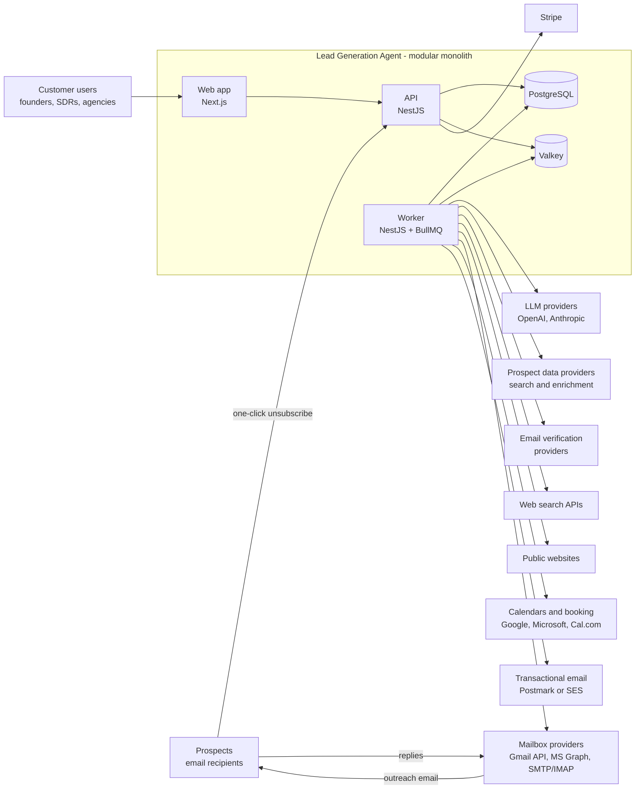

---

## 4. Runtime Boundaries: Frontend, Backend, Worker

There are three application processes, all built from this monorepo. `api` and `worker` share **one codebase and one Docker image**. They differ only in the entrypoint.

| Process | Entrypoint | Responsibilities | Must NOT |
|---------|-----------|------------------|----------|
| **web** (Next.js) | `apps/web` | UI rendering (RSC and client components), routing, forms, optimistic UI, calling `/api/v1` | Access DB/Valkey, hold provider secrets, contain business rules, call LLMs |
| **api** (NestJS) | `apps/api/src/main.ts` | Authentication, authorization, validation, CRUD, synchronous queries, **enqueuing** jobs, webhooks intake, unsubscribe endpoint, SSE stream, Bull Board (admin) | Run long or slow work inline (>2 s), call LLMs synchronously in request path (except explicit small "preview" calls with timeouts), process queues |
| **worker** (NestJS standalone) | `apps/worker/src/main.ts` | All BullMQ processors: crawling, AI, discovery, enrichment, verification, scoring, sending, inbox sync, classification, analytics rollups, maintenance; repeatable schedulers | Expose HTTP (except `/health` and `/metrics` on an internal port) |

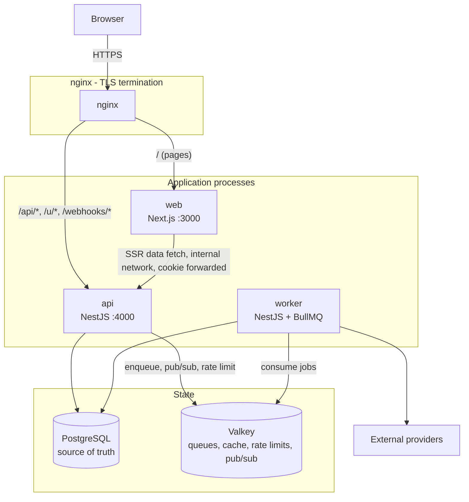

### Why one backend codebase with two roles

- Domain modules contain both their HTTP layer and their job processors. The API root module imports the HTTP sub-modules and the worker root module imports the jobs sub-modules (see §6.2).
- Both roles are scaled and deployed independently (separate containers) but versioned together, so there is no contract drift between producer and consumer.

---

## 5. Repository Layout (implemented, ADR-0032)

```
/
├─ AGENTS.md · CLAUDE.md · README.md
├─ docs/                         # product + architecture documentation, ADRs
├─ apps/
│  ├─ web/                       # Next.js App Router (TypeScript, Tailwind v4, shadcn/ui)
│  ├─ api/                       # NestJS HTTP process: controllers, guards, HTTP wiring
│  └─ worker/                    # NestJS application context: BullMQ processors, schedules, health server
├─ packages/
│  ├─ core/                      # backend core for api + worker: config, logging, errors, Prisma
│  │                             # (prisma/schema.prisma, migrations, client), Valkey/BullMQ, health;
│  │                             # platform/ and modules/ (§6.1) are added here phase by phase
│  ├─ contracts/                 # Zod schemas + inferred types, error codes, job envelope
│  ├─ shared/                    # isomorphic utilities (env parsing, redaction, helpers)
│  ├─ ui/                        # shadcn/ui components and design tokens
│  └─ config/                    # shared tsconfig, eslint, swc presets
├─ infra/
│  ├─ docker/                    # Dockerfiles, compose.dev.yml, compose.prod.yml, postgres init
│  ├─ nginx/                     # nginx.conf, TLS example
│  └─ scripts/                   # setup, dev runner, smoke test
└─ .github/workflows/            # CI
```

**Toolchain (pinned):** Node.js 24 LTS (22.12+ works locally), pnpm 10, TypeScript 6.0 strict, ESLint 9 + typescript-eslint (type-aware) + Prettier, Vitest 5 (unit and integration), Next.js 16, NestJS 12 (ESM), Prisma 7, BullMQ 6, Zod 4, Tailwind 4. Production builds use `tsc`. Development uses SWC watch.

> Node 22 enters end of life in April 2027, so new production images should target Node 24 LTS. The local machine currently has Node 22.16 and should be upgraded.

---

## 6. Backend Modules

### 6.1 Module catalog

**Platform modules** (cross-cutting, under `src/platform/`):

| Module | Responsibility | Owns tables |
|--------|---------------|-------------|
| `identity` | Sign-up, login, sessions, OAuth login, email verification, password reset, MFA | `users`, `auth_identities`, `sessions`, `user_tokens`, `mfa_factors` |
| `tenancy` | Workspaces, memberships, invitations, roles to permissions, tenant context | `workspaces`, `memberships`, `invitations` |
| `audit` | Append-only audit trail of security- and data-relevant actions | `audit_logs` |
| `billing` | Plans and limits (config), Stripe or merchant-of-record subscriptions, trial lifecycle, credit ledger (grants, packs, adjustments), usage metering, quota enforcement | `subscriptions`, `credit_grants`, `usage_records` |
| `integrations` | Connection lifecycle, encrypted credential vault, provider registry, shared rate limiting, retry and circuit breaking | `integration_connections`, `webhook_events` |
| `ai` | `AiGateway`, provider adapters, model routing, prompt registry, structured output validation, AI cost ledger, agent-run tracking | `ai_runs`, `agent_runs` |
| `compliance` | Suppression lists, unsubscribe tokens and endpoint, country outreach policies, DSAR workflows, retention jobs | `suppressions`, `dsar_requests` |
| `notifications` | In-app notifications, transactional email (invites, resets, alerts) | `notifications` |
| `files` | CSV import/export to object storage, signed download URLs | `file_objects` |

**Domain modules** (under `src/modules/`):

| Module | Responsibility | Owns tables | Key jobs |
|--------|---------------|-------------|----------|
| `business-profile` | Website crawl, content extraction, business profile, offerings, brand voice | `business_profiles`, `analysis_runs`, `crawled_pages`, `offerings` | `website.crawl`, `website.extract` |
| `icp` | ICP generation, editing, versioning, persona definitions, provider-filter mapping | `icps`, `icp_personas` | `icp.generate` |
| `prospecting` | Discovery runs, companies, contacts, dedupe and merge, CSV import, provenance | `discovery_runs`, `companies`, `contacts`, `data_provenance`, `imports` | `discovery.run`, `import.process` |
| `enrichment` | Contact/company enrichment waterfall, research facts for personalization | `research_facts` | `enrich.contact`, `enrich.company`, `research.company` |
| `verification` | Email verification via providers, freshness policy | `email_verifications` | `verify.email`, `verify.batch` |
| `scoring` | Leads (contact × ICP), fit/persona/quality/engagement scoring, tiers, lists | `leads`, `lead_lists`, `lead_list_members` | `score.lead`, `score.rescore-icp` |
| `mailboxes` | Mailbox connections, sending domains, DNS health (SPF/DKIM/DMARC), caps, ramp-up, health | `mailboxes`, `sending_domains` | `mailbox.health-check`, `domain.dns-check`, `mailbox.token-refresh` |
| `campaigns` | Campaigns, sequences and steps, enrollments, draft generation and approval, launch checks, **launch approval requests**, scheduling decisions | `campaigns`, `campaign_steps`, `campaign_mailboxes`, `campaign_enrollments`, `message_drafts`, `campaign_approvals` | `campaign.schedule-tick`, `draft.generate` |
| `email-engine` | MIME composition, sending through mailbox adapters, threading, inbox sync, bounce parsing | `email_threads`, `email_messages`, `email_events` | `email.send`, `inbox.sync`, `inbox.process-message` |
| `inbox` | Unified inbox, reply classification, suggested replies, human tasks | `reply_classifications`, `tasks` | `reply.classify`, `reply.suggest` |
| `meetings` | Booking-link insertion, availability lookup, meeting records, booking webhooks | `meetings` | `meeting.suggest-slots`, `meeting.sync` |
| `analytics` | Daily rollups, funnels, dashboards, cost-per-meeting | `campaign_daily_stats`, `mailbox_daily_stats` | `analytics.rollup` |

### 6.2 Internal structure of a module

```
modules/campaigns/
├─ campaigns.module.ts          # providers: services, repositories (imported by both roles)
├─ campaigns.http.module.ts     # controllers (imported only by AppApiModule)
├─ campaigns.jobs.module.ts     # BullMQ processors (imported only by AppWorkerModule)
├─ index.ts                     # PUBLIC SURFACE: services, types, events. The only import path for other modules.
├─ api/                         # controllers, request/response mapping (Zod from @contracts)
├─ application/                 # use-case services, event handlers, orchestration
├─ domain/                      # pure logic: state machines, policies, calculations (no I/O)
├─ infrastructure/              # Prisma repositories, external adapters
└─ jobs/                        # processors, job payload schemas, producers
```

CRUD-only modules can omit the `domain/` layer. Pure logic (scoring rules, scheduling and cap calculations, enrollment state machine, compliance policy) **must** live in `domain/` and be unit tested without I/O.

### 6.3 Module rules

1. **Public surface only.** A module imports another module only through its `index.ts`. This is enforced with `eslint-plugin-boundaries` or `dependency-cruiser` in CI.
2. **Table ownership.** Each table is owned by exactly one module, and only the owner's repositories write to it. Other modules call the owner's service. Exception: `analytics` may run **read-only** reporting queries across tables.
3. **No dependency cycles.** When a downstream module must react to an upstream one, use **domain events** instead of a back-reference. Example: `inbox` emits `reply.received` and `campaigns` handles it to stop the enrollment.
   - Synchronous, in-process: `@nestjs/event-emitter`, for side effects inside the same transaction boundary.
   - Asynchronous, cross-process: enqueue a BullMQ job.
4. **Tenancy everywhere.** Every service method takes or derives an `WorkspaceContext`. Repositories refuse queries without `workspaceId` (§11.3).
5. **External I/O only through adapters** in `platform/integrations` or a module's `infrastructure/`, wrapped with rate limiting, retries, timeouts, metering and provenance (see [INTEGRATIONS.md](INTEGRATIONS.md)).
6. **All LLM calls go through `AiGateway`.** Importing provider SDKs anywhere else is a lint error.
7. **All outbound HTTP to user-supplied URLs goes through `SafeFetch`** (SSRF protection, see [SECURITY.md](SECURITY.md)).

### 6.4 Module dependency graph

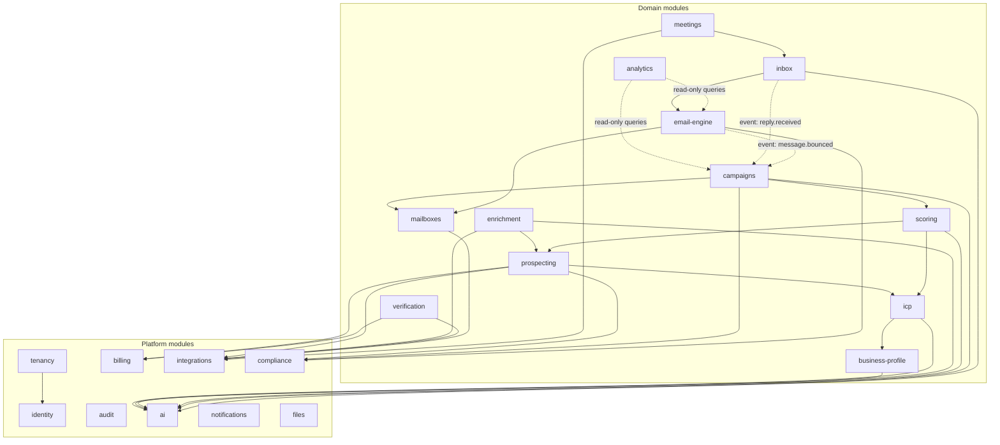

Solid arrows are allowed service dependencies. Dotted arrows are events or read-only access. `tenancy`, `audit`, `billing` and `notifications` are available to all modules and omitted from the graph for readability.

---

## 7. Core Workflows

### 7.1 Onboarding: website analysis to ICP

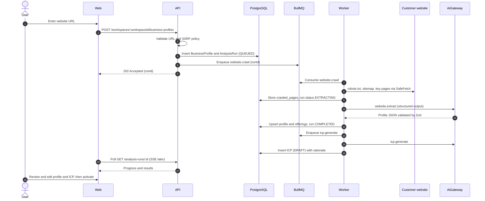

### 7.2 Prospecting pipeline

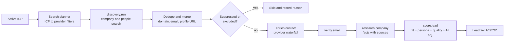

Each stage is a BullMQ job (fan-out via BullMQ Flows). Each stage updates the entity's DB status, so the pipeline can resume after any failure. Credits are reserved before a paid provider call and settled after it.

### 7.3 Campaign sending

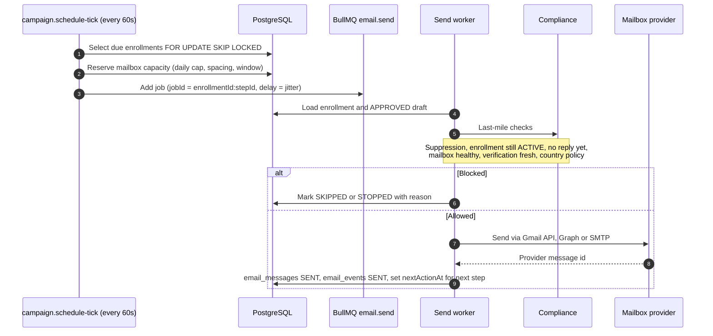

**Exactly-once sending** has three layers:

1. A deterministic BullMQ `jobId` deduplicates enqueues.
2. A unique constraint on `email_messages (enrollment_id, step_id)` rejects a second send record.
3. A `SENDING` state is written before the provider call, and the RFC `Message-ID` is generated deterministically before sending. If a crash leaves a `SENDING` row, the reconciler searches the mailbox's sent items for that `Message-ID` (Gmail `rfc822msgid:`, Graph `internetMessageId`, IMAP `SEARCH HEADER`) and never blindly retries.

### 7.4 Reply processing

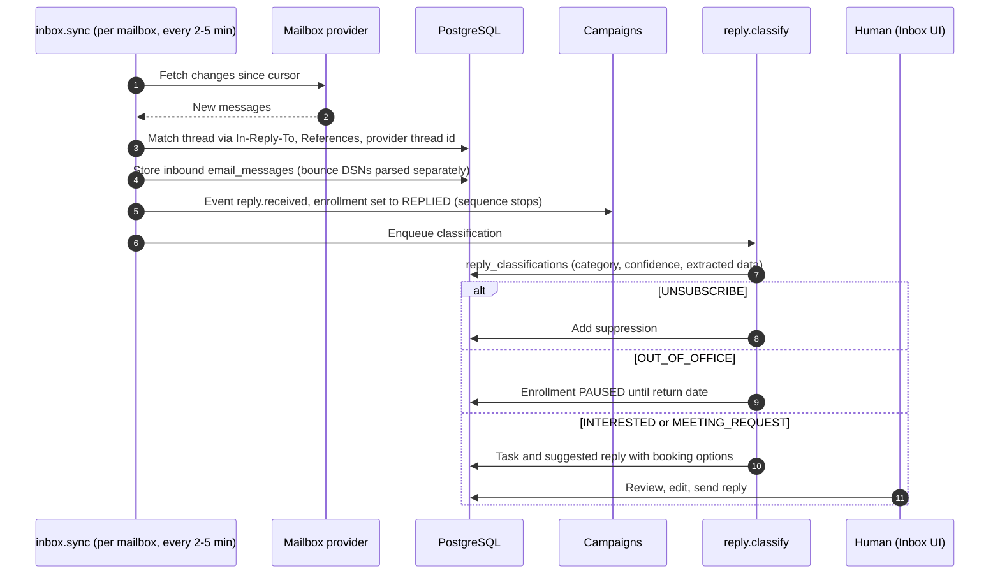

### 7.5 Enrollment lifecycle

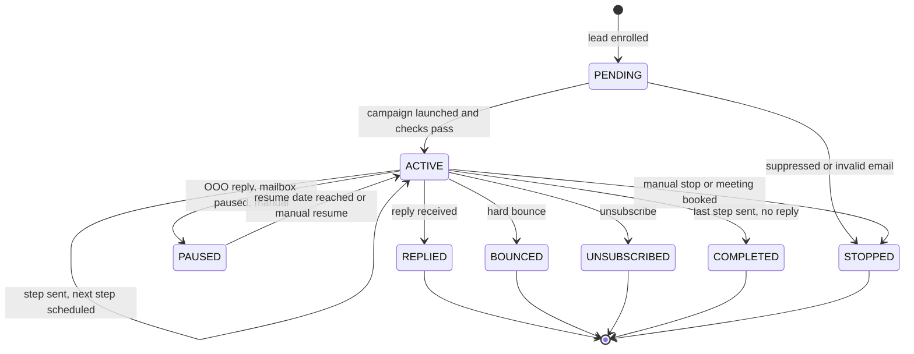

### 7.6 Campaign lifecycle and launch approval

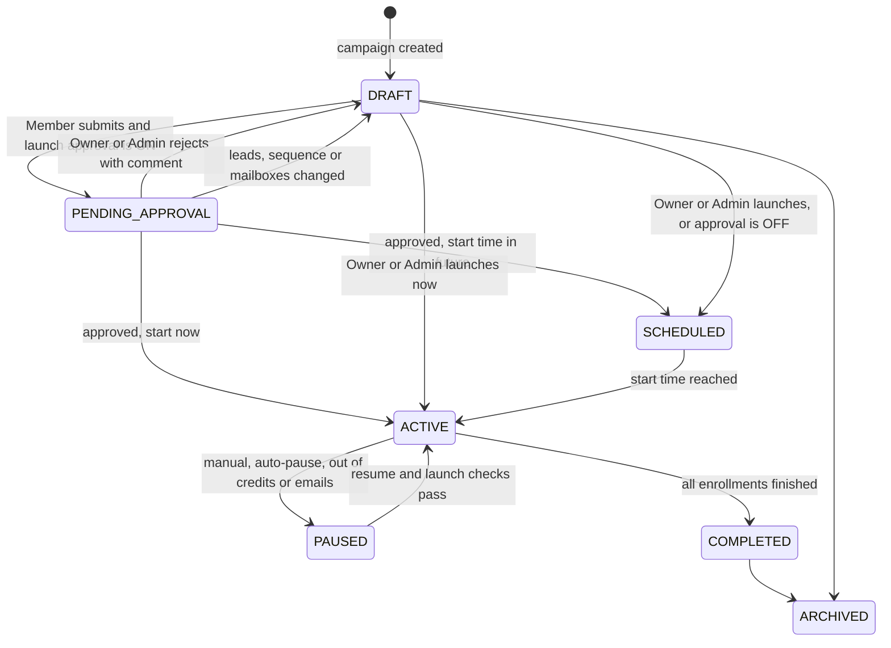

- **Launch checks** (PRD APR-03) run on submit, on approve and on launch. They are: workspace physical address and privacy-notice URL set, at least one healthy mailbox, SPF/DKIM/DMARC passing, step-1 drafts approved for the first day's volume, sufficient credits and monthly email allowance, and the workspace not `RESTRICTED` or `SUSPENDED`.
- Each submit, approve and reject writes a `campaign_approvals` row and an audit event, and notifies the relevant users.
- **Auto-pause reasons** are stored on `campaigns.paused_reason`: `BOUNCE_THRESHOLD`, `OUT_OF_CREDITS`, `EMAIL_LIMIT_REACHED`, `NO_HEALTHY_MAILBOX`, `WORKSPACE_SUSPENDED`, `MANUAL`.

### 7.7 Credits and quota flow

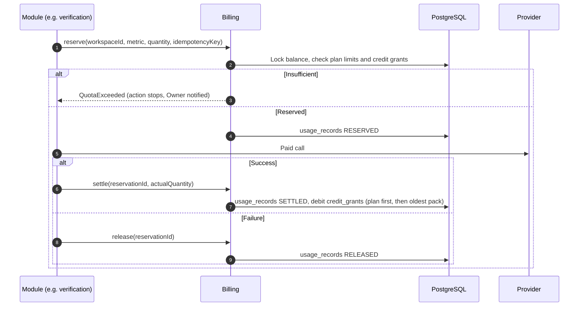

- **Essential operations never need credits:** reply sync, reply classification, unsubscribe, bounce processing, DNS checks, analytics.
- **Warnings:** at 80% of credits or monthly emails (in-app and email to the Owner). At 100%, credit-consuming actions stop and campaigns auto-pause with a resume-on-refill hook.
- Balances are cached in Valkey per workspace and always re-checked under a row lock in PostgreSQL at reservation time.

---

## 8. Frontend Architecture

**Stack:** Next.js App Router, React, TypeScript, Tailwind CSS v4, shadcn/ui, Lucide icons, TanStack Query (client data), TanStack Table (grids), React Hook Form + Zod (forms), Recharts via shadcn charts (analytics), `next-themes` (dark mode).

### 8.1 Route map

```
app/
├─ (marketing)/                 # optional: landing, pricing (can move to a separate site later)
├─ (auth)/
│  ├─ login · signup · verify-email · forgot-password · reset-password · accept-invite
├─ (app)/workspaces/            # workspace picker and "create workspace"
├─ (app)/[workspaceSlug]/
│  ├─ dashboard                 # KPIs, onboarding checklist, "needs attention"
│  ├─ onboarding                # guided: website → profile → ICP → leads → mailbox → first campaign
│  ├─ business                  # business profile, offerings, brand voice
│  ├─ icps/[icpId]              # ICP editor, personas, filters, rationale
│  ├─ prospects/
│  │  ├─ companies · contacts · discovery-runs · imports
│  ├─ leads                     # scored leads, tiers, lists
│  ├─ campaigns/[campaignId]    # wizard, sequence editor, enrollments, draft review queue, stats
│  ├─ campaigns/approvals       # pending launch requests (Owner/Admin)
│  ├─ inbox                     # unified inbox, classifications, suggested replies
│  ├─ meetings
│  ├─ analytics                 # dashboard, campaign reports, deliverability, usage and credits
│  └─ settings/
│     ├─ workspace · members · mailboxes · sending-domains · integrations · notifications
│     ├─ compliance (suppressions, country policy, privacy notice, DSAR) · audit-log
│     └─ billing (plan, checkout, credit packs, invoices via portal)
└─ admin/                       # platform super-admin (separate guard, MFA required, desktop only)
```

### 8.2 Data-fetching rules

- **Server Components** do the initial page data fetch from `http://api:4000/api/v1/...` over the internal Docker network. They forward the session cookie and never cache tenant data (`cache: 'no-store'`).
- **Client Components** use TanStack Query against same-origin `/api/v1/...` for interactive tables, polling job progress and mutations.
- **No Server Actions with business logic.** If Server Actions are used for form ergonomics, they are thin proxies to the API.
- `middleware.ts` only checks that the session cookie *exists* and redirects to `/login` if not. Real authorization always happens in the API.
- One typed API client (`lib/api`) built on `packages/contracts` parses responses with Zod in development.

### 8.3 UX principles for AI features

- Every AI output is **reviewable and editable**: profile, ICP, drafts, classifications.
- Show **why**: ICP rationale, score breakdown, facts and sources used in an email, and classification confidence.
- Long-running work shows progress states that come from DB status, not spinners tied to a single request.

---

## 9. API Communication

### 9.1 Conventions

| Concern | Convention |
|---------|-----------|
| Base path | `/api/v1`. Tenant-scoped resources live under `/api/v1/workspaces/:workspaceId/...` so the tenant is explicit and checked by a guard. |
| Format | JSON. Request and response schemas are defined in `packages/contracts` (Zod) and validated by a global `ZodValidationPipe`. |
| Docs | OpenAPI 3.1 generated from contracts, served at `/api/docs` in non-production only. |
| IDs | UUIDv7 strings. |
| Pagination | Cursor-based: `?cursor=&limit=` returns `{ data, nextCursor }`. Max limit is 100. |
| Filtering/sorting | `?filter[status]=ACTIVE&sort=-createdAt`, with an allowlist per endpoint. |
| Errors | RFC 9457 `application/problem+json` with a stable `code` from `contracts/errors`. |
| Idempotency | `Idempotency-Key` header is **required** on endpoints that spend credits or cause external effects (launch campaign, start discovery, buy enrichment). Keys are stored in Valkey for 24 h. |
| Async operations | Return `202 Accepted` with a resource (`analysisRun`, `discoveryRun`) whose `status` is polled or streamed. |
| Realtime | MVP: polling (TanStack Query `refetchInterval`). Later: `GET /api/v1/workspaces/:workspaceId/events` Server-Sent Events fed by Valkey pub/sub. |
| Versioning | Additive changes within v1. Breaking changes get `/api/v2` and a deprecation window. |
| Rate limits | nginx (per IP) plus NestJS throttler with Valkey storage (per user and per workspace). Limits are returned in `RateLimit-*` headers. |

### 9.2 Endpoint catalog (high level)

| Area | Endpoints |
|------|-----------|
| Auth | `POST /auth/signup`, `/auth/login`, `/auth/logout`, `/auth/verify-email` (POST `{token}`), `/auth/verify-email/resend`, `/auth/password/forgot`, `/auth/password/reset`, `/auth/reauthenticate`, `GET /auth/me`, `GET /auth/sessions`, `DELETE /auth/sessions/:id`, `POST /auth/sessions/revoke-others` (implemented, ADR-0034) · later: `GET /auth/oauth/:provider/start`, `/auth/oauth/:provider/callback`, `/auth/mfa/*` |
| Workspaces | Implemented: `GET/POST /workspaces`, `GET /workspaces/:workspaceId`, `POST /workspaces/:workspaceId/transfer-ownership`, `GET /workspaces/:workspaceId/members`, `PATCH/DELETE …/members/:memberId`, `GET/POST /workspaces/:workspaceId/invitations` (POST needs `Idempotency-Key`), `POST …/invitations/:id/resend`, `DELETE …/invitations/:id`, `GET /invitations/lookup?token=`, `POST /invitations/accept` · later: `PATCH/DELETE /workspaces/:workspaceId`, `POST …/restore`, `GET …/onboarding` |
| Business | `/business-profiles`, `POST /business-profiles/:id/analyze`, `GET /analysis-runs/:id`, `/business-profiles/:id/offerings` |
| ICP | `/icps`, `POST /icps/generate`, `POST /icps/:id/activate`, `/icps/:id/personas` |
| Prospecting | `/discovery-runs`, `/companies`, `/contacts`, `POST /imports` (CSV), `GET /imports/:id` |
| Data quality | `POST /contacts/:id/enrich`, `POST /verifications` (batch), `GET /contacts/:id/provenance` |
| Leads | `/leads`, `POST /leads/rescore`, `/lead-lists`, `/lead-lists/:id/members` |
| Mailboxes | `/mailboxes`, `GET /mailboxes/oauth/:provider/start`, `/mailboxes/oauth/:provider/callback`, `/sending-domains`, `POST /sending-domains/:id/check` |
| Campaigns | `/campaigns`, `/campaigns/:id/steps`, `/campaigns/:id/enrollments`, `GET /campaigns/:id/launch-checks`, `POST /campaigns/:id/launch\|pause\|resume`, `POST /campaigns/:id/submit-for-approval`, `GET /campaign-approvals?status=PENDING`, `POST /campaign-approvals/:id/approve\|reject`, `/campaigns/:id/drafts`, `POST /drafts/:id/approve\|reject\|regenerate`, `POST /drafts/bulk-approve` |
| Inbox | `/threads`, `/threads/:id/messages`, `POST /threads/:id/reply`, `PATCH /classifications/:id` (override) |
| Meetings | `/meetings`, `POST /meetings/suggest-slots` |
| Analytics | `/analytics/overview`, `/analytics/campaigns/:id`, `/analytics/funnel` |
| Compliance | `/suppressions`, `/dsar-requests`, `/compliance/country-policy` |
| Billing | `GET /billing/plans`, `GET /billing/subscription`, `POST /billing/checkout` (plan or credit pack), `POST /billing/portal`, `GET /billing/usage`, `GET /billing/credits` (balance + grants + ledger) |
| Notifications | `GET /notifications`, `POST /notifications/:id/read`, `PATCH /me/notification-preferences` |
| Platform admin (`SUPER_ADMIN`, `/api/v1/admin`) | `/admin/workspaces`, `PATCH /admin/workspaces/:id/standing`, `POST /admin/workspaces/:id/credit-adjustments`, `POST /admin/kill-switches`, `POST /admin/impersonations`, `GET /admin/system-health` |
| Integrations | `/integrations`, `POST /integrations/:provider/test` |
| Public (no session) | `GET/POST /u/:token` (unsubscribe, RFC 8058), `POST /webhooks/:provider`, `GET /health/live`, `GET /health/ready` |

All paths except Auth, Public, Platform admin and the Workspaces row are prefixed with `/api/v1/workspaces/:workspaceId`.

### 9.3 Inbound webhooks

`POST /webhooks/:provider` verifies the signature (Stripe, Cal.com, Calendly and others), stores the raw payload in `webhook_events` with a unique `(provider, external_id)` for idempotency, returns `200` immediately and processes the event asynchronously in the `webhooks` queue.

---

## 10. Asynchronous Processing

### 10.1 Queues

| Queue | Jobs | Concurrency (KVM 2) | Notes |
|-------|------|--------------------|-------|
| `website` | `website.crawl`, `website.extract` | 2 | SafeFetch, page and byte caps |
| `ai` | generic LLM tasks (`icp.generate`, `draft.generate`, `reply.suggest`) | 6 | Provider rate limits enforced via a shared Valkey limiter |
| `discovery` | `discovery.run`, `import.process` | 2 | Credit reservation |
| `enrichment` | `enrich.contact`, `enrich.company`, `research.company` | 4 | Provider waterfall |
| `verification` | `verify.email`, `verify.batch` | 4 | |
| `scoring` | `score.lead`, `score.rescore-icp` | 4 | Mostly CPU-light deterministic logic |
| `campaign-scheduler` | `campaign.schedule-tick` (repeatable, every 60 s) | 1 | Single-flight via lock |
| `email-send` | `email.send` | 4 | Per-mailbox spacing enforced by the scheduler and re-checked at send |
| `inbox` | `inbox.sync` (repeatable per mailbox), `inbox.process-message`, `reply.classify` | 4 | |
| `meetings` | `meeting.suggest-slots`, `meeting.sync` | 2 | |
| `analytics` | `analytics.rollup` (hourly and nightly) | 1 | |
| `maintenance` | token refresh, DNS checks, retention purges, reconcilers, key rotation | 1 | |
| `billing` | `billing.period-rollover` (grant plan credits, expire old grants), `billing.trial-expiry`, `billing.usage-alerts` | 1 | Daily plus on Stripe webhook |
| `webhooks` | `webhook.process` | 2 | |
| `notifications` | `notify.email`, `notify.in-app` | 2 | |

### 10.2 Reliability rules

- **DB-first:** write the entity with status `QUEUED` in a transaction, then enqueue after commit. A **reconciler** (every 5 minutes) re-enqueues entities stuck in `QUEUED` or `RUNNING` past their timeout. Losing Valkey loses only latency, never work.
- **Idempotent processors:** every job can run twice safely. Use deterministic `jobId`s and DB unique constraints.
- **Retries:** exponential backoff with jitter (default 5 attempts, 30 s base). Non-retryable errors (validation, 401/403 from provider, insufficient credits) fail fast and set the entity to `FAILED` with an error code.
- **Failed jobs** are kept for 14 days (inspectable in Bull Board at `/admin/queues`, platform admins only). Completed jobs are trimmed after 24 h or 1,000 per queue.
- **Job payloads carry IDs, never PII or secrets.** Processors load data from the DB.
- **Valkey config:** `maxmemory-policy noeviction` (BullMQ requirement) and AOF persistence (`appendfsync everysec`).
- **Graceful shutdown:** on SIGTERM, workers stop taking jobs and finish active ones (up to 60 s).
- **Correlation:** `requestId` and `workspaceId` travel in job metadata and appear in every log line.

---

## 11. Authentication and Authorization (summary)

Full details are in [SECURITY.md](SECURITY.md).

### 11.1 Authentication

- **Email + password:** argon2id, email verification required before sending anything.
- **OAuth login:** Google and Microsoft (OIDC, PKCE). These identities are kept *separate* from mailbox-connection OAuth grants, which ask for different scopes and are stored in `integration_connections`.
- **Sessions:** a 256-bit random token in cookie `__Host-lga_session` (`HttpOnly; Secure; SameSite=Lax; Path=/`). Only the SHA-256 hash is stored in `sessions`. Idle timeout is 7 days and absolute lifetime is 30 days. The token rotates on login and privilege change, and users can see and revoke sessions.
- **MFA:** TOTP plus recovery codes (V1). A workspace can enforce it for Owners and Admins. Passkeys come later.
- **CSRF:** same-origin deployment plus `SameSite=Lax`, plus an `Origin`/`Sec-Fetch-Site` check on all state-changing requests.

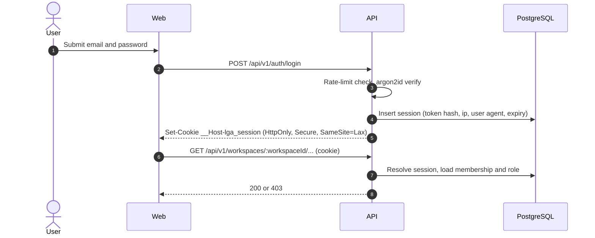

### 11.2 Authorization

- **RBAC** with roles `OWNER` (exactly one per workspace), `ADMIN` and `MEMBER`, plus a separate platform role `SUPER_ADMIN`. A `VIEWER`/client role is Future (PRD §4).
- Roles map to **permissions** (`campaign.launch`, `campaign.approve_launch`, `contacts.export`, ...). Code checks permissions, not roles (`@RequirePermission('campaign.launch')`), so custom roles can be added later without code changes. The full matrix is in SECURITY.md §3.2.
- When the workspace setting `launchRequiresApproval` is ON (default), Members lack `campaign.launch` and use `campaign.submit_for_approval` instead.
- Resource ownership checks (for example, a member can only connect or disconnect *their own* mailbox, and only approve drafts in their own campaigns) live in application services.

### 11.3 Tenant isolation

- `TenantGuard` resolves `:workspaceId`, verifies membership and sets a `WorkspaceContext` (AsyncLocalStorage).
- A Prisma client extension **requires** `workspaceId` in `where` for all tenant-scoped models and injects it on create. It throws on violations.
- Integration tests include a cross-tenant access suite. Every new endpoint must have a test proving that workspace B cannot read or modify workspace A's data.
- PostgreSQL RLS on the highest-risk tables (`contacts`, `email_messages`, `integration_connections`) is planned for V1 (Phase 7) hardening.

---

## 12. AI Agent Architecture

### 12.1 Principles

1. **Workflows, not autonomous loops.** Each "agent" is a fixed pipeline of steps tracked in `agent_runs`. LLMs make bounded judgments inside steps: extract, generate, classify, rank.
2. **LLMs have no side-effect tools.** Sending, spending credits, changing statuses and suppressing are done by deterministic code after validating the LLM's structured output against a policy.
3. **Untrusted content stays data.** Website text, search results and email replies are wrapped as delimited data, never merged into instructions. Outputs are constrained to schemas and enums.
4. **Facts need sources.** Personalization may only use `research_facts` that have a `source_url`. The copywriter must cite the fact IDs it used.
5. **Everything is metered and replayable.** Each call writes an `ai_runs` row (task, prompt version, provider, model, tokens, cost, latency, outcome).

### 12.2 Components

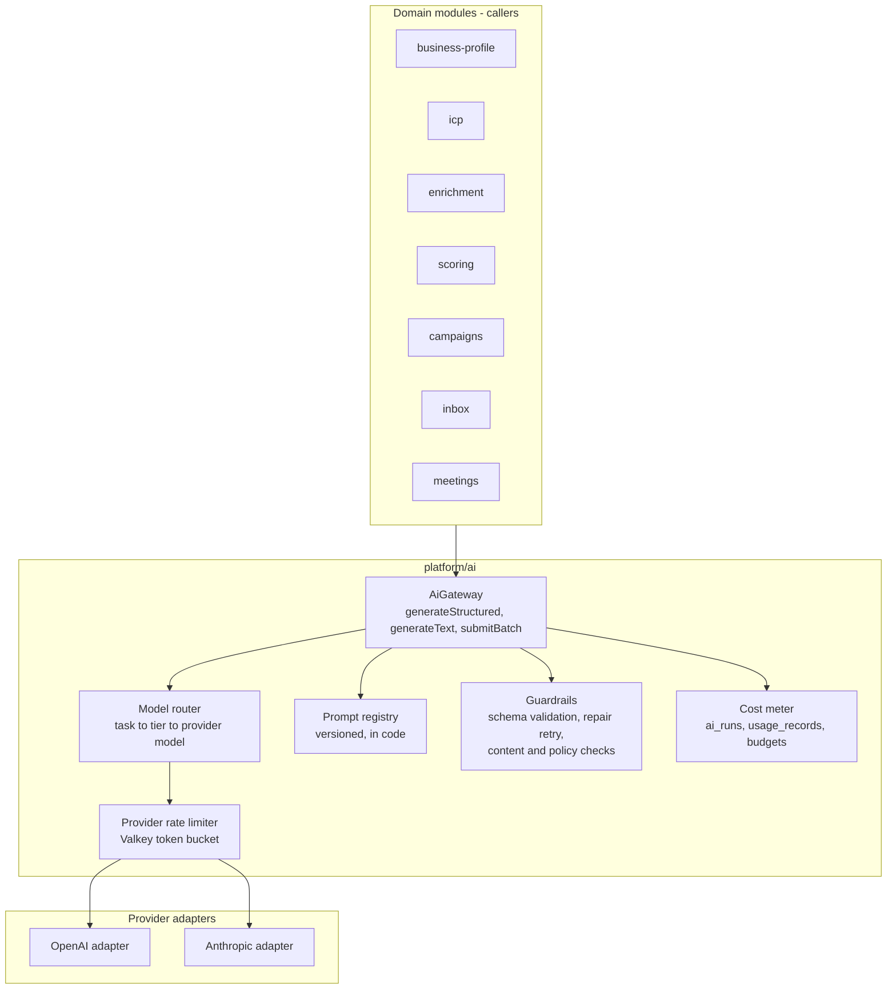

**`AiGateway` contract (sketch):**

```ts
interface AiGateway {
  generateStructured<T>(req: {
    task: AiTaskKey;                // e.g. 'website.extract' - selects prompt + tier
    schema: z.ZodType<T>;           // output contract
    variables: Record<string, unknown>;
    untrusted?: UntrustedBlock[];   // website text, emails - delimited, never instructions
    ctx: { workspaceId: string; entity?: EntityRef; agentRunId?: string; budgetKey?: string };
  }): Promise<AiResult<T>>;         // { data, usage, costMicros, provider, model, promptVersion }

  generateText(req: ...): Promise<AiResult<string>>;
  submitBatch<T>(reqs: ...): Promise<BatchHandle>; // provider batch APIs for bulk, non-urgent work
}
```

**Model routing (config, not code):**

```yaml
# config/ai-routing.yaml - concrete model IDs per environment
tiers:
  fast:     { primary: anthropic:<fast-model>,     fallback: openai:<fast-model> }
  standard: { primary: anthropic:<balanced-model>, fallback: openai:<balanced-model> }
  advanced: { primary: anthropic:<frontier-model>, fallback: openai:<frontier-model> }
tasks:
  website.extract:  { tier: standard }
  icp.generate:     { tier: advanced }
  search.plan:      { tier: standard }
  research.extract: { tier: fast }
  score.adjust:     { tier: fast }
  draft.generate:   { tier: standard, batchable: true }
  reply.classify:   { tier: fast }
  reply.suggest:    { tier: standard }
```

The primary provider and the concrete model IDs are an open decision. Defaults are chosen at Phase 0 after a small eval.

### 12.3 Agents

| Agent (workflow) | Trigger | Steps | Output | Tier | Human gate |
|------------------|---------|-------|--------|------|-----------|
| **Website Analyst** | New or re-analyzed business profile | SafeFetch crawl (≤25 pages, same site, robots.txt respected) → clean text → LLM extract → validate | Business profile: summary, value props, offerings, proof points, industries served, tone | standard | User reviews and edits |
| **ICP Strategist** | Profile completed, or user request | Combine profile with user inputs (best customers, exclusions) → LLM proposes 1–3 ICPs → map to provider filter vocabulary | ICPs: firmographics, personas, pains, triggers, exclusions, rationale | advanced | User activates ICP |
| **Prospect Search Planner** | Discovery run started | ICP → provider-specific queries → estimate volume and credits | Query plan with credit estimate | standard | User confirms spend above threshold |
| **Researcher** | Lead enters top tiers | Company homepage + web search (recent news, hiring, launches) → extract facts with sources | `research_facts` with source URLs and freshness | fast | None (data only) |
| **Lead Scorer** | Contact verified or ICP changed | Deterministic fit/persona/quality score → optional bounded LLM adjustment (±15) with reason | Score, tier, breakdown | fast | User can override |
| **Copywriter** | Enrollment created (draft ahead of send) | Assemble context (offering, persona pains, facts, brand voice, step intent) → generate → lint (length, spam phrases, placeholders, links, unsupported claims) → optional LLM-judge | Subject, body, `factIdsUsed`, warnings | standard (batchable) | **Approval required by default** (autonomy levels, §12.4) |
| **Reply Classifier** | Inbound reply | Strip quoted history and signature → classify → extract (OOO return date, referral contact, questions) | Category, confidence, extracted fields | fast | Low confidence goes to the human queue |
| **Reply Assistant / Scheduler** | Reply classified INTERESTED, MEETING_REQUEST or QUESTION | Pull availability (calendar free/busy or booking link) → draft reply | Suggested reply with 2–3 slots or a booking link | standard | **Always human-sent in MVP** |
| **Insights** (later) | Weekly | Aggregate analytics → narrative summary and recommendations | Report | standard | n/a |

Reply categories: `INTERESTED`, `MEETING_REQUEST`, `QUESTION`, `NOT_NOW`, `NOT_INTERESTED`, `UNSUBSCRIBE`, `WRONG_PERSON`, `REFERRAL`, `OUT_OF_OFFICE`, `AUTO_REPLY`, `BOUNCE`, `OTHER`.

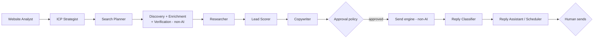

### 12.4 Autonomy levels (per campaign)

| Level | Behavior | Availability |
|-------|----------|-------------|
| L0 Manual | User writes all emails, and AI only suggests improvements | MVP |
| L1 Review all | AI drafts every email, and a human approves each one | **MVP default** |
| L2 Review sample | Human approves the first N per step and a random sample after that. The rest auto-approve if lint passes | V1 |
| L3 Guarded auto | Auto-approve when lint and judge pass and the workspace is in good standing (bounce and complaint thresholds met) | Later. Requires account standing |

### 12.5 Cost control

- **Credits gate customer-facing AI spend** (PRD §8.4): drafts, suggested replies, research, re-analysis and extra ICP generations reserve credits before the call (§7.7). Reply classification is free and always runs.
- **Internal per-workspace AI cost cap** (hidden, from plan config) protects margin even when credits remain, for example from abusive regenerate loops. Above the cap, non-essential AI tasks are throttled and Super Admins are alerted.
- **Prompt caching:** stable system prompts plus the business-profile and campaign context are placed first, so caching works across thousands of drafts for the same campaign.
- **Batch APIs** (about 50% cheaper on both providers) for bulk draft generation and re-scoring when latency doesn't matter.
- **Caching results:** a re-analysis skips unchanged pages (by `content_hash`), and research facts have a TTL.
- **Cost per outcome:** analytics joins `usage_records` to report AI and data cost per meeting booked.

### 12.6 Quality and evaluation

- Prompts live in `platform/ai/prompts/<task>/v<n>.ts`. A version bump is required for any change, and the version is stored on every `ai_runs` row.
- Golden datasets under `packages/core/test/ai-evals/` (anonymized): website→profile, reply classification (target ≥90% accuracy on core categories), and draft lint/judge.
- `pnpm ai:eval <task>` runs evals against the configured models. It must pass before a prompt or model change merges.
- Production feedback signals (user edits to drafts, classification overrides) are captured for future evals.

---

## 13. Email Delivery Architecture

| Concern | Design |
|---------|--------|
| Channels | **Launch:** generic SMTP for sending + IMAP for sync (covers Gmail and Google Workspace via app passwords, Zoho, Outlook.com, Hostinger mail and others) and Microsoft Graph (OAuth). **Gmail API (OAuth)** runs in Google testing mode for allow-listed users until verification (AD-20). Credentials are encrypted in `integration_connections`. |
| Message format | Plain-text-first with a minimal HTML alternative. No images or attachments in cold steps. Follow-ups thread via `In-Reply-To` and `References`. |
| Required headers | `List-Unsubscribe: <mailto:...>, <https://.../u/:token>` and `List-Unsubscribe-Post: List-Unsubscribe=One-Click`. The footer has an unsubscribe link, the sender's physical address and a privacy notice link (GDPR Art. 14). |
| Volume controls | Per-mailbox daily cap (default 30, hard max 100 with warning). Minimum spacing between sends (default 120 s) with random jitter. Monthly email allowance per plan (PRD §8). Trial: 25/day and 100 in total. Sending windows in the recipient's timezone (from country or explicit). Ramp-up for new mailboxes (starting at 5/day, +3/day). Mailbox rotation within a campaign. |
| Auto-protection | Pause the mailbox on auth failures, provider throttling (for example Gmail `5.7.x` or `4.2.x`) or a 7-day hard-bounce rate above 5%. Pause the campaign if the hard-bounce rate is over 3% across the last 100 sends. Workspaces exceeding abuse thresholds (above 5% bounces or above 1% unsubscribes over 7 days) are flagged to Super Admins, and sending stops when standing is `SUSPENDED`. |
| Domain health | DNS checks for SPF, DKIM (known selectors per provider plus user-supplied), DMARC and MX. These run daily and before launch. Launch is blocked if SPF, DKIM or DMARC is missing. |
| Bounces | DSNs (`multipart/report`) found during inbox sync are parsed into a hard or soft bounce. A hard bounce suppresses the address and marks the contact's email invalid. A soft bounce is retried once after 24 h, then treated as failed. |
| Unsubscribe | Stateless HMAC-signed token (workspace, contact, campaign, issued-at) at `/u/:token`. One-click POST without cookies or JS. The suppression takes effect immediately and is workspace-wide. |
| Link domain | Unsubscribe and any tracking links use a dedicated links domain, separate from the app domain, to isolate reputation. Per-workspace custom tracking domains come later. |
| Tracking | Opens and clicks are off by default. They can be enabled per campaign with a warning. |
| Warm-up | No built-in warm-up network. Ramp-up schedules only. Integration with external warm-up tools is a later option. |

---

## 14. Observability

- **Logs:** `pino` JSON (via `nestjs-pino`) with redaction of emails, tokens, cookies and message bodies. Docker `local` log driver with rotation. Shipped by a lightweight agent (Grafana Alloy or Vector) to a hosted log service (Grafana Cloud or Better Stack free or low tiers). No self-hosted Loki or Elasticsearch on KVM 2.
- **Errors and performance:** Sentry for `web`, `api` and `worker`, with PII scrubbing.
- **Metrics:** `prom-client` `/metrics` on an internal port for api and worker. This covers HTTP latency, queue depth, wait time, failures, provider error rates, sends per mailbox and AI tokens/cost.
- **Uptime:** an external monitor on `/health/ready` (checks DB and Valkey) and on the TLS certificate.
- **Alerts:** queue backlog above threshold, failed-job spikes, bounce-rate spikes, any provider circuit open, disk above 80%, memory pressure, backup failure, certificate expiry in under 14 days.
- **Tracing:** OpenTelemetry later. `requestId` correlation from day one.

---

## 15. Configuration

- Environment variables are validated at boot with Zod (`@nestjs/config` + schema). The process fails fast on missing or invalid config.
- Secrets live only in environment files on the server (`/opt/lga/env/*.env`, mode 600, owned by the deploy user). They are never in images or the repo. SOPS + age for encrypted env files in a private ops repo is an optional upgrade.
- Non-secret product config (AI routing, plan limits, country policies, default caps) lives in versioned YAML/TS in the repo. Workspace-level overrides are stored in `workspaces.settings`.
- Feature flags: per-workspace flags in `workspaces.settings.features`, with global defaults in config. No external flag service yet.

---

## 16. Cross-cutting Concerns

- **Time:** store UTC (`timestamptz`) and render in the user's timezone. Campaign windows are evaluated in the recipient's timezone.
- **i18n:** the UI is English-first, with copy externalized from day one (`next-intl`) so it can be localized. Email generation supports a target language per campaign (V1).
- **Accessibility:** WCAG 2.2 AA. shadcn/Radix primitives provide the baseline.
- **Money:** integer minor units (cents). Costs use micro-units (`BigInt`) for AI token pricing.

---

## 17. Deployment Architecture

### 17.1 Target host

**Hostinger KVM 2:** 2 vCPU, 8 GB RAM, 100 GB NVMe, about 8 TB bandwidth. Verify the current plan specs. Given the launch markets (US, UK, CA, AU, IE), a **UK or EU datacenter** is recommended: it simplifies the UK/EU data-protection posture, and latency to the US is acceptable for this app. OS is Ubuntu 24.04 LTS with Docker Engine and the Compose plugin.

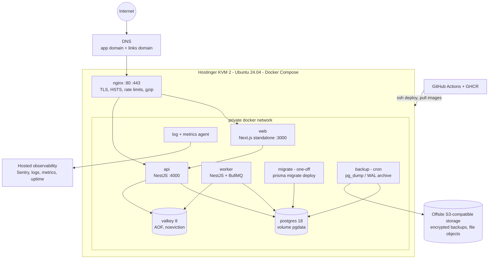

### 17.2 Containers and resource budget

| Service | Image | Memory limit | Notes |
|---------|-------|-------------|-------|
| nginx | `nginx:stable-alpine` | 128 MB | Only service publishing ports 80/443 |
| web | `ghcr.io/<owner>/lga-web:<sha>` | 768 MB | `output: 'standalone'`, `--max-old-space-size=512` |
| api | `ghcr.io/<owner>/lga-backend:<sha>` | 768 MB | Command `node dist/main.api.js` |
| worker | same backend image | 1.5 GB | Command `node dist/main.worker.js`. Concurrency per §10.1 |
| postgres | `postgres:18` | 3 GB | `shared_buffers=768MB`, `effective_cache_size=2GB`, `work_mem=16MB`, `max_connections=60` |
| valkey | `valkey/valkey:8` | 512 MB | `maxmemory 384mb`, `noeviction`, AOF |
| backup | small alpine + `pg_dump`/WAL-G | 256 MB | Cron-driven |
| **Total** | | **≈ 6.9 GB** | Leaves about 1 GB for the OS. Add a 4 GB swap file as a safety net |

Prisma connection pools: api 10, worker 15 (well under `max_connections`). There is no PgBouncer at this scale.

A headless browser (Playwright) is **not** deployed on KVM 2 by default. JS-heavy sites fall back to a hosted rendering API (see [INTEGRATIONS.md](INTEGRATIONS.md)) or wait for a host upgrade.

### 17.3 nginx

- `app.<domain>`: `/` goes to web, and `/api/`, `/u/` and `/webhooks/` go to api. `/admin/queues` goes to api and is restricted by IP allowlist plus a platform-admin session.
- `links.<domain>`: only `/u/` (unsubscribe) and future click-redirects go to api.
- TLS via Let's Encrypt (certbot, webroot, auto-renew). TLS 1.2+, HSTS, OCSP stapling.
- Security headers: CSP (set by Next.js with nonces), `X-Content-Type-Options`, `Referrer-Policy`, `Permissions-Policy`, `frame-ancestors 'none'`.
- `limit_req` zones for `/api/v1/auth/*` (strict) and `/api/` (general). `client_max_body_size 20m` for CSV import.

### 17.4 Environments

| Env | Where | Purpose |
|-----|-------|---------|
| local | Developer machine. `docker-compose.dev.yml` runs Postgres + Valkey (+ Mailpit for email testing). Apps run with `pnpm dev`. | Development |
| staging | **Launch (AD-21):** a scaled-down second compose project (`lga-staging`) on the production KVM 2, started only during release windows. It uses separate DB, Valkey, env files and subdomain, has memory limits totalling ≤ 1.5 GB, and is stopped after verification. **Later:** a dedicated small VPS once revenue allows | Pre-production verification, provider sandbox keys |
| production | Hostinger KVM 2 | Live |

While the staging stack runs, the production worker's concurrency is lowered by about 30% to keep memory headroom. If memory pressure alerts fire, staging is stopped first.

### 17.5 CI/CD

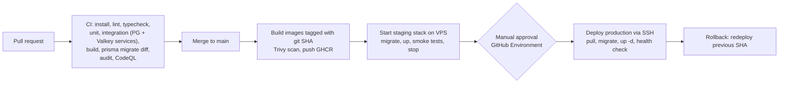

- Deploy script: `docker compose pull`, then `docker compose run --rm migrate`, then `docker compose up -d --no-deps api worker web`, then wait for `/health/ready`, then smoke test. If the health check fails, redeploy the previous tag automatically.
- **Migrations are expand → migrate → contract** (backward compatible for one release), so a rollback never needs a down-migration.
- The deploy user has a dedicated SSH key, is in the `docker` group and has no sudo.

### 17.6 Backups and disaster recovery

| Item | Phase 0 (launch) | V1, or past 100 paying workspaces |
|------|---------|-----------|
| PostgreSQL | Nightly `pg_dump -Fc`, encrypted with `age`, uploaded to offsite S3-compatible storage. Retention 7 daily, 4 weekly, 6 monthly | Continuous WAL archiving (WAL-G or pgBackRest) with point-in-time recovery |
| RPO / RTO | 24 h / 8 h | **15 min / 4 h** |
| Valkey | AOF on the volume. Not backed up (rebuildable via reconcilers) | Same |
| Files | Already in object storage (versioning enabled) | Same |
| Config/secrets | Encrypted copy in the password manager or ops vault | Same |
| Verification | Restore drill into a temporary container (or the staging stack), monthly | Automated weekly restore test |

Hostinger VPS snapshots are a convenience, not the DR strategy.

### 17.7 Server hardening (summary)

SSH key-only access with root login disabled. `ufw` allows only 22 (ideally an IP allowlist), 80 and 443. fail2ban, unattended security upgrades and a non-root deploy user. Docker containers run non-root with `read_only` root filesystems where possible, `no-new-privileges` and minimal capabilities. Postgres and Valkey are never published to the host network. Full checklist in [SECURITY.md](SECURITY.md).

### 17.8 Domains (to be provided)

- `app.<product-domain>` for the web app and API.
- `links.<separate-domain>` for unsubscribe and link redirects, on a separate registrable domain to isolate reputation.
- The marketing site can live on the root domain (static, or a separate host).

### 17.9 Scaling path (in order, only when metrics justify it)

1. Tune concurrency and indexes. Upgrade vertically to KVM 4 or KVM 8.
2. Move `worker` to a second VPS. It is stateless and connects to PG and Valkey over a private network or WireGuard.
3. Move PostgreSQL to a dedicated or managed instance, add PgBouncer and a read replica for analytics.
4. Run multiple `api` and `web` replicas behind nginx upstreams.
5. Extract a service **only** where there is a clear isolation or scaling reason. The likely first candidates are `email-engine` (sending + inbox sync) and the crawler. Module boundaries (§6.3) keep this mechanical.
6. Analytics events move to a columnar store only when Postgres rollups stop being sufficient.

---

## 18. Assumptions

1. **Multi-tenant SaaS from day one.** External customers sign up, and it is not an internal-only tool.
2. **Primary users** are freelancers, startups, marketing agencies, sales teams, B2B companies and lead-gen agencies (PRD §3). Agencies run multiple clients through multiple `business_profiles` in one workspace, not through nested tenants.
3. **B2B outreach only**, to business email addresses. No consumer marketing, SMS, calling or LinkedIn automation.
4. **Data providers are BYOK first.** Customers connect their own data-provider API keys, which keeps the customer as the licensee. Verification and AI are platform-managed and billed as usage. See INTEGRATIONS.md §8.
5. **Expected launch scale:** at most 50 active workspaces, 250 mailboxes, 10k sends/day and 1M contacts. That fits on KVM 2.
6. **Team:** 1–3 engineers using AI coding assistants. The roadmap durations assume this.
7. **English UI first.** Email generation in other languages is V1.
8. **GitHub** hosts the code and CI. GHCR is the image registry.
9. **Billing:** Stripe (Checkout, Portal, Tax) if available in the company's country, otherwise a merchant of record (AD-19).
10. The Hostinger KVM 2 specs listed in §17.1 are current.
11. **Plans, limits and credit costs** are defined in PRD §8 and implemented as config (`platform/billing/plans.ts`), not DB rows.

## 19. Open Questions

### 19.1 Resolved with startup defaults (PRD §2, 2026-11-26)

| # | Question | Resolution |
|---|----------|-----------|
| Q1 | Markets | Launch markets US, UK, CA, AU, IE. Strict-consent countries blocked by default (AD-22). *Company country still needed for billing (19.2).* |
| Q2 | Data-provider strategy | BYOK + CSV import. No resold data (PRD D2) |
| Q3 | Pricing model | Trial / Starter $49 / Growth $129 / Agency $299, plus credits and packs (PRD §8) |
| Q4 | Mailbox priority | SMTP/IMAP + Microsoft 365 first. Gmail OAuth in testing mode. CASA deferred (AD-20) |
| Q5 | Default autonomy | L1 approve every email. L0 available. L2 in V1 (PRD D5) |
| Q6 | Primary LLM | Chosen by a Phase 0 cost and quality eval. The other provider is the fallback (PRD D6). Zero-retention only if a customer contract requires it |
| Q7 | Staging | No separate VPS at launch (AD-21) |
| Q9 | Auth | Backend-owned sessions, no paid auth vendor (PRD D7) |
| Q10 | CRM | Not at launch. CSV export. HubSpot in V1 (PRD D12) |
| Q11 | Agency client logins | Future Viewer/Client role. Clients are business profiles (AD-16) |
| Q12 | Tracking | Off by default. Per-campaign toggle in V1 (PRD D13) |

### 19.2 Still open (non-blocking)

| # | Question | Impacts |
|---|----------|---------|
| Q1b | Country where the operating company is incorporated | Stripe vs merchant of record, tax setup, governing law of ToS |
| Q8 | Product name and domains (app domain plus a separate links domain) | Deployment, OAuth app registration, legal docs |
| Q13 | Which data provider the first design partners already use | First BYOK adapter (Phase 2) |
| Q14 | Price validation with the first 10–20 prospects | PRD §8 numbers |

## 20. Decision Log

Decisions in §2 are **Proposed**. Each is expanded into a full ADR in [architecture/adr/](architecture/adr/README.md) (the index maps AD-xx to ADR-00xx). **New decisions are recorded as ADR files from now on.** This table only summarizes them.

| ID | Date | Status | Title |
|----|------|--------|-------|
| AD-01 … AD-15 | 2026-11-26 | Proposed | Initial architecture (see §2) |
| AD-16 … AD-23 | 2026-11-26 | Proposed | Sync with PRD v2.0: workspace tenancy, roles, launch approval, billing and credits in MVP, mailbox priority, no staging VPS, launch markets, low-cost tooling |
| ADR-0001 … ADR-0031 | 2026-11-26 | Proposed | Detailed ADRs, including new ones: UUIDv7, field encryption, SafeFetch, exactly-once sending, HMAC unsubscribe tokens, analytics rollups, observability, backups, polling realtime, CSV-only uploads, prompt registry |
