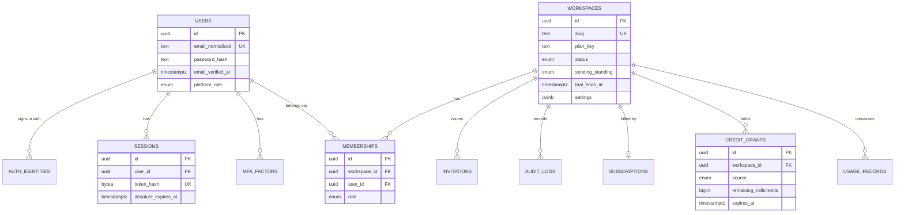
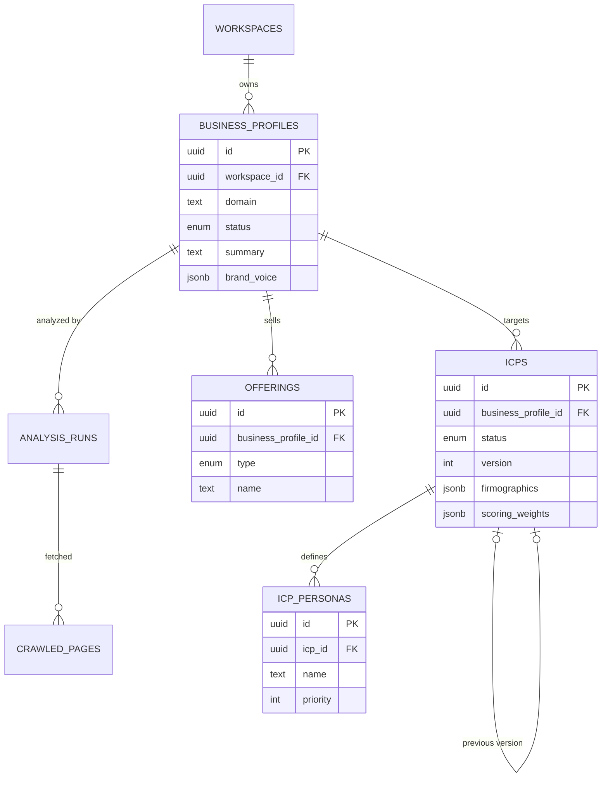
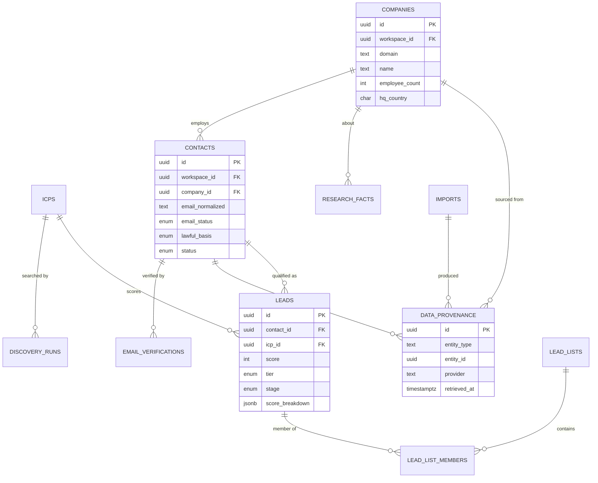
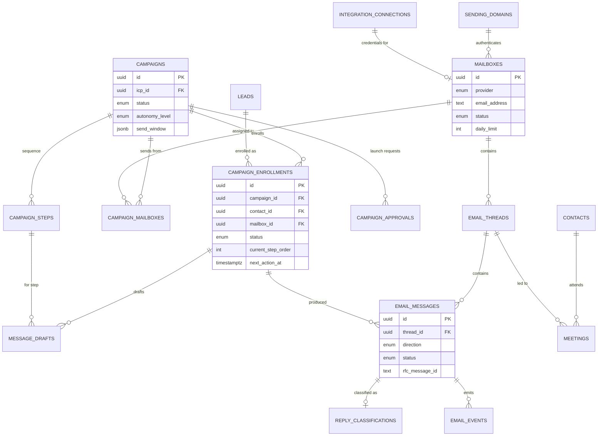

# Database Design

> Status: **Proposed. Awaiting approval.** Synced with PRD v2.0 on 2026-11-26 (workspaces, three roles, launch approvals, credit ledger).
> Engine: **PostgreSQL 18** (17 acceptable). ORM: **Prisma 7** with the `pg` driver adapter (schema and migrations in `packages/core/prisma/`, client generated into `packages/core/src/generated/`). Split into multiple schema files as domains grow.
> Related: [ARCHITECTURE.md](ARCHITECTURE.md) §6 (table ownership per module) · [SECURITY.md](SECURITY.md) (encryption, retention, erasure)
>
> **Implementation status (2026-11-26): schema v1 is implemented.** [`packages/core/prisma/schema.prisma`](../packages/core/prisma/schema.prisma) is now authoritative for table and column names. [ADR-0033](architecture/adr/ADR-0033-schema-v1-entities.md) records how it differs from this document:
> - Renamed tables (below).
> - `plans` and `roles` catalog tables synced from code.
> - `background_jobs`.
> - `data_sources` + `field_provenance` instead of `data_provenance`.
> - NO ACTION instead of RESTRICT and SET NULL on tenant references.
>
> The table specifications in §5 still describe columns and intent.
>
> | Implemented | Design name in this document |
> |-------------|------------------------------|
> | `workspace_members` | `memberships` |
> | `verification_tokens`, `password_resets` | `user_tokens` |
> | `usage_ledger` | `usage_records` |
> | `website_analyses` | `analysis_runs` |
> | `target_segments` | `icp_personas` |
> | `campaign_recipients` | `campaign_enrollments` |
> | `conversations` / `messages` / `message_events` | `email_threads` / `email_messages` / `email_events` |
> | `inbox_connections` | `mailboxes` |
> | `provider_connections` | `integration_connections` |
> | `import_batches` | `imports` |
> | `data_sources` + `field_provenance` | `data_provenance` |

---

## 1. Principles

1. **PostgreSQL is the single source of truth.** All business and workflow state lives here, including campaign progress, job status and credit reservations. Valkey holds nothing that cannot be rebuilt.
2. **Shared schema, tenant column.** Every tenant-owned table has `workspace_id uuid NOT NULL`, and it is the leading column of most composite indexes.
3. **One owner per table.** Only the owning module writes to a table (see the "owner" labels below and ARCHITECTURE.md §6.1).
4. **Relational core, JSONB at the edges.** Entities and relationships the system filters or joins on are columns. Semi-structured, AI-produced or provider-specific data (firmographic filter sets, score breakdowns, raw provider fields) goes in JSONB, validated by Zod schemas in `packages/contracts` and carrying a `schemaVersion`.
5. **Minimize personal data.** Store only what outreach needs. No personal phone numbers, home addresses or social profiles beyond a professional profile URL. Raw provider payloads are trimmed.
6. **Erasure must be possible.** Every table holding personal data is reachable from `contacts` or `email_normalized`, so a DSAR erasure can find and remove it (§8.3).

---

## 2. Conventions

| Item | Convention |
|------|-----------|
| Table names | `snake_case`, plural (`campaign_enrollments`). Prisma models are PascalCase singular with `@@map`. |
| Column names | `snake_case` in DB and `camelCase` in Prisma via `@map`. |
| Primary keys | `id uuid` UUIDv7 (time-ordered, index-friendly) via Prisma `@default(uuid(7))`. Join tables use composite PKs. |
| Foreign keys | Always declared. `ON DELETE` is chosen explicitly per relation: `CASCADE` for owned children, `RESTRICT` for references, `SET NULL` for optional links. |
| **Tenant-safe foreign keys** | Every tenant table has `UNIQUE (workspace_id, id)`, and every tenant-to-tenant FK is **composite** `(workspace_id, <fk>) → parent (workspace_id, id)`, which makes cross-tenant references impossible at the DB level ([architecture/09](architecture/09-multi-tenancy.md) §4.1) |
| **Optimistic locking** | `row_version int NOT NULL DEFAULT 1` on editable aggregates: `workspaces`, `business_profiles`, `icps`, `campaigns`, `campaign_steps`, `message_drafts`. Exposed as `ETag`, required via `If-Match` ([architecture/03](architecture/03-api.md) §7) |
| Timestamps | `timestamptz(3)`. Every table has `created_at` and mutable tables have `updated_at`. All values are UTC. |
| Soft delete | `deleted_at timestamptz NULL` only on user-facing aggregates (`workspaces`, `business_profiles`, `companies`, `contacts`, `campaigns`). Unique indexes are partial: `WHERE deleted_at IS NULL`. Erasure is always a hard delete. |
| Enums | PostgreSQL enums (Prisma `enum`) for stable state machines. Free-form categories use `text` with Zod validation. |
| Emails | `email` (as provided) plus `email_normalized` (trimmed, lower-cased) used for uniqueness and joins. |
| Hashes | `email_hash` = HMAC-SHA256(normalized email, `EMAIL_HASH_PEPPER`). Used where the address itself must not be retained (suppression after erasure). |
| Money and cost | `bigint` micro-units (`cost_micros`, 1 USD = 1,000,000) for AI and provider costs. Integer cents for billing amounts. |
| Countries | ISO-3166-1 alpha-2 `char(2)`. |
| Encrypted fields | `bytea`, AES-256-GCM, with a `key_version int` column alongside (see SECURITY.md §5). |
| Extensions | `pg_trgm` (fuzzy search), `btree_gin`. `pgvector` is reserved for later semantic matching. |

---

## 3. Schema Domains

| Domain | Tables | Owner module(s) |
|--------|--------|-----------------|
| Identity and tenancy | `users`, `auth_identities`, `sessions`, `user_tokens`, `mfa_factors`, `workspaces`, `memberships`, `invitations`, `audit_logs` | identity, tenancy, audit |
| Business understanding | `business_profiles`, `analysis_runs`, `crawled_pages`, `offerings`, `icps`, `icp_personas` | business-profile, icp |
| Prospecting and leads | `discovery_runs`, `companies`, `contacts`, `data_provenance`, `imports`, `research_facts`, `email_verifications`, `leads`, `lead_lists`, `lead_list_members` | prospecting, enrichment, verification, scoring |
| Outreach | `sending_domains`, `mailboxes`, `campaigns`, `campaign_steps`, `campaign_mailboxes`, `campaign_enrollments`, `message_drafts`, `campaign_approvals` | mailboxes, campaigns |
| Messaging and inbox | `email_threads`, `email_messages`, `email_events`, `reply_classifications`, `tasks` | email-engine, inbox |
| Meetings | `meetings` | meetings |
| Compliance | `suppressions`, `dsar_requests` | compliance |
| Platform | `integration_connections`, `webhook_events`, `file_objects`, `notifications`, `ai_runs`, `agent_runs`, `subscriptions`, `credit_grants`, `usage_records` | integrations, files, notifications, ai, billing |
| Analytics | `campaign_daily_stats`, `mailbox_daily_stats` | analytics |

---

## 4. Entity-Relationship Diagrams

### 4.1 Identity and tenancy

### 4.2 Business understanding and ICP

### 4.3 Prospecting and leads

### 4.4 Outreach, messaging and meetings

---

## 5. Table Specifications

Columns `id`, `workspace_id`, `created_at` and `updated_at` are implied on every tenant table unless stated otherwise. "UQ" means unique, and "IDX" means index.

### 5.1 Identity and tenancy

**`users`** (identity, not tenant-scoped)
`email`, `email_normalized` UQ, `name`, `password_hash` NULL (argon2id encoded), `email_verified_at`, `platform_role` enum(`NONE`,`SUPER_ADMIN`), `locale`, `timezone`, `terms_version_accepted`, `terms_accepted_at` (ToS, Privacy and AUP acceptance, PRD AUTH-01), `email_bounced_at` (system mail hard bounce), `last_login_at`, `failed_login_count`, `locked_until`, `deleted_at`.

**`auth_identities`**: `user_id` FK, `provider` enum(`GOOGLE`,`MICROSOFT`), `provider_subject`, `email`. UQ(`provider`,`provider_subject`).

**`sessions`**: `user_id` FK, `token_hash bytea` UQ (SHA-256), `active_workspace_id` NULL, `ip inet`, `user_agent`, `mfa_verified_at`, `reauthenticated_at` (step-up), `impersonator_user_id` NULL, `impersonation_workspace_id` NULL, `impersonation_expires_at` NULL, `impersonation_write_until` NULL ([architecture/08](architecture/08-authentication.md) §10), `last_seen_at`, `idle_expires_at`, `absolute_expires_at`, `revoked_at`. IDX(`user_id`).

**`user_tokens`**: `user_id` FK, `type` enum(`EMAIL_VERIFY`,`PASSWORD_RESET`,`EMAIL_CHANGE`), `token_hash` UQ, `expires_at`, `used_at`. Single use with short TTL (30 min for reset, 24 h for verify).

**`mfa_factors`**: `user_id` FK, `type` enum(`TOTP`), `secret_encrypted bytea`, `key_version`, `recovery_codes_hashed jsonb`, `confirmed_at`, `last_used_at`.

**`workspaces`** (the tenant root, so it has no `workspace_id` column)

| Column | Type | Notes |
|--------|------|-------|
| `name`, `slug` | text | `slug` UQ |
| `legal_name` | text | Used in email footers and invoices |
| `plan_key` | text | `trial`, `starter`, `growth`, `agency`, `enterprise` (definitions in `platform/billing/plans.ts`) |
| `status` | enum `TRIALING`,`ACTIVE`,`PAST_DUE`,`READ_ONLY`,`PENDING_DELETION`,`CLOSED` | Drives what the workspace may do (PRD BIL-01, BIL-05, BIL-06, WS-07) |
| `sending_standing` | enum `GOOD`,`WARNING`,`RESTRICTED`,`SUSPENDED` | Set by abuse rules and Super Admins (PRD SA-02). `SUSPENDED` blocks sending and credit spend |
| `standing_reason` | text | |
| `trial_ends_at` | timestamptz | Trial is 14 days |
| `physical_address` | jsonb | **Required before any launch** (email footer) |
| `privacy_notice_url` | text | Required before launch |
| `default_timezone` | text | |
| `settings` | jsonb | `{launchRequiresApproval: true, defaultSendWindow, discoveryConfirmThreshold: 500, autoVerify: true, features, retention, countryPolicyOverrides}` |
| `deletion_requested_at`, `purge_after` | timestamptz | 30-day restorable grace period |
| `deleted_at` | timestamptz | |

**`memberships`**: `user_id` FK, `role` enum(`OWNER`,`ADMIN`,`MEMBER`), `notification_preferences jsonb` (per-type email opt-outs, daily digest on/off). UQ(`workspace_id`,`user_id`). **Partial UQ(`workspace_id`) WHERE `role = 'OWNER'`** guarantees exactly one Owner (ownership transfer swaps roles in one transaction).

**`invitations`**: `email_normalized`, `role` enum(`ADMIN`,`MEMBER`) (Owner is never invited, only transferred), `token_hash` UQ, `invited_by_user_id`, `expires_at` (7 days), `accepted_at`, `revoked_at`. Pending invitations count toward the plan's seat limit.

**`audit_logs`** (append-only): `workspace_id` NULL (platform events), `actor_type` enum(`USER`,`SYSTEM`,`SUPPORT`,`API_KEY`), `actor_user_id`, `action` (for example `campaign.launched`, `contacts.exported`, `member.role_changed`), `target_type`, `target_id`, `metadata jsonb` (IDs and diffs, **no message bodies or emails**), `ip`, `user_agent`, `request_id`. IDX(`workspace_id`, `created_at DESC`). The app DB role has INSERT/SELECT only.

### 5.2 Business understanding

**`business_profiles`**

| Column | Type | Notes |
|--------|------|-------|
| `name` | text | |
| `website_url`, `domain` | text | `domain` = registrable domain. UQ(`workspace_id`,`domain`) WHERE `deleted_at IS NULL` |
| `status` | enum `DRAFT`,`ANALYZING`,`READY`,`FAILED` | |
| `summary`, `value_proposition` | text | AI-extracted, user-editable |
| `industries_served`, `target_markets` | text[] | |
| `differentiators`, `proof_points` | jsonb | Proof points carry `sourceUrl` |
| `brand_voice` | jsonb | tone, do/don't, banned phrases, signature defaults |
| `last_analyzed_at` | timestamptz | |
| `deleted_at` | timestamptz | |

**`analysis_runs`**: `business_profile_id` FK, `agent_run_id`, `status` enum(`QUEUED`,`CRAWLING`,`EXTRACTING`,`COMPLETED`,`FAILED`,`CANCELED`), `pages_discovered`, `pages_fetched`, `error_code`, `error_message`, `started_at`, `finished_at`. IDX(`status`,`updated_at`) for the reconciler.

**`crawled_pages`**: `analysis_run_id` FK, `business_profile_id` FK, `url`, `page_type` enum(`HOME`,`ABOUT`,`PRODUCT`,`SERVICE`,`PRICING`,`CASE_STUDY`,`BLOG`,`CONTACT`,`OTHER`), `title`, `content_text` (clean text, ≤100 KB), `content_hash`, `http_status`, `fetched_at`, `purge_after`. UQ(`analysis_run_id`,`url`).

**`offerings`**: `business_profile_id` FK, `type` enum(`PRODUCT`,`SERVICE`), `name`, `description`, `key_features jsonb`, `use_cases jsonb`, `pricing_notes`, `target_customer_notes`, `source` enum(`AI`,`USER`), `sort_order`, `archived_at`.

**`icps`**

| Column | Type | Notes |
|--------|------|-------|
| `business_profile_id` | uuid FK | |
| `name` | text | |
| `status` | enum `DRAFT`,`ACTIVE`,`ARCHIVED` | |
| `version`, `previous_version_id` | int, uuid FK NULL | Editing an ACTIVE ICP creates a new version, so leads keep the version they were scored against |
| `offering_ids` | uuid[] | Offerings this ICP is for |
| `firmographics` | jsonb | `{industries[], employeeRanges[], revenueRanges[], countries[], regions[], technologies[], keywords[], fundingStages[]}` |
| `exclusions` | jsonb | `{domains[], industries[], countries[], companyIds[]}` |
| `pain_points`, `buying_triggers` | jsonb | |
| `rationale` | text | Why this ICP (AI-generated, shown to the user) |
| `provider_filters` | jsonb | `{ apollo: {...}, pdl: {...} }` mapped filters |
| `scoring_weights` | jsonb | Overrides for default weights |
| `created_by` | enum `AI`,`USER` | |
| `activated_at` | timestamptz | |

**`icp_personas`**: `icp_id` FK, `name` (for example "Head of Operations"), `title_keywords text[]`, `seniorities text[]`, `departments text[]`, `responsibilities`, `pain_points jsonb`, `goals jsonb`, `messaging_angles jsonb`, `priority`.

### 5.3 Prospecting and leads

**`discovery_runs`**: `icp_id` FK, `persona_ids uuid[]`, `provider`, `status` enum(`PLANNED`,`AWAITING_CONFIRMATION`,`QUEUED`,`RUNNING`,`COMPLETED`,`FAILED`,`CANCELED`), `query_plan jsonb`, `estimated_credits`, `credits_used`, `results_found`, `results_new`, `results_duplicate`, `results_suppressed`, `idempotency_key` UQ, `created_by_user_id`, `agent_run_id`, `started_at`, `finished_at`, `error_code`.

**`companies`**

| Column | Type | Notes |
|--------|------|-------|
| `name` | text | IDX GIN trgm |
| `domain` | text | Registrable domain. UQ(`workspace_id`,`domain`) WHERE `deleted_at IS NULL` |
| `website_url`, `linkedin_url` | text | URLs only, no scraping |
| `industry`, `sub_industry` | text | Normalized taxonomy |
| `employee_count`, `employee_range` | int, text | |
| `revenue_range`, `funding_stage`, `last_funding_at` | text, text, date | |
| `hq_country`, `hq_region`, `hq_city` | char(2), text, text | |
| `description` | text | |
| `technologies`, `keywords` | text[] | IDX GIN |
| `status` | enum `ACTIVE`,`EXCLUDED`,`DO_NOT_CONTACT` | |
| `enriched_at`, `deleted_at` | timestamptz | |

**`contacts`**

| Column | Type | Notes |
|--------|------|-------|
| `company_id` | uuid FK NULL | |
| `first_name`, `last_name`, `full_name` | text | `full_name` IDX GIN trgm |
| `title`, `seniority`, `department` | text, enum, text | `seniority`: `C_LEVEL`,`VP`,`DIRECTOR`,`MANAGER`,`SENIOR`,`ENTRY`,`OWNER`,`PARTNER`,`UNKNOWN` |
| `email`, `email_normalized` | text | UQ(`workspace_id`,`email_normalized`) WHERE `email_normalized IS NOT NULL AND deleted_at IS NULL` |
| `email_status` | enum `UNVERIFIED`,`NOT_FOUND`,`VALID`,`CATCH_ALL`,`UNKNOWN`,`INVALID`,`DISPOSABLE`,`ROLE` | `NOT_FOUND` = email finder found nothing, so the contact can't be enrolled (PRD ENR-01) |
| `email_verified_at` | timestamptz | Freshness check before send (default 60 days) |
| `linkedin_url` | text | Profile URL only |
| `country`, `timezone` | char(2), text | Drives country policy and send window |
| `lawful_basis` | enum `LEGITIMATE_INTEREST`,`CONSENT`,`CUSTOMER_PROVIDED` | Required |
| `source` | enum `DISCOVERY`,`IMPORT`,`MANUAL`,`ENRICHMENT` | |
| `status` | enum `ACTIVE`,`DO_NOT_CONTACT` | |
| `last_contacted_at` | timestamptz | |
| `deleted_at` | timestamptz | |

**`data_provenance`**: `entity_type` enum(`COMPANY`,`CONTACT`), `entity_id`, `provider` (for example `apollo`, `hunter`, `csv_import`, `manual`), `provider_record_id`, `fields text[]` (which fields came from this source), `discovery_run_id` NULL, `import_id` NULL, `retrieved_at`, `cost_micros`. IDX(`workspace_id`,`entity_type`,`entity_id`). Used for GDPR Art. 14 source disclosure and provider ToS audits.

**`imports`**: `file_object_id` FK, `status` enum(`UPLOADED`,`MAPPING`,`QUEUED`,`PROCESSING`,`COMPLETED`,`FAILED`), `column_mapping jsonb`, `row_count`, `rows_imported`, `rows_updated`, `rows_skipped`, `rows_failed`, `lawful_basis_attestation jsonb` (`{basis, sourceDescription, attestedByUserId, attestedAt}`, **required**), `error_report_file_id`, `created_by_user_id`, `finished_at`.

**`research_facts`**: `company_id` FK, `contact_id` NULL, `type` enum(`NEWS`,`HIRING`,`FUNDING`,`PRODUCT_LAUNCH`,`TECH_STACK`,`CONTENT`,`PARTNERSHIP`,`AWARD`,`OTHER`), `statement` (≤280 chars), `source_url` **NOT NULL**, `source_title`, `published_at`, `retrieved_at`, `expires_at`, `confidence numeric(3,2)`, `ai_run_id`. IDX(`workspace_id`,`company_id`,`expires_at`).

**`email_verifications`**: `email_normalized`, `contact_id` NULL, `provider`, `result` enum(`VALID`,`INVALID`,`CATCH_ALL`,`UNKNOWN`,`DISPOSABLE`,`ROLE`), `sub_status`, `raw jsonb` (trimmed), `checked_at`, `expires_at`, `cost_micros`. IDX(`workspace_id`,`email_normalized`,`checked_at DESC`).

**`leads`**

| Column | Type | Notes |
|--------|------|-------|
| `contact_id`, `icp_id`, `persona_id` | uuid FK | UQ(`contact_id`,`icp_id`) |
| `stage` | enum `NEW`,`QUALIFIED`,`ENROLLED`,`CONTACTED`,`REPLIED`,`INTERESTED`,`MEETING_BOOKED`,`WON`,`LOST`,`DISQUALIFIED` | |
| `score` | smallint 0–100 | |
| `tier` | enum `A`,`B`,`C`,`D` | |
| `score_breakdown` | jsonb | `{fit, persona, dataQuality, intent, engagement, aiAdjustment, reasons[], schemaVersion}` |
| `scoring_version`, `scored_at` | text, timestamptz | |
| `score_override`, `overridden_by_user_id` | smallint NULL, uuid NULL | |
| `owner_user_id` | uuid NULL | |
| `disqualified_reason` | text | |

IDX(`workspace_id`,`icp_id`,`tier`,`score DESC`).

**`lead_lists`**: `name`, `description`, `created_by_user_id`.
**`lead_list_members`**: PK(`lead_list_id`,`lead_id`), `workspace_id`, `added_by_user_id`, `added_at`.

### 5.4 Outreach

**`sending_domains`**: `domain`, `spf_status`, `dkim_status`, `dmarc_status` (enum `PASS`,`FAIL`,`MISSING`,`UNKNOWN`), `dmarc_policy`, `mx_status`, `dkim_selectors text[]`, `check_details jsonb`, `last_checked_at`. UQ(`workspace_id`,`domain`).

**`mailboxes`**

| Column | Type | Notes |
|--------|------|-------|
| `owner_user_id` | uuid FK | The person whose mailbox it is |
| `connection_id` | uuid FK → `integration_connections` | Encrypted OAuth tokens or SMTP/IMAP credentials |
| `sending_domain_id` | uuid FK | |
| `provider` | enum `GOOGLE`,`MICROSOFT`,`SMTP_IMAP` | |
| `email_address`, `display_name` | text | UQ(`workspace_id`,`email_address`) |
| `signature_text`, `signature_html` | text | |
| `status` | enum `CONNECTED`,`PAUSED`,`ERROR`,`DISCONNECTED` | |
| `status_reason` | text | For example `auth_revoked`, `throttled`, `bounce_threshold` |
| `daily_limit`, `min_interval_seconds` | int | Defaults 30 and 120 |
| `ramp_up` | jsonb | `{startedAt, startLimit, dailyIncrement}` |
| `sync_cursor` | jsonb | Gmail `historyId`, Graph `deltaLink` or IMAP `uidValidity`/`lastUid` |
| `next_free_slot_at` | timestamptz | Next send slot after spacing (scheduler, [architecture/06](architecture/06-background-jobs.md) §7) |
| `smtp_saves_sent` | bool NULL | SMTP/IMAP only. If false, outreach is APPENDed to the IMAP Sent folder (ADR-0023) |
| `last_synced_at`, `last_sent_at` | timestamptz | |
| `health` | jsonb | Rolling 7-day sent, bounces, replies and errors |

**`campaigns`**

| Column | Type | Notes |
|--------|------|-------|
| `business_profile_id`, `icp_id`, `offering_id` | uuid FK | |
| `name` | text | |
| `status` | enum `DRAFT`,`PENDING_APPROVAL`,`SCHEDULED`,`ACTIVE`,`PAUSED`,`COMPLETED`,`ARCHIVED` | State machine in ARCHITECTURE.md §7.6 |
| `start_at` | timestamptz NULL | Optional scheduled start |
| `approved_by_user_id`, `approved_at` | uuid NULL, timestamptz NULL | Latest launch approval. Cleared when leads, sequence or mailboxes change |
| `autonomy_level` | enum `L0`,`L1`,`L2`,`L3` | Default `L1`. L2 is V1, L3 is Future |
| `allow_catch_all` | bool | Default false. When true, catch-all emails are capped at 10% of daily volume |
| `language` | text (BCP-47) | |
| `timezone_mode`, `timezone` | enum `RECIPIENT`,`FIXED`, text | |
| `send_window` | jsonb | `{days:[1..5], start:"09:00", end:"17:00"}` |
| `daily_cap` | int | Campaign-level cap on top of mailbox caps |
| `stop_on_reply` | bool | Default true, cannot be disabled in MVP |
| `track_opens`, `track_clicks` | bool | Default false |
| `booking_url` | text | |
| `settings` | jsonb | |
| `paused_reason` | enum NULL `MANUAL`,`BOUNCE_THRESHOLD`,`OUT_OF_CREDITS`,`EMAIL_LIMIT_REACHED`,`NO_HEALTHY_MAILBOX`,`WORKSPACE_SUSPENDED`,`PAST_DUE` | Auto-pauses resume automatically when the cause clears (except `BOUNCE_THRESHOLD` and `MANUAL`) |
| `launched_at`, `created_by_user_id`, `deleted_at` | | |

**`campaign_approvals`**: `campaign_id` FK, `requested_by_user_id`, `status` enum(`PENDING`,`APPROVED`,`REJECTED`,`CANCELED`), `decided_by_user_id`, `decided_at`, `comment`, `launch_check_snapshot jsonb` (results at request time), `config_hash` (hash of leads, sequence and mailboxes. A mismatch cancels the request, per PRD APR-04 AC3). Partial UQ(`campaign_id`) WHERE `status = 'PENDING'`. IDX(`workspace_id`,`status`).

**`campaign_steps`**: `campaign_id` FK, `step_order`, `type` enum(`EMAIL`,`MANUAL_TASK`), `delay_days`, `business_days_only bool`, `thread_mode` enum(`NEW_THREAD`,`REPLY_IN_THREAD`), `intent` enum(`INTRO`,`FOLLOW_UP`,`VALUE_ADD`,`SOCIAL_PROOF`,`BREAKUP`), `subject_template`, `body_template`, `ai_instructions`. UQ(`campaign_id`,`step_order`). (A/B variants come later via `campaign_step_variants`.)

**`campaign_mailboxes`**: PK(`campaign_id`,`mailbox_id`), `workspace_id`, `weight`.

**`campaign_enrollments`**

| Column | Type | Notes |
|--------|------|-------|
| `campaign_id`, `lead_id`, `contact_id` | uuid FK | UQ(`campaign_id`,`contact_id`) |
| `mailbox_id` | uuid FK | Sticky sender for the whole sequence |
| `thread_id` | uuid FK NULL | Set after first send |
| `status` | enum `PENDING`,`ACTIVE`,`PAUSED`,`REPLIED`,`BOUNCED`,`UNSUBSCRIBED`,`COMPLETED`,`STOPPED` | |
| `current_step_order` | int | |
| `next_action_at` | timestamptz | **Partial IDX(`next_action_at`) WHERE `status = 'ACTIVE'`** (scheduler hot path) |
| `scheduled_send_at` | timestamptz NULL | Set when a send slot is reserved, cleared after send or skip. Partial IDX(`mailbox_id`, `scheduled_send_at`) WHERE NOT NULL (capacity counting) |
| `paused_until`, `stop_reason` | timestamptz, text | |
| `enrolled_at`, `last_sent_at`, `completed_at` | timestamptz | |

Partial UQ(`workspace_id`,`contact_id`) WHERE `status IN ('PENDING','ACTIVE','PAUSED')`. A contact can be in only one live sequence per workspace.

**`message_drafts`**: `enrollment_id` FK, `step_id` FK, `version`, `subject`, `body_text`, `body_html` NULL, `status` enum(`PENDING_GENERATION`,`NEEDS_REVIEW`,`APPROVED`,`REJECTED`,`SUPERSEDED`,`SENT`), `lint_warnings jsonb`, `fact_ids uuid[]`, `ai_run_id`, `edited_by_user_id`, `approved_by_user_id`, `approved_at`. Partial UQ(`enrollment_id`,`step_id`) WHERE `status IN ('PENDING_GENERATION','NEEDS_REVIEW','APPROVED')`. IDX(`workspace_id`,`status`) for the review queue.

### 5.5 Messaging and inbox

**`email_threads`**: `mailbox_id` FK, `contact_id` NULL, `enrollment_id` NULL, `provider_thread_id`, `subject`, `last_message_at`, `last_inbound_at`, `status` enum(`OPEN`,`AWAITING_REPLY`,`CLOSED`), `assigned_user_id`, `is_unread`. IDX(`workspace_id`,`last_message_at DESC`).

**`email_messages`**

| Column | Type | Notes |
|--------|------|-------|
| `thread_id`, `mailbox_id` | uuid FK | |
| `enrollment_id`, `step_id`, `draft_id`, `contact_id` | uuid FK NULL | |
| `direction` | enum `OUTBOUND`,`INBOUND` | |
| `status` | enum `SENDING`,`SENT`,`FAILED`,`RECEIVED` | |
| `rfc_message_id` | text | Deterministic for outbound. UQ(`mailbox_id`,`rfc_message_id`) |
| `in_reply_to`, `references` | text, text[] | Threading |
| `provider_message_id` | text | |
| `from_email`, `to_emails`, `cc_emails` | text, text[], text[] | |
| `subject`, `snippet` | text | |
| `body_text` | text | Quoted history stripped for inbound storage, with the original kept |
| `body_html_sanitized` | text NULL | Sanitized server-side. Rendered in a sandboxed iframe |
| `is_bounce`, `bounce_type` | bool, enum `HARD`,`SOFT` NULL | |
| `delivery_unconfirmed` | bool | True when crash reconciliation couldn't confirm delivery on an SMTP host without Sent copies. Treated as sent and never resent (ADR-0023) |
| `sent_at`, `received_at` | timestamptz | |
| `error_code`, `error_message` | text | |

Partial UQ(`enrollment_id`,`step_id`) WHERE `direction = 'OUTBOUND' AND status <> 'FAILED'`. This is the exactly-once guard. IDX(`workspace_id`,`thread_id`,`created_at`), IDX(`status`) WHERE `status = 'SENDING'` (reconciler).

**`email_events`** (append-only, analytics source): `message_id` NULL, `enrollment_id`, `campaign_id`, `step_id`, `mailbox_id`, `contact_id`, `type` enum(`SENT`,`FAILED`,`BOUNCED`,`REPLIED`,`POSITIVE_REPLY`,`UNSUBSCRIBED`,`OPENED`,`CLICKED`,`MEETING_BOOKED`), `dedupe_key` **UQ** (idempotent emission, [architecture/11](architecture/11-analytics.md) §2), `occurred_at`, `metadata jsonb`. IDX(`workspace_id`,`campaign_id`,`occurred_at`), BRIN(`occurred_at`).

**`reply_classifications`**: `message_id` FK UQ, `category` enum (see ARCHITECTURE.md §12.3), `confidence numeric(4,3)`, `sentiment` enum(`POSITIVE`,`NEUTRAL`,`NEGATIVE`), `summary`, `extracted jsonb` (`{oooReturnDate, referral:{name,email}, questions[]}`), `ai_run_id`, `overridden_category`, `overridden_by_user_id`, `overridden_at`.

**`tasks`**: `type` enum(`REVIEW_DRAFTS`,`RESPOND_TO_REPLY`,`MANUAL_STEP`,`FIX_MAILBOX`,`REVIEW_CLASSIFICATION`,`CONFIRM_SPEND`), `status` enum(`OPEN`,`DONE`,`DISMISSED`), `priority`, `assignee_user_id`, `entity_type`, `entity_id`, `title`, `due_at`, `completed_at`. IDX(`workspace_id`,`status`,`assignee_user_id`).

### 5.6 Meetings

**`meetings`**: `contact_id` FK, `lead_id`, `campaign_id`, `thread_id` NULL, `status` enum(`PROPOSED`,`BOOKED`,`RESCHEDULED`,`CANCELED`,`COMPLETED`,`NO_SHOW`), `source` enum(`BOOKING_LINK`,`CALENDAR_INVITE`,`MANUAL`), `provider` enum(`CAL_COM`,`CALENDLY`,`GOOGLE`,`MICROSOFT`,`MANUAL`), `external_event_id`, `starts_at`, `ends_at`, `timezone`, `meeting_url`, `host_user_id`, `notes`. UQ(`workspace_id`,`provider`,`external_event_id`).

### 5.7 Compliance

**`suppressions`**: `email_hash bytea` NULL, `email_normalized` NULL (set to NULL on erasure, hash kept), `domain` NULL, `reason` enum(`UNSUBSCRIBED`,`HARD_BOUNCE`,`COMPLAINT`,`MANUAL`,`ERASURE_REQUEST`,`OBJECTION`,`EXISTING_CUSTOMER`,`COMPETITOR`), `source_type`, `source_id`, `created_by_user_id`. Partial UQ(`workspace_id`,`email_hash`) WHERE `email_hash IS NOT NULL`, partial UQ(`workspace_id`,`domain`) WHERE `domain IS NOT NULL`. Checked at import, enrollment and send.

**`dsar_requests`**: `requester_email_hash`, `requester_email_encrypted bytea`, `key_version`, `type` enum(`ACCESS`,`ERASURE`,`OBJECTION`,`RECTIFICATION`), `status` enum(`RECEIVED`,`VERIFYING`,`IN_PROGRESS`,`COMPLETED`,`REJECTED`), `received_at`, `due_at` (received + 30 days), `completed_at`, `handled_by_user_id`, `export_file_id`, `notes`.

### 5.8 Platform

**`integration_connections`**

| Column | Type | Notes |
|--------|------|-------|
| `provider` | text | `apollo`, `hunter`, `zerobounce`, `google_mail`, `microsoft_mail`, `smtp_imap`, `google_calendar`, `cal_com`, ... |
| `category` | enum `DATA`,`VERIFICATION`,`SEARCH`,`MAILBOX`,`CALENDAR`,`CRM` | |
| `owner_user_id` | uuid NULL | Personal connections (mailbox, calendar) |
| `status` | enum `ACTIVE`,`ERROR`,`EXPIRED`,`REVOKED` | |
| `credentials_encrypted` | bytea | AES-256-GCM. AAD = `workspace_id`‖`id` |
| `key_version` | int | For key rotation |
| `scopes` | text[] | Granted OAuth scopes |
| `external_account_id`, `external_account_email` | text | |
| `token_expires_at` | timestamptz | Refresh scheduling |
| `config` | jsonb | Non-secret settings |
| `last_used_at`, `last_error_code`, `last_error_at`, `revoked_at` | | |

**`webhook_events`** (not tenant-scoped at intake): `provider`, `external_id`, `workspace_id` NULL (resolved during processing), `event_type`, `payload jsonb`, `signature_valid`, `status` enum(`RECEIVED`,`PROCESSED`,`FAILED`,`IGNORED`), `received_at`, `processed_at`, `error`. UQ(`provider`,`external_id`).

**`file_objects`**: `kind` enum(`IMPORT_CSV`,`EXPORT_CSV`,`DSAR_EXPORT`,`ERROR_REPORT`), `storage_key`, `content_type`, `size_bytes`, `sha256`, `created_by_user_id`, `expires_at`.

**`notifications`**: `user_id` FK, `type`, `title`, `body`, `link`, `read_at`.

**`ai_runs`** (implemented 2026-11-27, ADR-0037: `workspace_id` NULL for platform self-tests, scope `tenant-optional`; `agent_run_id` without FK until `agent_runs` exists; request payload stored as block structure, sizes and hashes only): `agent_run_id` NULL, `task_key`, `prompt_version`, `provider`, `model`, `status` enum(`SUCCESS`,`BATCHED`,`INVALID_OUTPUT`,`CHECK_BLOCKED`,`MODEL_REFUSED`,`PROVIDER_ERROR`,`TIMEOUT`,`BUDGET_BLOCKED`), `check_results jsonb` (`[{id, outcome, detail}]` for AIC-* checks, [architecture/15](architecture/15-ai-security-controls.md)), `injection_suspected bool`, `attempt`, `input_tokens`, `cached_input_tokens`, `output_tokens`, `cost_micros bigint`, `latency_ms`, `batch_id` NULL, `entity_type`, `entity_id`, `request_payload jsonb` (redacted, **purged after 30 days**), `response_payload jsonb` (purged after 30 days), `error_code`. IDX(`workspace_id`,`created_at`), IDX(`task_key`,`created_at`).

**`agent_runs`**: `agent_type` enum(`WEBSITE_ANALYST`,`ICP_STRATEGIST`,`SEARCH_PLANNER`,`RESEARCHER`,`LEAD_SCORER`,`COPYWRITER`,`REPLY_CLASSIFIER`,`REPLY_ASSISTANT`), `status`, `entity_type`, `entity_id`, `steps jsonb` (`[{key,status,startedAt,finishedAt,errorCode}]`), `total_cost_micros`, `created_by_user_id`, `started_at`, `finished_at`.

**`subscriptions`**: `workspace_id` UQ, `provider` enum(`STRIPE`,`PADDLE`,`LEMON_SQUEEZY`), `external_customer_id`, `external_subscription_id`, `plan_key`, `billing_interval` enum(`MONTHLY`,`ANNUAL`), `status` enum(`ACTIVE`,`PAST_DUE`,`CANCELED`,`INCOMPLETE`), `extra_seats`, `extra_mailboxes`, `current_period_start`, `current_period_end`, `cancel_at`, `grace_period_ends_at` (failed payment + 7 days). Trials have no row here. They live on `workspaces.trial_ends_at`.

**`credit_grants`** (credit ledger, "buckets")

| Column | Type | Notes |
|--------|------|-------|
| `source` | enum `TRIAL`,`PLAN`,`PACK`,`ADJUSTMENT`,`REFUND` | |
| `granted_millicredits` | bigint | 1 credit = 1,000 millicredits (supports 0.2-credit actions) |
| `remaining_millicredits` | bigint | Decremented on settle. CHECK ≥ 0 |
| `period_start`, `expires_at` | timestamptz | PLAN expires at period end. PACK expires after 12 months. TRIAL at trial end |
| `external_ref` | text | Payment or invoice id (idempotency) |
| `granted_by_user_id`, `reason` | uuid NULL, text | Required for `ADJUSTMENT` (Super Admin, audited) |

UQ(`source`,`external_ref`) WHERE `external_ref IS NOT NULL`. Partial UQ(`workspace_id`) WHERE `source = 'TRIAL'` (one trial grant per workspace). IDX(`workspace_id`,`expires_at`) WHERE `remaining_millicredits > 0`. **Spend order:** PLAN/TRIAL grants first, then PACK and ADJUSTMENT grants ordered by `expires_at` (PRD BIL-03 AC2). The balance is `SUM(remaining_millicredits)` over unexpired grants, cached in Valkey and recomputed under a row lock (`SELECT … FOR UPDATE`) at reservation.

**`usage_records`** (debits and metered usage): `metric` enum(`CREDITS`,`EMAIL_SENT`,`DISCOVERY_RESULT`,`AI_COST_INTERNAL`), `action` text (for `CREDITS`: `VERIFICATION`, `AI_DRAFT`, `AI_REPLY`, `RESEARCH`, `WEBSITE_ANALYSIS`, `ICP_GENERATION`, `SCORE_ADJUST`), `quantity bigint` (millicredits for `CREDITS`, count otherwise), `status` enum(`RESERVED`,`SETTLED`,`RELEASED`), `grant_debits jsonb` (`[{grantId, millicredits}]`, set on settle), `shortfall_millicredits bigint DEFAULT 0` (absorbed if a grant expired between reserve and settle), `unit_cost_micros` (internal cost), `period char(7)` (`YYYY-MM`, billing period), `reference_type`, `reference_id`, `actor_user_id`, `idempotency_key` UQ. IDX(`workspace_id`,`metric`,`period`). Monthly email allowance = `SUM(quantity)` of `EMAIL_SENT` in the current period. Reservations older than 1 h are released by the reconciler.

Plan definitions (prices, seats, mailboxes, emails/month, monthly credits, contacts stored, active campaigns, business profiles) are **code/config** (`platform/billing/plans.ts`, mirroring PRD §8), not DB rows. Per-workspace overrides set by Super Admins live in `workspaces.settings.limitOverrides`.

### 5.9 Analytics rollups

**`campaign_daily_stats`**: PK(`campaign_id`,`date`,`step_order`) where `step_order = 0` means the campaign total. Columns: `workspace_id`, `sent`, `failed`, `bounced`, `replied`, `positive_replies`, `unsubscribed`, `meetings_booked`, `opened`, `clicked`, `ai_cost_micros`, `data_cost_micros`.
**`mailbox_daily_stats`**: PK(`mailbox_id`,`date`), plus `workspace_id`, `sent`, `bounced`, `replied`, `errors`.

Rollups are recomputed idempotently from `email_events`, `meetings` and `usage_records` for a date range (hourly for today, nightly for the trailing 3 days).

---

## 6. Indexing Strategy

| Access path | Index |
|-------------|-------|
| Tenant list views | `(workspace_id, created_at DESC)` or `(workspace_id, <filter>, <sort>)` |
| Scheduler hot path | `campaign_enrollments (next_action_at) WHERE status = 'ACTIVE'` |
| Reconcilers | Partial indexes on transient statuses (`analysis_runs`, `discovery_runs`, `email_messages WHERE status='SENDING'`) |
| Dedupe | `companies (workspace_id, domain)`, `contacts (workspace_id, email_normalized)`, both partial on `deleted_at IS NULL` |
| Suppression check | `suppressions (workspace_id, email_hash)` and `(workspace_id, domain)` |
| Fuzzy search | GIN `gin_trgm_ops` on `companies.name`, `contacts.full_name` |
| Array filters | GIN on `companies.technologies`, `companies.keywords` |
| Time-series | BRIN on `email_events.occurred_at` |
| Threading | `email_messages (mailbox_id, rfc_message_id)` unique |

Prisma cannot express partial or GIN-trigram indexes, so these are added as hand-written SQL in migration files and documented in the schema with comments. Before Phase 6, every list endpoint is reviewed with `EXPLAIN (ANALYZE, BUFFERS)` on realistic seed volumes.

---

## 7. Multi-tenancy Enforcement

1. **Request layer:** `TenantGuard` verifies membership for `:workspaceId` and sets `WorkspaceContext` in AsyncLocalStorage.
2. **Data layer:** a Prisma client extension on tenant models:
   - adds `workspace_id = ctx.workspaceId` to `findMany`, `findFirst`, `count`, `updateMany`, `deleteMany` and `aggregate`;
   - rejects `findUnique`, `update` and `delete` by `id` alone. Repositories use compound `{ id, workspaceId }`;
   - injects `workspaceId` on `create` and throws if it differs from the context;
   - can be bypassed only with an explicit `withSystemContext()`, which is used by schedulers and webhooks, logged, and lint-flagged for review.
3. **Worker layer:** job payloads include `workspaceId`, and processors run inside `runWithWorkspaceContext(workspaceId)`.
4. **Tests:** a cross-tenant suite seeds two workspaces and asserts that every repository and endpoint isolates them.
5. **Database roles:**
   - `lga_migrator` has DDL and is used only by the `migrate` container.
   - `lga_app` has DML only and no DDL. On `audit_logs` it has INSERT/SELECT only.
   - `lga_readonly` has SELECT and is used for support and analytics tooling.
6. **RLS (V1 / Phase 7 hardening):** enable on `contacts`, `companies`, `email_messages`, `email_threads`, `integration_connections` and `suppressions`, with `USING (workspace_id = current_setting('app.workspace_id')::uuid)`. The setting is applied via `SET LOCAL` inside the transaction wrapper. Measure the overhead first.

---

## 8. Data Lifecycle

### 8.1 Retention defaults (workspace-overridable within limits)

| Data | Default retention | Mechanism |
|------|------------------|-----------|
| `crawled_pages.content_text` | 90 days after run | `maintenance.purge` nulls content and keeps metadata |
| `ai_runs` request/response payloads | 30 days | Payload columns nulled. Metrics kept 24 months |
| Contacts never contacted | 12 months after `created_at` | Flagged, then deleted after a 30-day notice in-app |
| Contacts contacted, no positive engagement | 24 months after `last_contacted_at` | Deleted, suppression hash kept if suppressed |
| Email message bodies | 24 months (configurable 6–36 months in V1, PRD CMP-05) | Body columns nulled, metadata kept for analytics |
| `research_facts` | `expires_at` (default 90 days) | Deleted |
| `email_verifications` | 12 months | Deleted (latest status lives on `contacts`) |
| `sessions`, `user_tokens` | 7 days after expiry | Deleted |
| `webhook_events` | 30 days | Deleted |
| `audit_logs` | 24 months | Deleted (or archived to object storage) |
| `suppressions` | Indefinite | Required to honor opt-outs |
| Deleted workspaces | 30-day restorable grace (`PENDING_DELETION`), then full deletion | `workspace.purge` job |
| Expired trials without a plan | Data kept 30 days (reply sync for 14 days), then deletion with warnings at day 14 and 25 | `billing.trial-expiry` + `workspace.purge` |
| Cancelled subscriptions | Read-only (export allowed) for 30 days after period end, then deletion warnings and purge after a further 30 days | `workspace.purge` |
| `credit_grants`, `usage_records`, `subscriptions` | 7 years (financial records), with personal data minimized | Retained |
| Backups | Up to 6 months (monthly) | Erased data disappears as backups age out. This is documented in the privacy policy |

### 8.2 Re-verification freshness

Emails verified more than 60 days ago (configurable) are re-verified before the first send of a new enrollment.

### 8.3 Erasure (DSAR) procedure

For email `X` in workspace `O`:

1. Resolve `contacts` where `email_normalized = X` (plus any linked by provenance).
2. Delete or redact in one transaction: `leads`, `lead_list_members`, `campaign_enrollments` (stop first), `message_drafts`, `research_facts` (contact-level), `email_verifications`, `data_provenance`, `meetings`. In `email_messages` and `email_threads` the body, addresses and subject are redacted and aggregate counters kept.
3. Delete the `contacts` row (hard delete).
4. Upsert a `suppressions` row with `email_hash` only, reason `ERASURE_REQUEST`, so the person is not re-imported.
5. Write an `audit_logs` entry that references the DSAR id, not the email.
6. Ask connected providers for deletion where their API supports it (recorded in the DSAR notes).

---

## 9. Migrations

- **Prisma Migrate.** Use `prisma migrate dev` locally and `prisma migrate deploy` from the one-off `migrate` container in staging and production.
- **Expand → migrate → contract.** Add nullable columns or new tables, deploy code that writes both, backfill with a job, then remove old columns in a later release. Never rename in place.
- Never edit an applied migration. A fix is always a new migration.
- Large-table index builds use `CREATE INDEX CONCURRENTLY` in a dedicated migration. Confirm Prisma's transaction handling for that migration.
- CI runs `prisma migrate diff` to ensure the schema and migrations agree, and applies all migrations to an empty database.
- Seeds (`prisma/seed.ts`) provide a demo workspace, users for each role and sample ICP/leads. They are for local and staging only.

---

## 10. Capacity and Scaling

**Year-1 estimate at launch scale** (ARCHITECTURE.md §18):

| Table | Rows (yr 1) | Approx. size incl. indexes |
|-------|-------------|----------------------------|
| contacts | 1M | 2–3 GB |
| companies | 200k | 0.5 GB |
| email_messages | 4M | 12–15 GB (bodies dominate) |
| email_events | 6M | 1.5 GB |
| ai_runs (payloads purged) | 5M | 2 GB |
| everything else | n/a | under 2 GB |
| **Total** | | **≈ 20–25 GB**, which fits on 100 GB NVMe with offsite backups |

**Scaling levers, in order:**

1. Purge jobs and body retention.
2. Monthly declarative partitioning of `email_events` and `ai_runs` past roughly 20M rows (raw SQL migration).
3. Move bodies of old messages to object storage.
4. Dedicated DB host, PgBouncer (transaction mode), read replica for analytics.
5. Columnar store for events only if rollups become insufficient.

---

## 11. Backups and Recovery

See ARCHITECTURE.md §17.6. In short: nightly encrypted `pg_dump` offsite in Phase 0, WAL archiving with point-in-time recovery in V1 or past 100 paying workspaces (RPO 15 min / RTO 4 h), and monthly restore drills into a temporary container (no permanent staging server at launch), each with a recorded checklist.

---

## 12. Open Questions

1. **Global vs per-tenant company data.** Company and contact records are per-tenant (proposed). A shared cross-tenant cache would cut provider costs but may violate provider licensing and blurs controller boundaries. Keep it per-tenant unless provider contracts explicitly allow sharing.
2. **Platform-wide suppression.** Should a hard bounce in one tenant mark the address invalid for all tenants? This is deliverability data rather than personal preference, so it is defensible, but it needs legal sign-off. Proposed: share hashed hard-bounce data only.
3. ~~Email body retention default~~ **Resolved:** 24 months (configurable in V1).
4. ~~Agency white-labeling tenancy level~~ **Resolved (AD-16):** a single tenancy level. Agency clients are `business_profiles`. A future Viewer/Client role can be scoped to business profiles via an optional `memberships.business_profile_ids uuid[]` column without changing tenancy.
