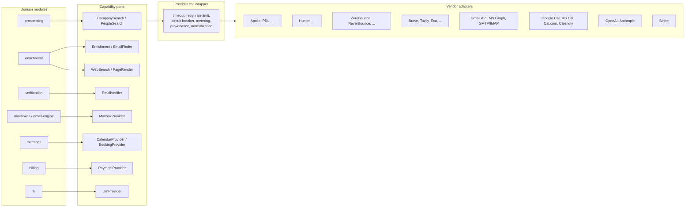
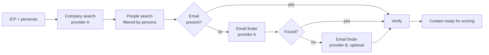

# Third-party Integrations

> Status: **Proposed. Awaiting approval.** Synced with PRD v2.0 on 2026-11-26 (startup defaults D2–D4, D8, D11).
> Provider names are **candidates**. Before building an adapter, confirm current API capabilities, pricing, rate limits and **terms of service** (especially data reuse, storage and resale clauses) and record the outcome in §10.
> Related: [ARCHITECTURE.md](ARCHITECTURE.md) §6.3 rule 5 · [SECURITY.md](SECURITY.md) §6

---

## 1. Integration Principles

1. **Ports and adapters.** Domain modules depend on capability interfaces (`PeopleSearchProvider`, `EmailVerifier`, `MailboxProvider`, ...), never on vendor SDKs. Adapters live in `platform/integrations/providers/<vendor>/` (or `modules/<x>/infrastructure/` for module-specific ones).
2. **One wrapper for all outbound provider calls.** It applies:
   - timeout (default 15 s),
   - retries with exponential backoff and jitter on 429/5xx/network errors (honoring `Retry-After`),
   - a **shared rate limiter** in Valkey per `(provider, credential)`, because provider limits are per key, not per process,
   - a circuit breaker per provider (opens after N consecutive failures, half-opens after a cool-down, raises an alert),
   - **cost metering** to `usage_records`, with credits reserved before the call and settled after,
   - **provenance recording** to `data_provenance` for any personal or company data received,
   - structured logging without PII,
   - response normalization into internal DTOs (Zod-validated).
3. **Credentials** live only in `integration_connections` (encrypted) or server env (platform keys). They never appear in job payloads or the browser.
4. **Respect provider terms.** No caching, sharing or resale beyond what the contract allows. Flags per provider (`cacheTtl`, `crossTenantShareAllowed=false`, `storeAllowed`) live in the adapter config.
5. **Fakes for every port.** Each capability has an in-memory fake used in unit and integration tests and in local development (`INTEGRATIONS_MODE=fake`).
6. **Inbound webhooks** use the shared intake (signature check, `webhook_events`, async processing). See SECURITY.md §7.6.



---

## 2. Integration Catalog

| Category | Purpose | MVP candidate(s) | Alternatives | Phase | Credential model |
|----------|---------|-----------------|--------------|-------|-----------------|
| **LLM** | Extraction, ICP, copy, classification | Anthropic (Claude) **and** OpenAI behind `AiGateway` | Others via new adapter | 0–1 | Platform-managed |
| **Website fetching** | Crawl customer site, company homepages | Native `fetch` via SafeFetch + `cheerio` + `@mozilla/readability` | Hosted renderer (Firecrawl, ScrapingBee) for JS-heavy sites | 1 | n/a / platform |
| **Web search** | News, triggers, lookalike discovery | Brave Search API **or** Tavily | Exa, SerpAPI | 2 | Platform-managed |
| **Company and people data** | Discovery and enrichment | Apollo.io API (people and organization search, enrichment) | People Data Labs, Lusha, Snov.io, Crunchbase (firmographics) | 2 | **BYOK first** (§8) |
| **Email finding** | Find business email for a person at a domain | Hunter.io (domain search, email finder) | Provider-native (Apollo), Snov.io, Dropcontact | 2 | BYOK |
| **Email verification** | Validate deliverability before sending | **Lowest-cost reliable verifier**: MillionVerifier **or** Bouncer (evaluate accuracy on a labeled sample) | ZeroBounce, NeverBounce, Kickbox | 2 | Platform-managed, 1 credit per email (target cost ≤ $0.004) |
| **Local business discovery** | SMB targets (agencies, clinics, trades) | Google Places API (New): text search | Yelp Fusion | Later | Platform-managed. ToS limits storage |
| **Technographics** | Tech-stack signals | (provider-native fields first) | BuiltWith, Wappalyzer API | Later | BYOK |
| **Mailbox: generic** (launch priority 1) | Any host, **including Gmail and Google Workspace via app passwords**, Zoho, Outlook.com, Fastmail, cPanel/Hostinger mail | SMTP (`nodemailer`) + IMAP (`imapflow`) | n/a | 3 (MVP) | Per-user credentials |
| **Mailbox: Microsoft 365** (launch priority 1) | Send and sync replies | Microsoft Graph Mail (OAuth 2.0) | n/a | 3 (MVP) | Per-user OAuth |
| **Mailbox: Google (OAuth)** (priority 2) | Send and sync replies | Gmail API (OAuth 2.0) in Google **testing mode** for allow-listed beta users | IMAP/SMTP with app password | 3 (limited), V1 GA after verification + CASA | Per-user OAuth |
| **Transactional email** | Invites, resets, alerts (not outreach) | **Amazon SES** (lowest cost) **or Resend** (free tier, simplest setup) | Postmark, Mailgun | 0 | Platform-managed |
| **Calendar** | Free/busy, create events | Google Calendar API, Microsoft Graph Calendar | n/a | 4 | Per-user OAuth |
| **Booking links** | Prospect self-booking | Cal.com (API + webhooks), Calendly (API + webhooks) | Any URL (no sync) | 4 | Per-workspace |
| **Billing** | Subscriptions, credit packs, invoices, tax | Stripe (Checkout, Billing, Customer Portal, Tax, webhooks) **if available in the company's country** | Paddle or Lemon Squeezy as merchant of record (handles global VAT, works from more countries) | 5 (**MVP**) | Platform |
| **CRM** | Push meetings and leads, pull exclusions | HubSpot | Pipedrive, Salesforce | Later | Per-workspace OAuth |
| **Error monitoring** | Errors and performance | Sentry (free/developer tier) | GlitchTip (self-host) | 0 | Platform |
| **Logs, metrics, uptime** | Observability | Better Stack **or** Grafana Cloud (free tiers), UptimeRobot for uptime | Self-host on a bigger box | 0 | Platform |
| **DNS / CDN** | Domains, DNS, optional proxy | Cloudflare (free plan) | Registrar DNS | 0 | Platform |
| **Object storage** | Backups, imports and exports | Cloudflare R2 **or** Backblaze B2 (S3-compatible) | AWS S3, Hostinger object storage | 0 | Platform |

---

## 3. LLM Providers

- **Adapters:** official SDKs (`@anthropic-ai/sdk`, `openai`) wrapped as `LlmProvider`:

```ts
interface LlmProvider {
  readonly key: 'anthropic' | 'openai';
  generate(req: LlmRequest): Promise<LlmResponse>;           // messages, schema (JSON), maxTokens, temperature
  submitBatch?(reqs: LlmRequest[]): Promise<ProviderBatch>;  // async bulk, discounted
  getBatch?(id: string): Promise<ProviderBatchResult>;
  countTokens?(req: LlmRequest): Promise<number>;
}
```

- **Structured output:** use each provider's native JSON-schema or tool-based structured output, then **always** validate with Zod. On validation failure, retry once with a repair prompt containing the error, then fail as `INVALID_OUTPUT`.
- **Prompt caching:** order prompts as stable system prompt → workspace/campaign context → per-item variables, so provider-side caching can apply to the shared prefix.
- **Batch:** draft generation for large enrollments and nightly re-scoring use provider batch APIs where available (results polled by a `maintenance` job).
- **Fallback:** on provider outage or open circuit, route to the fallback provider in the tier config. Record `provider`/`model` per `ai_runs` row.
- **Pricing table:** per-model token prices live in `config/ai-pricing.yaml` (input, cached input, output, batch discount) so costs are computed in-house. Review monthly.
- **Model IDs** are configured per environment (ARCHITECTURE.md §12.2). Never hard-code them in modules.

---

## 4. Prospect Data

### 4.1 Ports

```ts
interface CompanySearchProvider {
  searchCompanies(q: CompanyQuery, ctx: ProviderContext): Promise<Page<CompanyCandidate>>;
  estimate?(q: CompanyQuery, ctx: ProviderContext): Promise<{ total: number; credits: number }>;
}
interface PeopleSearchProvider {
  searchPeople(q: PeopleQuery, ctx: ProviderContext): Promise<Page<PersonCandidate>>; // often without emails
}
interface EnrichmentProvider {
  enrichPerson(input: PersonLookup, ctx: ProviderContext): Promise<EnrichedPerson | null>;
  enrichCompany(input: { domain: string }, ctx: ProviderContext): Promise<EnrichedCompany | null>;
}
interface EmailFinderProvider {
  findEmail(input: { firstName: string; lastName: string; domain: string }, ctx: ProviderContext)
    : Promise<{ email: string; confidence: number } | null>;
}
```

`CompanyQuery` and `PeopleQuery` are **our** normalized vocabulary (industries, employee ranges, countries, titles, seniorities, departments, technologies, keywords). The ICP module stores per-provider mapped filters in `icps.provider_filters`, generated by the Search Planner and editable by the user.

### 4.2 Waterfall



- The waterfall order is per-workspace configuration. It stops at the first verified result to save credits.
- Before any paid call: dedupe against existing `contacts` and `companies`, check `suppressions` (email hash and domain), check ICP exclusions and the country policy.
- Credit estimate shown to the user before large runs. A `CONFIRM_SPEND` task is created above the workspace's threshold.

### 4.3 Rules

- Store only the fields we use (DATABASE_DESIGN.md §5.3). Trim raw payloads.
- Record `data_provenance` for every contact and company field set.
- Honor provider-specific storage and refresh terms (for example, max cache TTL or attribution requirements).
- **Excluded sources:** LinkedIn scraping or automation, browser-extension scraping, purchased or rented lists, and any provider unable to state its lawful sourcing.

---

## 5. Email Verification

```ts
interface EmailVerifier {
  verify(email: string, ctx: ProviderContext): Promise<VerificationResult>;
  verifyBatch?(emails: string[], ctx: ProviderContext): Promise<{ batchId: string }>;
  getBatch?(batchId: string, ctx: ProviderContext): Promise<VerificationResult[] | 'PENDING'>;
}
type VerificationResult = {
  email: string;
  result: 'VALID' | 'INVALID' | 'CATCH_ALL' | 'UNKNOWN' | 'DISPOSABLE' | 'ROLE';
  subStatus?: string; // provider detail, e.g. mailbox_not_found, spamtrap, abuse
  raw?: unknown;      // trimmed
};
```

- **Send policy:** `VALID` is sent. `CATCH_ALL` is sent only if the campaign opts in, capped at 10% of daily volume by default. `UNKNOWN` is re-checked once after 24 h. `INVALID`, `DISPOSABLE` and spam-trap or abuse sub-statuses are suppressed. `ROLE` (info@, sales@) is excluded by default.
- Batch endpoints for imports over 100 rows. Single verification for just-in-time checks.
- **We never perform SMTP RCPT probing from our own servers.** It harms IP reputation, outbound port 25 is commonly blocked on VPS hosts, and it gives unreliable results on catch-all domains.

---

## 6. Mailboxes

### 6.1 Port

```ts
interface MailboxProvider {
  readonly kind: 'GOOGLE' | 'MICROSOFT' | 'SMTP_IMAP';
  verifyConnection(ctx: MailboxContext): Promise<ConnectionHealth>;
  send(mime: OutboundMessage, ctx: MailboxContext): Promise<{ providerMessageId: string; providerThreadId?: string }>;
  syncSince(cursor: SyncCursor | null, ctx: MailboxContext): Promise<{ messages: InboundMessage[]; nextCursor: SyncCursor }>;
  findSentByMessageId(rfcMessageId: string, ctx: MailboxContext): Promise<boolean>; // crash reconciliation
  refreshCredentials?(ctx: MailboxContext): Promise<void>;
}
```

MIME is composed in-house (`nodemailer` MailComposer) with a deterministic `Message-ID`, `In-Reply-To`/`References` for follow-ups, `List-Unsubscribe` and `List-Unsubscribe-Post`. It is then submitted raw (Gmail `users.messages.send` with `raw`, Graph `sendMail` or MIME upload, SMTP `DATA`).

### 6.2 Google Workspace (Gmail API)

| Item | Detail |
|------|--------|
| Scopes | `gmail.send` (classified *sensitive*) to send. Reading replies needs `gmail.readonly` or `gmail.modify` (classified *restricted*). Plus `openid email profile` |
| **Verification** | Sensitive scopes need Google OAuth app verification. **Restricted scopes also need an annual third-party security assessment (CASA)**, which has a cost and takes several weeks. Until verified, the app is limited to a small number of test users and shows an "unverified app" warning |
| Sync | Polling `users.history.list` from the stored `historyId` every 2–5 min. Full resync if the history ID expires. Push via `users.watch` + Cloud Pub/Sub later |
| Limits | Per-user sending limits apply (Workspace daily limits). Our caps are far below them. Handle `429` and `403 rateLimitExceeded` by pausing the mailbox |
| Fallback | IMAP/SMTP with an app password where the Workspace admin allows it |

> **Startup approach (AD-20):** at launch the Gmail OAuth app stays in Google **testing mode**, usable only by allow-listed test users (design partners). Everyone else connects Gmail or Google Workspace through **SMTP/IMAP with an app password** (requires 2-Step Verification and an admin policy that allows it), and the UI guides them through it. Complete Google brand verification early (needed for Google sign-in branding). Defer the restricted-scope verification **and the paid CASA assessment** until revenue justifies it (V1 target), then make Gmail OAuth generally available.

### 6.3 Microsoft 365 (Graph)

| Item | Detail |
|------|--------|
| Scopes (delegated) | `Mail.Send`, `Mail.ReadWrite` (or `Mail.Read`), `offline_access`, `User.Read` |
| App registration | Multi-tenant Entra ID app. **Publisher verification** recommended, because many tenants restrict user consent to verified publishers or require admin consent |
| Sync | Delta query on Inbox and SentItems (`/messages/delta`) every 2–5 min. Change-notification subscriptions later (need renewal and a public endpoint) |
| Note | Exchange Online is retiring Basic-auth SMTP AUTH. Use Graph with OAuth for M365, not SMTP passwords |

### 6.4 Generic SMTP/IMAP

- SMTP submission over 465 (implicit TLS) or 587 (STARTTLS). TLS is required and certificates are validated.
- IMAP polling with `UIDVALIDITY` + last UID cursor on INBOX (and Sent for reconciliation). No long-lived IDLE connections on KVM 2.
- The connection test on save covers SMTP auth, IMAP login and a no-op send to self (optional).
- **Presets** (PRD MBX-02): Gmail/Google Workspace (`smtp.gmail.com:465`, `imap.gmail.com:993`, app password required), Outlook.com, Zoho, Hostinger mail, Fastmail, generic. Errors are mapped to specific messages (wrong password, app password required, TLS failure, host unreachable).

### 6.5 DNS health checks (no third party)

Node `dns/promises` lookups for SPF (`TXT v=spf1`, include the provider), DMARC (`_dmarc` TXT, policy), DKIM (`<selector>._domainkey`, known selectors: Google `google`, Microsoft `selector1`/`selector2`, plus user-supplied ones) and MX. Results are stored on `sending_domains` with fix-it instructions in the UI.

---

## 7. Calendars, Booking and Meetings

```ts
interface CalendarProvider {
  getFreeBusy(range: { from: Date; to: Date }, ctx: CalendarContext): Promise<BusyInterval[]>;
  createEvent(evt: NewEvent, ctx: CalendarContext): Promise<{ externalEventId: string; meetingUrl?: string }>;
}
interface BookingProvider {
  verifyWebhook(rawBody: Buffer, headers: Headers): boolean;
  parseWebhook(payload: unknown): BookingEvent; // created, rescheduled, canceled
}
```

- **MVP (Phase 4):** booking-link mode. The workspace and each user set a booking link (Cal.com, Calendly or any URL), and the reply assistant drafts a response with the link. Meetings are logged manually from the thread or lead (PRD MTG-01, MTG-02). No calendar or booking API integration is needed for launch.
- **V1:** booking webhooks (Cal.com, Calendly) create or update `meetings` automatically and stop the enrollment. Attendees are matched by email to contacts (PRD MTG-03).
- **V1:** slot proposals. Read free/busy from the user's connected Google or Microsoft calendar and propose 2–3 slots in the prospect's timezone. On confirmation the user (not AI) sends the invite via `createEvent`.

---

## 8. Credential Model: Platform-managed vs BYOK

| Model | What it means | Pros | Cons |
|-------|--------------|------|------|
| **BYOK** | Customer connects their own provider account and API key | Customer is the provider's licensee (clean licensing). No data-resale agreements needed. Our cost risk is zero | More setup friction. Feature depth varies by customer plan |
| **Platform-managed** | We hold the provider contract and resell usage as credits | Smooth onboarding. Single bill | Many data providers prohibit resale without a partner or reseller agreement. Cost and fraud risk. Margin management |

**Decision (PRD D2/D3):**
- **Data providers (discovery, enrichment, email finding): BYOK + CSV import at launch.** They cost **0 platform credits**, because the customer's provider bills them directly. Platform-managed data comes later, only with explicit reseller or partner agreements.
- **Email verification, web search/research, LLMs: platform-managed**, paid with credits (PRD §8.4) and recorded in `usage_records`. Reply classification is free.

---

## 9. Billing (Stripe, or a merchant of record) [MVP]

Plans, limits and credit costs are defined in PRD §8 and mirrored in `platform/billing/plans.ts`.

| Flow | Implementation |
|------|---------------|
| Trial | No payment provider involved. `workspaces.trial_ends_at` + a `TRIAL` credit grant of 150 credits |
| Subscribe | Hosted Checkout (`mode=subscription`) with monthly and annual prices per plan, plus quantity-based add-ons for extra seats and mailboxes |
| Manage | Customer Portal for payment method, invoices, cancellation and plan switch. Upgrades are prorated immediately. Downgrades take effect at period end (PRD BIL-02) |
| Plan credits | On `invoice.paid` for a subscription period, create a `PLAN` credit grant (`external_ref` = invoice id) expiring at period end |
| Credit packs | Hosted Checkout (`mode=payment`) for 1k/5k/20k/100k packs. On `checkout.session.completed` (paid), create a `PACK` grant valid for 12 months (`external_ref` = session id) |
| Failed payment | On `invoice.payment_failed`, set `PAST_DUE` with a 7-day grace period (`grace_period_ends_at`), then campaigns pause with `PAST_DUE`. Data is kept (PRD BIL-05) |
| Cancellation | `customer.subscription.deleted` at period end → workspace `READ_ONLY` for 30 days (PRD BIL-06) |
| Tax | Stripe Tax for VAT/GST/sales tax where registered. A merchant of record handles this automatically |
| Overage | **None in MVP.** Limits stop usage and prompt an upgrade or pack purchase. No surprise bills |

All webhooks are signature-verified and idempotent (SECURITY.md §7.6–7.7). If Stripe is not available in the company's country, the same flows map onto Paddle or Lemon Squeezy (checkout, subscriptions, one-time products, webhooks) behind the `PaymentProvider` port.

---

## 10. Provider Evaluation Checklist

Complete one entry per provider before building its adapter:

| Criterion | Notes |
|-----------|-------|
| API capability fit | Endpoints, filters, field coverage for target markets |
| Data sourcing and lawful basis | How the provider collects data. GDPR/CCPA posture. DPA available |
| ToS: storage, caching, display, resale, AI use | Allowed retention, cross-customer sharing, whether data may be sent to LLMs |
| Pricing and credit model | Per call or record, minimums, overage |
| Rate limits | Per key, per minute or day, concurrency |
| Reliability | Status page, SLA |
| Webhooks and batch | For async workloads |
| Sandbox or test keys | For CI and staging |
| Security | SOC 2 / ISO 27001, key scoping, IP allowlisting |
| Decision | Adopt / Reject / Later, with date and owner |

### Decision register

| Provider | Category | Status | Date | Notes |
|----------|----------|--------|------|-------|
| _tbd_ | | | | |

---

## 11. Long-lead Items (start early)

| Item | Why | Start by |
|------|-----|----------|
| Google brand verification (sign-in consent screen) + Gmail OAuth app in testing mode | Google sign-in branding. Gmail OAuth for allow-listed design partners | Phase 1 |
| Gmail restricted-scope verification + CASA assessment | Gmail OAuth for everyone. **Deferred until revenue justifies it** (AD-20) | V1 |
| Microsoft Entra app + publisher verification | Avoids consent blocks in M365 tenants. Free, but takes days | Phase 1 |
| Data-provider accounts and API access (first BYOK adapter) | Some APIs require paid plans or sales contact | Phase 1 |
| Transactional email domain setup (SPF/DKIM/DMARC for the platform domain, SES production access request) | Invites and resets must deliver | Phase 0 |
| Stripe account + Stripe Tax (or merchant-of-record application) | **Billing ships in MVP** (Phase 5). Merchant-of-record approval can take 1–2 weeks | Phase 2 |
| Legal docs (ToS incl. subscription and credit terms, AUP, Privacy, DPA, sub-processors) | Needed for OAuth branding, billing and launch | Phase 1–2 |
