# Product Requirements Document (PRD)

> **Product:** Lead Generation Agent (working name). AI lead generation and outreach SaaS
> **Version:** 2.0 · **Date:** 2026-11-26 · **Status:** Draft for approval
> **Owner:** Product · **Related:** [ARCHITECTURE.md](ARCHITECTURE.md) · [DATABASE_DESIGN.md](DATABASE_DESIGN.md) · [SECURITY.md](SECURITY.md) · [INTEGRATIONS.md](INTEGRATIONS.md) · [ROADMAP.md](ROADMAP.md)
>
> Priority legend: **MVP** = required for launch (paid private beta) · **V1** = within ~3 months after launch · **Future** = backlog.
> This document defines *what* and *why*. It does not implement features.

---

## Table of Contents

1. [Product Overview](#1-product-overview)
2. [Startup Decisions (resolved defaults)](#2-startup-decisions-resolved-defaults)
3. [Target Customers](#3-target-customers)
4. [User Roles and Permissions](#4-user-roles-and-permissions)
5. [End-to-End User Journey](#5-end-to-end-user-journey)
6. [Features and Acceptance Criteria](#6-features-and-acceptance-criteria)
7. [MVP vs Future Scope](#7-mvp-vs-future-scope)
8. [Subscription Plans, Usage Limits and Credits](#8-subscription-plans-usage-limits-and-credits)
9. [UI States: Empty, Loading, Error, Success](#9-ui-states-empty-loading-error-success)
10. [Responsive UI Requirements](#10-responsive-ui-requirements)
11. [Non-functional Requirements](#11-non-functional-requirements)
12. [Compliance Requirements](#12-compliance-requirements)
13. [Success Metrics](#13-success-metrics)
14. [Out of Scope](#14-out-of-scope)
15. [Open Questions and Impacts on Other Docs](#15-open-questions-and-impacts-on-other-docs)
16. [Glossary](#16-glossary)

---

## 1. Product Overview

### 1.1 Problem

B2B businesses and agencies lose many hours a week on prospecting: deciding who to target, finding decision-makers, getting correct emails, writing relevant messages, following up and sorting replies. Today's options are expensive data platforms without strategy, or sending tools without targeting or personalization. Used carelessly, they burn sending domains and create legal exposure.

### 1.2 Solution

An AI prospecting assistant that:

1. **Reads the customer's website** and works out what they sell.
2. **Proposes an Ideal Customer Profile (ICP)** with reasoning.
3. **Finds and verifies decision-makers** through approved data sources.
4. **Scores and prioritizes** leads with explainable scores.
5. **Writes personalized emails** grounded in real, sourced facts.
6. **Runs compliant sequences** from the customer's own mailboxes.
7. **Sorts replies** and helps turn interest into **booked meetings**.
8. **Reports** what works and what it costs.

### 1.3 Product principles

1. **Strategy before volume.** A sharp ICP and relevant copy beat send counts.
2. **Human approval by default.** AI drafts, humans approve anything that leaves the building.
3. **Explainable AI.** Every ICP, score and email shows its reasoning and sources.
4. **Deliverability and compliance are features.** Safe defaults that the user cannot silently bypass.
5. **Customer-owned assets.** The customer's mailboxes, domains and data-provider accounts.
6. **Lean to run.** Every feature must be affordable to operate at startup scale (see §2).

---

## 2. Startup Decisions (resolved defaults)

These resolve the open questions in ARCHITECTURE.md §19 with the **lowest-cost, lowest-risk option that still gives a good product**. Each can be revisited later.

| # | Question | Decision for launch | Why it's right for a startup |
|---|----------|--------------------|-----------------------------|
| D1 | Tenant model and agencies | **Workspace = tenant.** A user can belong to many workspaces. Agencies manage multiple clients as **Business Profiles inside one workspace**. Client logins and white-label are Future. | One tenancy level is simpler, cheaper and faster to build. Agencies still get per-client separation of ICPs, mailboxes and campaigns. |
| D2 | Prospect data source | **BYOK** (customer connects their own data-provider API key) **plus CSV import**. No platform-resold contact data. | Zero data-licensing contracts, zero data cost risk, no reseller agreements. |
| D3 | Verification, AI, research | **Platform-managed and paid with credits** (§8). Use the lowest-cost reliable verifier and cheap "fast" AI models where quality allows. | Small per-unit cost with a healthy margin. A simple user experience. |
| D4 | Mailbox providers | **Launch with SMTP/IMAP (any host, including Gmail and Google Workspace via app passwords where allowed) and Microsoft 365 (OAuth).** Gmail OAuth runs in Google "testing" mode until verification. The paid Google security assessment is deferred until revenue justifies it. | Avoids weeks of delay and a security-assessment fee before launch. |
| D5 | Autonomy | **Approve every email (L1) by default.** "Manual" (L0) is also available. Sample approval (L2) is V1. | Protects customers' domains and our reputation. Builds trust. |
| D6 | AI providers | One primary provider (picked by a Phase 0 cost and quality eval) and the other as automatic fallback, with task-based model tiers. | Avoids lock-in without paying for two full integrations' worth of complexity in prompts. |
| D7 | Authentication | **Built into the backend** (sessions, email/password, Google and Microsoft login). No paid auth vendor. | No per-user auth fees. Full control. |
| D8 | Billing | **Stripe Checkout, Customer Portal and Stripe Tax** if Stripe supports the company's country. Otherwise a merchant of record (Paddle or Lemon Squeezy). **Self-serve billing is in MVP.** | Revenue from day one. Stripe has the lowest fees. A merchant of record removes VAT work where Stripe isn't available. |
| D9 | Free trial | **14-day trial, no card required**, with tight sending limits (1 mailbox, 100 emails total, 150 credits). | Low signup friction while limiting spam abuse. |
| D10 | Staging environment | **No separate staging VPS at launch.** A scaled-down staging stack runs on the same VPS during release windows only. Most testing happens in CI and local Docker. | Saves the cost of a second server. Upgrade when revenue allows. |
| D11 | Supporting services | Free or low tiers: Sentry (errors), Better Stack or Grafana Cloud (logs and uptime), Cloudflare R2 or Backblaze B2 (backups), Amazon SES or Resend (system emails), Cloudflare DNS. | Near-zero monthly tooling cost. |
| D12 | CRM | **Not at launch.** CSV export of leads and meetings instead. HubSpot is first in V1. | Avoids integration work before product-market fit. |
| D13 | Open/click tracking | **Off by default.** Available per campaign in V1. | Better deliverability. Reply rate is the real metric. |
| D14 | Markets | **English-language UI. Launch markets US, UK, Canada, Australia and Ireland.** Other countries are allowed only under the country policy (§12). Strict-consent countries (for example Germany) are blocked by default. | The clearest legal ground for B2B cold email. Lower legal cost at launch. |
| D15 | Languages for outreach | English at launch. Multi-language generation in V1. | Focus. |

---

## 3. Target Customers

### 3.1 Segments

| Segment | Profile | Main jobs to be done | Key pains | Must-have features | Plan fit |
|---------|---------|---------------------|-----------|--------------------|----------|
| **Marketing agencies** | 3–50 staff, selling SEO, ads, web or content services to SMBs. Need their *own* pipeline and sometimes run outreach for clients | Keep a steady flow of new client meetings. Run outreach for some clients | Inconsistent pipeline. Generic outreach gets ignored | Website-to-ICP, personalization, multiple business profiles, reply triage | Growth / Agency |
| **Sales teams** | SDR/AE teams of 2–20 at B2B companies | Hit meeting quotas. Prioritize the best accounts | Manual research. Low reply rates. Messy inbox | Scoring, sequences, mailbox rotation, unified inbox, analytics per rep | Growth |
| **Freelancers** | Solo consultants, developers, designers, copywriters | Win 2–5 new clients a month without hours of prospecting | No time, no sales skills, small budget | Guided onboarding, AI copy, simple campaigns, low price | Starter |
| **Startups** | Founders doing sales before hiring an SDR | Find first 10–100 customers. Test ICP hypotheses | Don't know the exact ICP. Founder time is scarce | ICP generation with rationale, fast experiments, analytics by ICP | Starter / Growth |
| **B2B companies** | SMB/mid-market companies with a marketing or sales function | Predictable outbound alongside inbound | Tool sprawl. Compliance worries | Compliance controls, roles, approvals, analytics | Growth |
| **Lead generation agencies** | Agencies whose core service is booking meetings for clients | Run many client campaigns efficiently and prove results | Managing many clients' mailboxes, domains, copy and reporting | Business profiles per client, many mailboxes, approvals, per-client reports | Agency |

### 3.2 Primary launch segments

**Freelancers, startups and marketing agencies.** They have the shortest sales cycles, self-serve buying and strong word of mouth. Lead-generation agencies are the second wave, once agency reporting (V1) exists.

### 3.3 Anti-personas (we do not serve)

- Bulk senders who want to send purchased lists or high-volume blasts.
- B2C marketers (consumer emails).
- Anyone needing LinkedIn automation or scraping.

---

## 4. User Roles and Permissions

### 4.1 Role definitions

| Role | Scope | Who | Summary |
|------|-------|-----|---------|
| **Platform Super Admin** | Whole platform | Internal staff only | Operates the SaaS. Manages workspaces, plans, abuse, kill switches, support access. Cannot be granted from the product UI. |
| **Workspace Owner** | One workspace | The person who created the workspace (transferable) | Full control including billing, deletion and ownership transfer. Exactly one Owner per workspace. |
| **Workspace Admin** | One workspace | Team leads, ops managers, agency account managers | Manages members, integrations, mailboxes, compliance and approvals. No billing ownership or deletion. |
| **Team Member** | One workspace | SDRs, freelancers' assistants, agency staff | Does the daily work: prospects, campaigns, drafts, inbox. Launching a campaign needs approval when the workspace requires it. |

A user can hold different roles in different workspaces.

### 4.2 Permission matrix

| Capability | Super Admin | Owner | Admin | Member |
|-----------|:-----------:|:-----:|:-----:|:------:|
| View all workspaces, suspend or restore workspaces, adjust credits | ✅ | — | — | — |
| Global kill switches (pause sending, disable AI or a provider) | ✅ | — | — | — |
| Support impersonation (read-only, time-boxed, audited, visible to workspace) | ✅ | — | — | — |
| Delete workspace, transfer ownership | — | ✅ | — | — |
| Manage subscription, payment method, invoices, buy credits | — | ✅ | — | — |
| Invite or remove members, change roles (not Owner) | — | ✅ | ✅ | — |
| Workspace settings (name, address, privacy notice, defaults) | — | ✅ | ✅ | — |
| Connect data-provider keys (BYOK), calendars, booking tools | — | ✅ | ✅ | — |
| Connect **own** mailbox | — | ✅ | ✅ | ✅ |
| Manage or disconnect **any** mailbox, sending domains | — | ✅ | ✅ | — |
| Compliance: suppression list, country policy, DSAR requests | — | ✅ | ✅ | — |
| View audit log | — | ✅ | ✅ | — |
| Export contacts and leads (CSV) | — | ✅ | ✅ | — |
| Create and edit business profiles, run website analysis | — | ✅ | ✅ | ✅ |
| Generate, edit and activate ICPs | — | ✅ | ✅ | ✅ |
| Run discovery, import CSV, enrich, verify (spends credits) | — | ✅ | ✅ | ✅ |
| Create and edit campaigns, generate and edit drafts | — | ✅ | ✅ | ✅ |
| Approve email drafts | — | ✅ | ✅ | ✅ (own campaigns) |
| **Launch** campaign | — | ✅ | ✅ | ✅ only if "launch approval" is off. Otherwise submits for approval |
| **Approve** campaign launch requests | — | ✅ | ✅ | — |
| Reply from inbox, reassign threads, override classifications | — | ✅ | ✅ | ✅ |
| View analytics | — | ✅ | ✅ | ✅ |

Rules:
- A workspace always has exactly one Owner. Transferring ownership turns the old Owner into an Admin.
- Admins cannot remove or demote the Owner, or other Admins' access to billing (which they don't have).
- Role changes take effect on the user's next request and are audited.
- Super Admin access to customer data happens only through audited impersonation.
- Future: **Viewer/Client** role (read-only analytics, optionally restricted to one business profile) for agency clients.

---

## 5. End-to-End User Journey

```mermaid
flowchart LR
    A["1 Register"] --> B["2 Verify email"]
    B --> C["3 Create workspace"]
    C --> D["4 Business onboarding"]
    D --> E["5 Website analysis"]
    E --> F["6 ICP generation"]
    F --> G["7 Lead discovery"]
    G --> H["8 Enrichment and verification"]
    H --> I["9 Lead scoring"]
    I --> J["10 Campaign creation"]
    J --> K["11 Campaign approval"]
    K --> L["12 Email sending"]
    L --> M["13 Reply management"]
    M --> N["14 Meeting booking"]
    N --> O["15 Analytics"]
    O -. "learn and refine ICP" .-> F
```

**Target:** a new user reaches stage 12 (first approved email scheduled) within **30 minutes** of registering, given a connected mailbox and a data source.

| # | Stage | User goal | What the user does | What the system does | Done when |
|---|-------|-----------|--------------------|----------------------|-----------|
| 1 | **Registration** | Create an account | Signs up with email + password, Google or Microsoft. Accepts Terms and AUP | Validates input, checks for breached passwords, creates the user, sends a verification email (email signup only) | Account exists. User sees "Check your email" |
| 2 | **Email verification** | Prove email ownership | Clicks the link in the email (valid 24 h) or requests a new one | Marks the email verified. Google and Microsoft sign-ups are auto-verified | User lands on workspace creation |
| 3 | **Workspace creation** | Set up the team space | Enters workspace name, company website, timezone. Optionally invites teammates | Creates the workspace with the user as Owner, starts the 14-day trial, applies the default country policy | Workspace dashboard with onboarding checklist |
| 4 | **Business onboarding** | Tell the system about the business | Confirms company name, website, physical address (required for email footers), privacy-notice URL, and what they want (meetings, demos, calls) | Saves the business profile, shows the onboarding checklist | Profile basics saved |
| 5 | **Website analysis** | Let AI understand the business | Starts analysis and watches progress | Crawls up to 25 pages, extracts the summary, offerings, value proposition, industries served, proof points and tone | User reviews, edits and confirms the profile |
| 6 | **ICP generation** | Know who to target | Reviews 1–3 proposed ICPs, edits filters and personas, activates one | Generates ICPs with rationale, personas, triggers and exclusions | One ICP is **Active** |
| 7 | **Lead discovery** | Get a list of prospects | Connects a data-provider key (BYOK) **or** uploads a CSV. Reviews the search filters and estimate, then runs discovery | Converts the ICP to provider filters, shows estimated results, imports and deduplicates companies and contacts, skips suppressed ones | Contacts appear in the Prospects view |
| 8 | **Lead enrichment** | Complete missing data | Runs enrichment and verification (automatic by default) | Finds missing emails (BYOK), verifies emails (credits), adds company facts with sources for top leads | Contacts show verified email status |
| 9 | **Lead scoring** | Focus on the best leads | Reviews tiers A–D and breakdowns. Overrides or disqualifies | Scores fit, persona match and data quality. Assigns tiers | Leads are ranked and ready to enroll |
| 10 | **Campaign creation** | Build the outreach | Picks ICP, offering, leads, mailbox(es), schedule. Reviews the AI-built 3–4 step sequence | Generates sequence and personalized drafts, runs quality checks (lint) | Campaign in **Draft** with drafts ready for review |
| 11 | **Campaign approval** | Make sure everything is right | Approves, edits or regenerates drafts. Submits for launch approval (Members) or launches (Owner/Admin) | Runs launch checks (domain records, mailbox health, footer data, approvals). Notifies approvers | Campaign is **Scheduled** or **Active** |
| 12 | **Email sending** | Reach prospects safely | Monitors progress. Pauses or resumes | Sends within windows, caps and spacing. Follow-ups thread as replies. Stops on reply, bounce or unsubscribe | Emails sent and logged |
| 13 | **Reply management** | Handle responses fast | Opens the inbox, reads AI-categorized replies, sends suggested responses | Syncs replies (≤5 min), classifies them, auto-handles unsubscribes, bounces and out-of-office replies, drafts suggested responses | Replies are answered or closed |
| 14 | **Meeting booking** | Turn interest into meetings | Sends a booking link or proposes times. Logs the meeting | Inserts the booking link. Records the meeting from a booking webhook (V1) or manually. Stops the sequence | Meeting recorded and linked to lead and campaign |
| 15 | **Analytics** | Learn what works | Reviews the dashboard and campaign reports | Shows sends, replies, positive replies, meetings, bounces, and cost per meeting (V1) | User adjusts ICP or copy and repeats |

---

## 6. Features and Acceptance Criteria

Acceptance criteria (AC) are written to be testable. "User" means any role allowed by §4.2 unless stated otherwise.

### 6.1 Authentication and account (`AUTH`)

**AUTH-01 Email registration** (MVP)
- AC1: The user can register with name, email and password (12–128 chars). A password found in a known breach list is rejected with a clear message.
- AC2: The user must tick acceptance of the Terms of Service, Privacy Policy and Acceptable Use Policy. The acceptance version and time are stored.
- AC3: Registering with an existing email shows the same "Check your email" screen. No account enumeration happens, and the existing owner receives a "someone tried to sign up" email.
- AC4: More than 5 sign-up attempts per IP per hour are rate-limited with a friendly error.

**AUTH-02 Email verification** (MVP)
- AC1: A single-use verification link valid for 24 hours is sent within 1 minute.
- AC2: An expired or used link shows an error with a "Send a new link" button (limited to 3 per hour).
- AC3: Unverified users can sign in, but cannot create campaigns, connect mailboxes or spend credits. A banner explains why.

**AUTH-03 Google and Microsoft sign-in** (MVP)
- AC1: The user can sign up or sign in with Google or Microsoft. The account email is treated as verified.
- AC2: If a password account exists with the same verified email, the identity is linked after the user confirms their password.
- AC3: Mailbox access is **not** requested at sign-in. It is a separate step (MBX-01/02).

**AUTH-04 Login and sessions** (MVP)
- AC1: A successful login creates a session valid for 7 days of inactivity (30 days maximum).
- AC2: After 5 failed attempts within 15 minutes for an account, further attempts are delayed, with a generic error message.
- AC3: The user can view active sessions (device, location estimate, last active) and sign out any or all of them.
- AC4: A login from a new device sends a notification email.

**AUTH-05 Password reset** (MVP)
- AC1: A reset link (valid 30 minutes, single use) is sent if the account exists. The response is the same either way.
- AC2: A successful reset signs out all other sessions and sends a confirmation email.

**AUTH-06 Profile settings** (MVP)
- AC1: The user can change name, timezone and password (current password required).
- AC2: Changing email requires re-verification of the new address and notifies the old address.

**AUTH-07 Two-factor authentication (TOTP)** (V1)
- AC1: The user can enable an authenticator app with 10 recovery codes.
- AC2: An Owner can require 2FA for all Owners and Admins of the workspace. Affected users are prompted at next login.
- AC3: Super Admins must always use 2FA.

**AUTH-08 Account deletion** (V1)
- AC1: The user can delete their account. If they are the sole Owner of a workspace, they must first transfer ownership or delete the workspace.

### 6.2 Workspaces and team (`WS`)

**WS-01 Create workspace** (MVP)
- AC1: Workspace creation asks for name (required), company website (optional at this step) and timezone (pre-filled from the browser).
- AC2: The creator becomes the Owner, and a 14-day trial starts with trial limits (§8.2).
- AC3: A unique URL slug is generated and editable later.

**WS-02 Switch workspaces** (MVP)
- AC1: A user in multiple workspaces can switch from the sidebar. The URL reflects the active workspace.
- AC2: Data from one workspace is never visible in another. Accessing another workspace's resource URL returns "Not found".

**WS-03 Invite members** (MVP)
- AC1: Owners and Admins can invite by email with a role (Admin or Member). The invite link is valid for 7 days.
- AC2: Seat limits per plan are enforced. When the limit is reached, the invite button explains the limit and links to an upgrade.
- AC3: Pending invites can be resent or revoked.
- AC4: Accepting an invite with a different signed-in email requires signing in with the invited email.

**WS-04 Manage members** (MVP)
- AC1: Owners and Admins can change roles (Admin ↔ Member) and remove members. Removal immediately revokes access.
- AC2: Removing a member keeps their campaigns. Their mailboxes are paused and reassigned to the Owner for decision.

**WS-05 Transfer ownership** (MVP)
- AC1: The Owner can transfer ownership to an existing Admin after re-entering their password. The old Owner becomes an Admin.

**WS-06 Workspace settings** (MVP)
- AC1: Owners and Admins can set the company legal name, **physical postal address (required before any campaign launch)**, privacy-notice URL, default timezone, and default sending window.
- AC2: The "Campaign launch requires Admin approval" toggle defaults to **ON**.

**WS-07 Delete workspace** (MVP)
- AC1: Only the Owner can delete, after typing the workspace name and re-authenticating.
- AC2: Sending stops immediately. Data is permanently deleted after a 30-day grace period, during which the Owner can restore it. The subscription is cancelled at period end.

**WS-08 Onboarding checklist** (MVP)
- AC1: The dashboard shows checklist steps: verify email, analyze website, activate ICP, add leads, connect mailbox, verify domain records, launch first campaign. Each step has a progress state and a deep link.
- AC2: The checklist can be dismissed after all steps are done, or manually by the Owner.

### 6.3 Business onboarding and website analysis (`BIZ`)

**BIZ-01 Create business profile** (MVP)
- AC1: The user enters company name and website URL. The URL is validated (public http/https only, no IPs, no internal hosts).
- AC2: Plan limits on the number of business profiles are enforced (§8.3).

**BIZ-02 Website analysis** (MVP)
- AC1: Analysis crawls up to 25 pages on the same site, respects robots.txt, and prioritizes home, about, products/services, pricing, case studies and contact pages.
- AC2: A progress view shows pages found, pages read and the current step (Reading site → Understanding business → Done) and updates at least every 5 seconds.
- AC3: Typical sites finish in under 3 minutes. Sites that cannot be read (blocked, JS-only, offline) give a clear error with options: retry, enter details manually, or paste text about the business.
- AC4: The first analysis of each business profile is free. Re-analysis costs credits (§8.4).

**BIZ-03 Business profile review** (MVP)
- AC1: Extracted fields are shown for review: summary, value proposition, offerings (products and services), industries served, target markets, differentiators, proof points (each with source page link) and tone of voice.
- AC2: Every field is editable. User edits are marked "edited" and are preserved when re-analysis runs.
- AC3: The user must confirm the profile ("Looks right") before ICP generation starts automatically.

**BIZ-04 Offerings management** (MVP)
- AC1: The user can add, edit, archive and reorder offerings (name, type, description, key features, use cases, ideal buyer notes).

**BIZ-05 Brand voice** (MVP)
- AC1: The user can set tone (for example friendly, formal, direct), words and phrases to avoid, preferred call-to-action, and email signature.
- AC2: Brand voice is applied to all drafts for that business profile.

**BIZ-06 Multiple business profiles** (MVP, limited by plan)
- AC1: Agency and Growth plans can create multiple profiles (§8.3). Each profile has its own ICPs, campaigns and default mailboxes.
- AC2: Lists, campaigns and analytics can be filtered by business profile.

**BIZ-07 Scheduled re-analysis and change detection** (Future)

### 6.4 ICP generation (`ICP`)

**ICP-01 Generate ICPs** (MVP)
- AC1: After profile confirmation, the system proposes 1–3 ICPs within 60 seconds.
- AC2: Each ICP includes target industries, company size range, geography (limited to allowed countries), optional technologies and keywords, 1–3 buyer personas (job titles, seniority, department, pains, goals), buying triggers, exclusions, and a plain-language **rationale**.
- AC3: The user can optionally provide hints before generating: best current customers (names or domains), deal size, regions, companies to exclude.

**ICP-02 Edit ICP** (MVP)
- AC1: Every field is editable with structured inputs (multi-select industries, size ranges, country picker, title chips).
- AC2: The UI shows a live estimate of the matching company count when a data provider is connected (best effort; shows "unavailable" otherwise).

**ICP-03 Activate and version ICP** (MVP)
- AC1: Activating an ICP makes it available for discovery and campaigns.
- AC2: Editing an Active ICP creates a new version. Existing leads keep their original score until the user clicks "Rescore with new version".

**ICP-04 Exclude existing customers** (V1)
- AC1: The user can upload a CSV of customer domains, which are automatically excluded from discovery and campaigns.

**ICP-05 ICP performance insights** (Future)
- Suggests ICP changes based on which ICPs and personas convert.

### 6.5 Lead discovery (`DISC`)

**DISC-01 Connect data provider (BYOK)** (MVP)
- AC1: Owners and Admins can add an API key for a supported data provider. The key is tested on save and stored encrypted, and only the last 4 characters are ever shown.
- AC2: An invalid or expired key shows status "Error" with the provider's message and a link to fix it.

**DISC-02 Search plan and estimate** (MVP)
- AC1: From an Active ICP, the system builds provider search filters that the user can review and edit before running.
- AC2: Before running, the UI shows the estimated number of companies and contacts, plus the platform credits needed for verification (provider charges are the customer's own).
- AC3: Runs above the workspace's confirmation threshold (default 500 contacts) require explicit confirmation.

**DISC-03 Run discovery** (MVP)
- AC1: Discovery runs in the background with visible progress (found, new, duplicates, skipped as suppressed or excluded).
- AC2: Contacts already in the workspace are not duplicated. Matching is by email, else by name + company domain.
- AC3: Suppressed emails and domains, ICP exclusions and blocked countries are skipped **before** any paid call where possible, and counted as "skipped".
- AC4: Each new contact records its data source and retrieval time (visible in the contact's "Data source" panel).
- AC5: The user can cancel a running discovery, and partial results are kept.

**DISC-04 CSV import** (MVP)
- AC1: The user can upload a CSV (max 20 MB / 50,000 rows), map columns (with auto-detection), and preview the first 20 rows.
- AC2: The user must select the lawful basis and describe the data source (for example "Our CRM export", "Event attendees who opted in"). The import is blocked without it.
- AC3: Invalid rows (missing email and name, malformed email) are skipped, and a downloadable error report lists the row number and reason.
- AC4: The result summary shows imported, updated, duplicates, suppressed skipped and failed.

**DISC-05 Prospects views** (MVP)
- AC1: Companies and Contacts tables support search (name, email, domain), filters (ICP, tier, email status, country, industry, size, source, date added), sorting and column visibility.
- AC2: Tables are paginated and load in under 1 second for 50 rows with up to 1M contacts in the workspace.
- AC3: Bulk actions: add to list, enroll in campaign, verify, enrich, suppress, delete.

**DISC-06 Manual contact add and edit** (MVP)
- AC1: The user can add a single contact (lawful basis required) and edit contact fields. Edits are audited.

**DISC-07 Additional providers and waterfall** (V1) · **DISC-08 Lookalike discovery from web search** (Future) · **DISC-09 Local business discovery** (Future)

### 6.6 Lead enrichment and verification (`ENR`)

**ENR-01 Email finding** (MVP)
- AC1: For contacts without an email, the system uses the connected BYOK email-finder or data provider to find a business email. The result and its confidence are stored.
- AC2: Contacts where no email is found are marked "No email found" and excluded from campaign enrollment.

**ENR-02 Email verification** (MVP)
- AC1: Emails are verified automatically after discovery or import (setting on by default). Each verification costs 1 credit.
- AC2: Results are one of: Valid, Invalid, Catch-all, Unknown, Disposable, Role-based. Each is shown as a badge with a tooltip explaining what it means.
- AC3: Invalid and Disposable emails are automatically suppressed from sending. Role-based emails (info@, sales@) are excluded by default.
- AC4: Emails verified more than 60 days ago are re-verified before the first send in a new campaign.
- AC5: An email already verified in the last 60 days is not charged again.

**ENR-03 Company enrichment** (MVP)
- AC1: Missing firmographics (industry, size, country) are filled from the connected provider where available, with source recorded.

**ENR-04 Company research facts** (MVP basic, V1 full)
- MVP AC1: For A and B tier leads, the system reads the company's homepage and stores up to 3 short facts, each with a source URL.
- V1 AC2: Research also includes recent public news, hiring signals and funding from web search. Each fact has a date and source, and facts expire after 90 days.
- AC3: Users can view, remove or add facts manually. Only facts with sources are used in emails.

### 6.7 Lead scoring (`SCO`)

**SCO-01 Automatic scoring** (MVP)
- AC1: Each contact matched to an ICP receives a score from 0 to 100 and a tier (A ≥ 80, B 60–79, C 40–59, D < 40).
- AC2: The score combines firmographic fit (default 50%), persona fit (30%) and data quality (20%). Default weights are editable per ICP.
- AC3: Scoring completes within 1 minute for 1,000 leads.

**SCO-02 Score explanation** (MVP)
- AC1: Every lead shows a breakdown with reasons (for example "Industry matches: SaaS ✓", "Company size 40 within 10–200 ✓", "Title 'Head of Ops' matches persona 'Operations leader' ✓", "Email verified ✓").

**SCO-03 Override and disqualify** (MVP)
- AC1: The user can override the tier or disqualify a lead with a reason. Overrides are visible and reversible.

**SCO-04 Rescore** (MVP)
- AC1: When an ICP is updated, the user can rescore all its leads. Progress is shown.

**SCO-05 Lead lists** (MVP)
- AC1: The user can create named lists and add or remove leads in bulk. Lists can be used to enroll campaigns.

**SCO-06 AI score adjustment** (V1)
- AC1: An optional AI review adjusts scores by at most ±15 points with a written reason.

**SCO-07 Engagement scoring** (V1)
- AC1: Positive replies and meetings raise the score. Negative replies lower it and mark the lead as handled.

### 6.8 Mailboxes and sending domains (`MBX`)

**MBX-01 Connect Microsoft 365 mailbox** (MVP)
- AC1: The user connects via Microsoft sign-in with send and read-mail permissions only. The connection is tested by reading the inbox and checking send permission.
- AC2: If access is revoked or expires, the mailbox shows "Reconnect needed", its campaigns pause sending from it, and the owner is notified by email and in-app.

**MBX-02 Connect SMTP/IMAP mailbox** (MVP)
- AC1: The user enters SMTP and IMAP host, port, security and credentials, with presets for common providers (Gmail/Google Workspace app password, Zoho, Outlook.com, Hostinger, generic).
- AC2: The connection test checks SMTP login and IMAP login, and shows specific errors (wrong password, TLS error, host unreachable, app password required).
- AC3: Credentials are stored encrypted and never shown again.

**MBX-03 Connect Gmail via Google sign-in** (MVP limited, V1 full)
- MVP AC1: Available to beta users added as test users while Google verification is pending. Otherwise the UI recommends the SMTP/IMAP app-password option.
- V1 AC2: Generally available once Google verification is complete.

**MBX-04 Sending domain health** (MVP)
- AC1: For each mailbox's domain, the system checks SPF, DKIM and DMARC and shows Pass/Fail/Missing with step-by-step fix instructions for common DNS hosts.
- AC2: Checks run on connect, daily, and on demand ("Re-check"). Campaign launch is blocked if SPF, DKIM or DMARC is missing.

**MBX-05 Mailbox sending settings** (MVP)
- AC1: Each mailbox has a daily limit (default 30, max 100), minimum gap between sends (default 2 minutes, randomized), display name and signature.
- AC2: New mailboxes ramp up automatically: they start at 5 per day and increase by 3 per day up to the daily limit. The current effective limit is shown.
- AC3: Setting a daily limit above 50 shows a deliverability warning that must be acknowledged.

**MBX-06 Mailbox health** (MVP)
- AC1: Each mailbox shows status (Connected, Paused, Error, Reconnect needed), sent today vs limit, 7-day bounce rate and last sync time.
- AC2: A mailbox is auto-paused when the provider reports throttling or authentication failures, or when its 7-day hard-bounce rate exceeds 5%. The reason is shown.

### 6.9 Campaign creation (`CAM`)

**CAM-01 Campaign wizard** (MVP)
- AC1: Steps: (1) Name + business profile + ICP + offering, (2) Leads (list, tier filter or saved filter), (3) Mailboxes, (4) Schedule, (5) Sequence and drafts, (6) Review.
- AC2: Progress is saved automatically. The user can leave and resume a Draft campaign.

**CAM-02 Lead enrollment rules** (MVP)
- AC1: Only contacts with a Valid email (Catch-all if the campaign opts in) can be enrolled.
- AC2: Contacts that are suppressed, in a blocked country, disqualified, or already active in another campaign in this workspace are skipped. The review step shows counts by reason.
- AC3: The user can add more leads to an Active campaign. They go through the same rules.

**CAM-03 AI sequence builder** (MVP)
- AC1: The system proposes a 3–4 step sequence (intro, follow-up, value-add, break-up) with delays (default 0, +3, +4, +5 business days). Steps can be added, removed, reordered and edited (max 6 steps).
- AC2: Each step has an intent and optional instructions ("mention our case study with X").
- AC3: Follow-up steps default to "reply in the same thread".

**CAM-04 Personalized draft generation** (MVP)
- AC1: Drafts are generated per lead per step using the business profile, offering, persona pains, brand voice and the lead's sourced facts.
- AC2: Each draft shows the facts used, with source links, in a side panel.
- AC3: Drafts are generated ahead of each step's send time (step 1 at launch preparation, later steps at least 24 hours before they are due). Each draft costs 1 credit, and regeneration also costs 1 credit.
- AC4: If credits run out, draft generation pauses, the campaign shows "Paused: out of credits", and the Owner is notified. No email is sent without an approved draft.

**CAM-05 Draft quality checks (lint)** (MVP)
- AC1: Every draft is checked for: length (subject ≤ 60 characters, body ≤ 150 words for cold steps by default), spam-trigger phrases, unresolved placeholders, links not on the allowed list, claims not supported by the business profile, and missing signature.
- AC2: Drafts with **blocking** issues (placeholders, disallowed links, missing footer data) cannot be approved until fixed. Warnings can be acknowledged.

**CAM-06 Schedule settings** (MVP)
- AC1: Sending days and hours (default Mon–Fri 09:00–17:00) in the **recipient's** timezone (default) or a fixed timezone.
- AC2: Campaign daily cap (optional) applies on top of mailbox limits.
- AC3: An optional start date and time.

**CAM-07 Mailbox rotation** (MVP)
- AC1: When multiple mailboxes are selected, new leads are distributed by available capacity. Each lead keeps the same sender for all steps.

**CAM-08 A/B testing** (V1) · **CAM-09 Manual task steps (call, social touch)** (V1) · **CAM-10 Open/click tracking toggle** (V1) · **CAM-11 Multi-language campaigns** (V1) · **CAM-12 Campaign templates library** (Future)

### 6.10 Campaign approval (`APR`)

**APR-01 Draft review queue** (MVP)
- AC1: A review screen lists drafts needing approval with filters (step, tier, warnings). The user can approve, edit, regenerate (with optional instruction) or reject each draft.
- AC2: Bulk approve is available for selected drafts that have no blocking issues.
- AC3: Edits are saved as the approved version and recorded as "edited by [user]".
- AC4: Keyboard shortcuts on desktop: A approve, E edit, R regenerate, J/K next/previous.

**APR-02 Autonomy levels** (MVP: L0, L1 · V1: L2)
- AC1: L0 "Manual": the user writes each step template, and AI only suggests improvements.
- AC2: L1 "Approve every email" is the **default**.
- AC3 (V1): L2 "Approve samples": the user approves the first 10 drafts per step and a random 10% after that. The rest are auto-approved if they pass lint with no warnings.

**APR-03 Launch checks** (MVP)
- AC1: Before launch the system checks: workspace physical address set, privacy-notice URL set, at least one healthy mailbox, domain SPF/DKIM/DMARC passing, step 1 drafts approved for at least the first day's volume, sufficient credits, and the workspace not restricted.
- AC2: Each failed check is listed with a direct link to fix it. Launch is disabled until all blocking checks pass.

**APR-04 Launch approval workflow** (MVP)
- AC1: When "launch requires Admin approval" is ON, a Member's **Launch** button becomes **Submit for approval**. Owners and Admins receive in-app and email notifications.
- AC2: An approver can approve (the campaign becomes Scheduled or Active) or reject with a comment (the campaign returns to Draft with the comment shown).
- AC3: Changing leads, sequence or mailboxes of an approved but not-yet-started campaign requires re-approval.
- AC4: Every approval and rejection is recorded in the audit log.

### 6.11 Email sending (`SND`)

**SND-01 Scheduled sending** (MVP)
- AC1: Emails are sent only within the campaign's sending window in the recipient's timezone, respecting mailbox limits, ramp-up and minimum gaps (randomized).
- AC2: Sends happen within ±2 minutes of their scheduled slot under normal load.
- AC3: An email is **never sent twice** to the same lead for the same step, even after server restarts or failures.

**SND-02 Compliance on every email** (MVP)
- AC1: Every email includes a one-click unsubscribe header, a visible unsubscribe link, the workspace's physical address and a privacy-notice link.
- AC2: Immediately before sending, the system re-checks suppression, lead status (no reply yet), mailbox health and country policy. Any failure skips the send with a recorded reason.

**SND-03 Threaded follow-ups** (MVP)
- AC1: Follow-ups set to "same thread" appear in the same conversation in Gmail and Outlook.

**SND-04 Automatic stops** (MVP)
- AC1: The sequence stops for a lead when they reply (any human reply), hard-bounce, unsubscribe, or a meeting is recorded.
- AC2: An out-of-office reply pauses the lead until the detected return date (or 7 days if no date), then resumes.

**SND-05 Unsubscribe** (MVP)
- AC1: One click (from the email client button or the link) unsubscribes the person with no login or form. A confirmation page is shown.
- AC2: The email is added to the workspace suppression list immediately and is never emailed again by any campaign in that workspace.
- AC3: Unsubscribe links never expire.

**SND-06 Bounce handling** (MVP)
- AC1: Hard bounces are detected from bounce messages, mark the email Invalid and suppress it. Soft bounces retry once after 24 hours, then are treated as failed.
- AC2: A campaign auto-pauses if hard bounces exceed 3% of its last 100 sends. The Owner/Admin and campaign creator are notified with guidance.

**SND-07 Campaign controls** (MVP)
- AC1: The user can pause and resume a campaign. Pause takes effect within 1 minute, and no new sends start after pause.
- AC2: The user can stop a single lead's sequence or remove a lead from a campaign.

**SND-08 Campaign progress view** (MVP)
- AC1: Shows per step: scheduled, sent, replied, bounced, unsubscribed. Lists upcoming sends for the next 24 hours.

### 6.12 Reply management (`INB`)

**INB-01 Reply sync** (MVP)
- AC1: Replies from connected mailboxes appear in the inbox within 5 minutes of arrival.
- AC2: Replies are matched to the right lead, campaign and thread. Replies that can't be matched appear under "Other" and are not lost.

**INB-02 AI classification** (MVP)
- AC1: Each reply is classified as one of: Interested, Meeting request, Question, Not now, Not interested, Unsubscribe, Wrong person, Referral, Out of office, Auto-reply, Bounce or Other, with a confidence level.
- AC2: Low-confidence classifications (below 0.7) are marked "Needs review".
- AC3: The user can change the category with one click. The change is recorded and used to improve quality.
- AC4: Reply classification **does not consume credits** and continues even when credits are exhausted.

**INB-03 Automatic reply actions** (MVP)
- AC1: Unsubscribe → suppress. Bounce → suppress and mark invalid. Out of office → pause until return date. Not interested → stop and mark the lead "Not interested". All actions are shown in the thread timeline and are reversible where safe (except unsubscribe).

**INB-04 Unified inbox** (MVP)
- AC1: A list view with tabs or filters by category (default "Needs attention" = Interested, Meeting request, Question, Needs review), mailbox, campaign, business profile, assignee and read state.
- AC2: The thread view shows the full conversation with safe rendering (no scripts, remote images blocked until "Show images").
- AC3: The user can reply from the original mailbox, assign the thread to a teammate, mark it done or snooze it.

**INB-05 Suggested replies** (MVP)
- AC1: For Interested, Meeting request and Question replies, an AI-suggested response is drafted, including the booking link if set. It costs 1 credit and is generated when the thread is opened.
- AC2: Suggested replies are **never sent automatically**. The user edits and sends.

**INB-06 Referral handling** (V1)
- AC1: For "Referral" replies, the referred person's name and email are extracted. The user can create a new contact (lawful-basis prompt) and add them to a campaign.

### 6.13 Meeting booking (`MTG`)

**MTG-01 Booking link** (MVP)
- AC1: Owners, Admins and each user can set a booking link (Cal.com, Calendly or any URL). It is used in suggested replies and the `{{booking_link}}` variable.

**MTG-02 Log meeting manually** (MVP)
- AC1: From a thread or lead, the user can record a meeting (date, time, timezone, notes). The lead becomes "Meeting booked" and its sequence stops.

**MTG-03 Booking webhooks** (V1)
- AC1: When a prospect books via a connected Cal.com or Calendly account, a meeting is created automatically, matched to the lead by email, and the sequence stops. Reschedules and cancellations update the meeting.

**MTG-04 Suggest time slots from calendar** (V1)
- AC1: With a connected Google or Microsoft calendar, the suggested reply proposes 3 free slots in the prospect's timezone. The user confirms and the system creates the calendar invite.

**MTG-05 Meeting outcomes** (V1)
- AC1: After the meeting time, the user is prompted to mark Completed, No-show or Rescheduled.

### 6.14 Analytics (`ANA`)

**ANA-01 Dashboard** (MVP)
- AC1: KPI tiles for a selectable date range (default last 30 days) with comparison to the previous period: emails sent, reply rate, positive reply rate, meetings booked, bounce rate, unsubscribe rate, new leads (by tier).
- AC2: "Needs attention" panel: replies awaiting response, drafts awaiting approval, launch requests, mailbox issues.
- AC3: Numbers match the underlying records exactly (verified by automated reconciliation tests).

**ANA-02 Campaign report** (MVP)
- AC1: Per-campaign metrics overall, per step and per mailbox, with a daily chart of sent vs replies.

**ANA-03 Deliverability health** (MVP)
- AC1: Per mailbox and domain: bounce trend, DNS status, auto-pause history.

**ANA-04 Usage and credits** (MVP)
- AC1: Shows credits used by type (verification, AI drafts, research, analysis) and remaining credits, emails sent vs plan limit, mailboxes and seats used.

**ANA-05 Funnel and breakdowns** (V1)
- AC1: Funnel discovered → verified → enrolled → contacted → replied → positive → meeting, filterable by ICP, persona, business profile, industry and campaign.

**ANA-06 Cost per meeting** (V1)
- AC1: Shows credit cost per lead, per positive reply and per meeting.

**ANA-07 Client reports for agencies** (V1)
- AC1: A shareable, read-only report link (or PDF) per business profile and date range.

**ANA-08 CSV export** (MVP)
- AC1: Owners and Admins can export leads, campaign results and meetings to CSV. Exports are audited, and cells are protected against spreadsheet formula injection.

**ANA-09 AI weekly insights** (Future)

### 6.15 Billing and credits (`BIL`)

**BIL-01 Trial** (MVP)
- AC1: A new workspace gets a 14-day trial with trial limits (§8.2). The days remaining are shown in the header.
- AC2: At trial end without a plan, sending and credit spending stop. Data is kept for 30 days, and reply sync continues for 14 days so no reply is lost.

**BIL-02 Subscribe and change plan** (MVP)
- AC1: The Owner can choose a plan (monthly or annual) and pay via hosted checkout.
- AC2: Upgrades apply immediately (prorated) and downgrades at period end. If current usage exceeds the target plan (for example seats or mailboxes), the UI lists what must be reduced.
- AC3: Invoices and the payment method are managed via the billing portal.

**BIL-03 Credits** (MVP)
- AC1: Plan credits are added at the start of each billing period and expire at period end. Purchased credit packs last 12 months.
- AC2: Credits are spent in this order: plan credits first, then purchased packs (oldest first).
- AC3: The user sees the credit cost before any action that spends more than 50 credits.
- AC4: At 80% usage the Owner is warned (in-app and email). At 0, credit-consuming actions stop with a "Buy credits" or "Upgrade" prompt. Essential functions (reply sync, classification, unsubscribes, bounces) always continue.

**BIL-04 Buy credit packs** (MVP)
- AC1: The Owner can buy packs (§8.5) via checkout. Credits are available within 1 minute of payment confirmation.

**BIL-05 Failed payments** (MVP)
- AC1: On a failed renewal, the Owner is notified and given a 7-day grace period. After that, sending and credit spending pause until payment succeeds. Data is kept.

**BIL-06 Cancellation** (MVP)
- AC1: The Owner can cancel. Access continues until period end, after which the workspace becomes read-only (export allowed) for 30 days before deletion warnings start.

### 6.16 Compliance and data controls (`CMP`)

**CMP-01 Suppression list** (MVP)
- AC1: Owners and Admins can view, search, add (single or CSV), and remove suppressed emails and domains. Removing an unsubscribe-reason entry is not allowed.
- AC2: Suppressions apply at import, enrollment and immediately before every send.

**CMP-02 Country outreach policy** (MVP)
- AC1: Default policy: launch countries are Allowed, strict-consent countries are Blocked unless consent exists, and others show a warning. An unknown country is treated as Warning.
- AC2: Admins can override per country after accepting an attestation. Overrides are audited.

**CMP-03 Data source transparency** (MVP)
- AC1: Every contact shows its data source(s), lawful basis and date collected.

**CMP-04 Data subject requests** (MVP)
- AC1: Owners and Admins can log a request (access, deletion, objection) for an email address.
- AC2: Access produces a downloadable export of all data held about that email. Deletion removes the person's data and keeps only a one-way hash in the suppression list so they are not re-added. Objection suppresses them.
- AC3: Requests show a due date (30 days) and status.

**CMP-05 Data retention settings** (V1)
- AC1: Owners can choose how long to keep email bodies (6–36 months) and non-engaged contacts (12–24 months).

**CMP-06 Audit log** (MVP)
- AC1: Owners and Admins can view and filter the audit log (who, what, when) for security and data actions: logins, role changes, integrations, launches, approvals, exports, suppressions, data requests, impersonation.

### 6.17 Notifications (`NOT`)

**NOT-01 In-app notifications** (MVP)
- AC1: A bell icon with unread count shows: new positive replies, launch requests and decisions, campaign auto-pauses, mailbox disconnects, credit warnings, trial and billing alerts, completed long jobs (analysis, discovery, import).

**NOT-02 Email notifications** (MVP)
- AC1: Users receive emails for critical events (mailbox disconnected, campaign auto-paused, launch request, payment failed). A daily digest of replies needing attention is optional and on by default.
- AC2: Users can turn off non-critical notification emails per type.

### 6.18 Platform Super Admin (`SA`)

**SA-01 Workspace directory** (MVP)
- AC1: Lists all workspaces with plan, status, signup date, sends (7 days), bounce rate, unsubscribe rate and credit balance. Searchable and filterable.

**SA-02 Account standing and suspension** (MVP)
- AC1: Can set a workspace's standing (Good, Warning, Restricted, Suspended) with a reason. Suspended workspaces cannot send or spend credits, and the Owner is notified.
- AC2: Workspaces exceeding abuse thresholds (for example >5% bounces or >1% unsubscribes over 7 days) are auto-flagged for review.

**SA-03 Kill switches** (MVP)
- AC1: Can instantly pause all sending platform-wide, for one workspace, or for one mailbox. Can disable AI generation or a specific provider integration. Every use is audited.

**SA-04 Credit adjustments and plan overrides** (MVP)
- AC1: Can grant or deduct credits and set custom limits with a reason (audited). Visible to the workspace Owner in usage history.

**SA-05 Support impersonation** (MVP)
- AC1: Read-only by default, limited to 30 minutes, requires a reason, and is logged in both the platform log and the workspace's audit log.

**SA-06 System health** (MVP)
- AC1: Shows queue backlogs, failed jobs, provider error rates and AI spend today (also accessible via the queue dashboard).

---

## 7. MVP vs Future Scope

### 7.1 MVP (paid private beta → public launch)

| Area | MVP features |
|------|-------------|
| Account and team | AUTH-01–06, WS-01–08 |
| Business understanding | BIZ-01–06, ICP-01–03 |
| Prospecting | DISC-01–06, ENR-01–03, ENR-04 (homepage facts), SCO-01–05 |
| Mailboxes | MBX-01, MBX-02, MBX-03 (test users), MBX-04–06 |
| Campaigns | CAM-01–07, APR-01, APR-02 (L0/L1), APR-03, APR-04 |
| Sending | SND-01–08 |
| Inbox and meetings | INB-01–05, MTG-01, MTG-02 |
| Analytics | ANA-01–04, ANA-08 |
| Billing | BIL-01–06 |
| Compliance | CMP-01–04, CMP-06 |
| Notifications | NOT-01, NOT-02 |
| Platform | SA-01–06 |

### 7.2 V1 (about 3 months after launch)

AUTH-07 2FA, AUTH-08 account deletion · ICP-04 exclude customers · DISC-07 more providers/waterfall · ENR-04 full research · SCO-06 AI adjustment, SCO-07 engagement scoring · MBX-03 Gmail OAuth GA · CAM-08 A/B tests, CAM-09 manual tasks, CAM-10 tracking toggle, CAM-11 multi-language · APR-02 L2 sample approval · INB-06 referrals · MTG-03 booking webhooks, MTG-04 calendar slots, MTG-05 outcomes · ANA-05 funnel, ANA-06 cost per meeting, ANA-07 client reports · CMP-05 retention settings · HubSpot CRM sync.

### 7.3 Future

BIZ-07 change detection · ICP-05 ICP insights · DISC-08 lookalike discovery, DISC-09 local business discovery · CAM-12 templates library · ANA-09 AI weekly insights · Viewer/Client role and white-label agency portal · Pipedrive and Salesforce sync · public API and API keys · SSO (SAML/OIDC) · fully guarded auto-send (L3) for workspaces in good standing · real-time inbox push sync · custom tracking domains · platform-managed data credits (only with reseller agreements) · mobile-optimized inbox app (PWA).

---

## 8. Subscription Plans, Usage Limits and Credits

> Prices are **proposals** for validation with the first 10–20 customers. They are set to keep gross margin at or above 75% given the expected cost per credit (§8.6).

### 8.1 Plans

| | **Trial** | **Starter** | **Growth** | **Agency** | **Enterprise** (Future) |
|---|---|---|---|---|---|
| For | Evaluation | Freelancers, solo founders | Startups, sales teams, B2B companies | Marketing and lead-gen agencies | Large teams |
| Price (monthly) | Free, 14 days | **$49** | **$129** | **$299** | Custom |
| Price (annual, per month) | — | $39 | $103 | $239 | Custom |
| Seats (users) | 2 | 2 | 5 | 15 | Custom |
| Additional seat | — | $15/mo | $15/mo | $10/mo | Custom |
| Business profiles | 1 | 1 | 3 | 15 | Custom |
| Connected mailboxes | 1 | 3 | 10 | 40 | Custom |
| Additional mailbox | — | $5/mo | $5/mo | $4/mo | Custom |
| Emails sent / month | 100 total | 3,000 | 15,000 | 60,000 | Custom |
| Monthly credits included | 150 (one-time) | 2,000 | 8,000 | 25,000 | Custom |
| Contacts stored | 1,000 | 10,000 | 50,000 | 250,000 | Custom |
| Active campaigns | 1 | 5 | Unlimited | Unlimited | Unlimited |
| Autonomy levels | L0, L1 | L0, L1 | L0, L1, L2 (V1) | L0, L1, L2 (V1) | + L3 (Future) |
| Launch approval workflow | ✅ | ✅ | ✅ | ✅ | ✅ |
| BYOK data providers | ✅ | ✅ | ✅ | ✅ | ✅ |
| Analytics | Basic | Basic | Full (V1 funnel and cost) | Full + client reports (V1) | Full |
| CRM sync (V1) | — | — | HubSpot | HubSpot | All |
| Support | Email | Email | Email + chat | Priority + onboarding call | Dedicated |

### 8.2 Trial rules

- No card required. Needs a verified email.
- 1 mailbox, 100 emails total, 150 credits, 1,000 contacts, 1 active campaign.
- Sending is limited to 25 emails per day during the trial (abuse control).
- At trial end, see BIL-01.

### 8.3 Usage limits and enforcement

| Limit | Warning | At limit | Notes |
|-------|---------|----------|-------|
| Seats | — | Invite blocked, with an upgrade or add-seat prompt | Pending invites count toward seats |
| Business profiles | — | Creation blocked | Archive to free a slot |
| Mailboxes | — | Connect blocked, with an add-mailbox or upgrade prompt | Disconnected mailboxes don't count |
| Emails per month | 80% (in-app + email to Owner) | New sends pause until next period or upgrade. Sequences resume automatically | Replies from the inbox are **not** counted |
| Credits | 80% | Credit-consuming actions stop. Essential functions continue (BIL-03) | |
| Contacts stored | 90% | New imports and discovery blocked. Existing campaigns continue | Deleting contacts frees space |
| Active campaigns | — | Launch blocked | Pause or complete to free a slot |
| Per-mailbox daily limit | Above 50/day needs acknowledgement | Hard maximum 100/day | Deliverability safety, not a commercial limit |

### 8.4 Credit costs

| Action | Credits | Notes |
|--------|---------|-------|
| Email verification | 1 per email | Not charged again if verified within 60 days |
| AI email draft (generate or regenerate) | 1 per draft | |
| AI suggested reply | 1 | Generated when the thread is opened |
| Company research (facts) | 2 per company | Cached for 90 days per company in the workspace |
| Website analysis | 0 for the first analysis per business profile, then 20 | |
| ICP generation | 0 for the first 3 per business profile, then 5 | |
| AI lead score adjustment (V1) | 0.2 per lead (billed per 5 leads) | |
| Reply classification | **0** | Always free and always on |
| Discovery and email finding via BYOK | **0 platform credits** | The customer's provider bills them directly |
| Unsubscribe, bounce processing, DNS checks, analytics | 0 | |

### 8.5 Credit packs (one-time, valid 12 months)

| Pack | Price | Per credit |
|------|-------|-----------|
| 1,000 credits | $15 | $0.015 |
| 5,000 credits | $60 | $0.012 |
| 20,000 credits | $200 | $0.010 |
| 100,000 credits | $800 | $0.008 |

### 8.6 Unit economics guardrails (internal)

- Target platform cost per credit: **≤ $0.004** (cost-optimized verifier at about $0.001–0.004 per email, fast or standard AI tier for drafts, prompt caching and batch processing for bulk drafts).
- Infrastructure (single VPS + low-cost tooling) is a mostly fixed cost. Margin improves with customer count.
- Per-workspace AI spend caps (internal) prevent runaway costs even within credit balances.
- Review credit pricing monthly against actual provider costs (`usage_records` and `ai_runs`).

---

## 9. UI States: Empty, Loading, Error, Success

### 9.1 Global state patterns

| State | Pattern | Rules |
|-------|---------|-------|
| **Empty (first use)** | Illustration or icon, one-sentence explanation, **one primary action**, optional "Learn more" link | Explain the value, not the absence ("Leads you discover will appear here"). Never show an empty table with headers only |
| **Empty (no results from filters)** | "No results match your filters" + "Clear filters" button | Keep filters visible |
| **Loading: page** | Skeletons matching the final layout (tables: 8 skeleton rows; cards: skeleton cards) | Never a full-page spinner after the first app load. Skeleton appears within 100 ms if data isn't ready |
| **Loading: action** | Button shows spinner + verb ("Saving…"), disabled to prevent double-submit | Optimistic updates for low-risk actions (mark read, assign) with rollback on failure |
| **Loading: background job** | Progress card with step labels, counts and percent, "You can leave this page; we'll notify you" | Progress comes from server job status and survives page reloads |
| **Error: field validation** | Inline message under the field, red border, focus moved to the first invalid field | Validate on blur and submit. Messages say how to fix the problem |
| **Error: action failed** | Toast with plain-language message + "Retry" where safe | Never show raw technical errors. Include an error reference code for support |
| **Error: page/data load failed** | Inline error panel replacing the content: message, "Try again", "Contact support" | Keep navigation usable |
| **Error: permission** | "You don't have access to this. Ask an Owner or Admin." + who the admins are | Hide actions the user can't take. Explain disabled ones via tooltip |
| **Error: limit reached** | Panel naming the limit, current usage and options (upgrade, buy credits, free up space) | Owners see the purchase button. Others see "Ask your Owner" |
| **Error: offline** | Top banner "You're offline. Changes will be retried." | Disable sends and approvals while offline |
| **Success: action** | Toast (auto-dismiss 4 s) with an undo where possible (archive, remove from list) | Don't toast for trivial actions such as filter changes |
| **Success: milestone** | Celebration card (first ICP activated, first campaign launched, first meeting) with the next suggested step | Shown once |
| **Destructive confirmation** | Modal naming the exact consequence. Typed confirmation for irreversible actions (delete workspace) | The default focus is "Cancel" |

### 9.2 Screen-level states

| Screen | Empty | Loading | Error | Success |
|--------|-------|---------|-------|---------|
| **Sign up / Login** | — | Button spinner | Inline field errors. Generic "Email or password is incorrect". Rate-limit message with wait time | Redirect to verify-email screen or dashboard |
| **Verify email** | "Check your inbox at {email}" + resend | Resend spinner | Expired link: "This link expired" + resend | "Email verified" → workspace setup |
| **Dashboard** | Onboarding checklist as the main content | KPI and panel skeletons | Per-widget error panels (one failing widget doesn't break the page) | KPIs and the "Needs attention" list |
| **Website analysis** | URL input with an example + "Analyze" | Step progress: Reading site (n/25 pages) → Understanding business → Done | Site unreachable or blocked: options to retry, enter manually or paste text | Profile review screen with "Looks right" |
| **Business profile** | Prompt to run analysis or fill in manually | Form skeleton | Save failed toast. Field errors | "Profile saved" toast. "edited" badges |
| **ICP list / editor** | "Your ICP will appear after website analysis" + "Generate ICP" | "Generating ICPs…" with an animated outline (≤60 s) | Generation failed: retry (no credit charged) | ICP cards with rationale. "ICP activated" milestone |
| **Data provider connect** | Provider cards with "Connect" | "Testing key…" | "Key rejected by provider: {reason}" | "Connected" badge, last 4 characters of the key |
| **Discovery run** | "Run your first search from your active ICP" | Live counters: found, new, duplicates, skipped | Provider error, rate-limited (auto-retrying) or out of provider credits, each with a specific message | Summary with "View leads" |
| **CSV import** | Dropzone + template download | Upload progress, then processing counters | File too large, wrong format, missing required columns, row errors (downloadable report) | Summary: imported, updated, skipped, failed |
| **Prospects / Leads tables** | First use: "Add leads by searching or importing" (two actions). Filtered: "No matches" + clear filters | Row skeletons. Sticky header stays visible | Load failed panel with retry | Bulk action toasts with counts ("124 leads added to list") |
| **Lead detail** | Facts section: "No facts yet" + "Research company (2 credits)" | Section skeletons | Section-level errors | Score breakdown, facts with sources |
| **Mailboxes** | "Connect a mailbox to start sending" + provider options | "Testing connection…" | Specific connection errors (auth, TLS, app password needed, host unreachable) | "Connected". DNS check results with fix steps |
| **Sending domain check** | — | "Checking DNS…" | DNS lookup failed: retry | Pass/Fail/Missing per record with copy-paste fix values |
| **Campaign list** | "Create your first campaign" + template suggestion | Card or row skeletons | Load error panel | Status chips (Draft, Pending approval, Scheduled, Active, Paused, Completed) |
| **Campaign wizard** | Step-specific guidance | Draft generation progress (n of total) | Out of credits (pause + buy prompt). Generation failures listed per lead with retry | "Drafts ready for review (n)" |
| **Draft review queue** | "All caught up. No drafts waiting." | Draft skeleton | Regenerate failed: retry. Blocking lint issues highlighted inline | "Approved" with a counter. "All step 1 drafts approved. Ready to launch" |
| **Launch / approval** | — | "Running launch checks…" | Checklist with failing items and fix links. Rejection comment shown | "Campaign launched" milestone, or "Sent for approval to {approvers}" |
| **Campaign report** | "No emails sent yet. First send scheduled {time}" | Chart and table skeletons | Load error panel | Metrics and charts |
| **Inbox** | "No replies yet. Replies appear here within 5 minutes." / filtered: "Nothing needs attention 🎉" | Thread list skeletons | Mailbox sync error banner per mailbox with "Reconnect" | Reply sent toast. Thread moves to "Done" |
| **Suggested reply** | — | "Writing a suggestion…" inline | "Couldn't generate a suggestion" + write manually | Suggestion inserted in the editable composer |
| **Meetings** | "Meetings you book will show here" + set booking link | List skeleton | Load error | "Meeting logged" toast. Lead marked "Meeting booked" |
| **Analytics** | "Analytics appear after your first emails are sent" | Tile and chart skeletons | Per-widget errors | Charts with date-range comparison |
| **Billing / Usage** | — | Skeleton | Payment failed banner with "Update payment method" | "Plan updated" / "Credits added" toasts |
| **Members** | "Invite your team" | Row skeletons | Seat limit reached panel. Invite failed toast | "Invitation sent to {email}" |
| **Suppression list** | "No suppressed contacts yet. Unsubscribes and bounces appear here automatically." | Row skeletons | Import errors report | "{n} added to suppression list" |
| **Super Admin console** | — | Table skeletons | Load errors | Action confirmations with audit reference |

### 9.3 Copy guidelines for states

- Plain language, second person, no jargon ("DKIM record missing" is paired with "Your email provider can't prove the email is from you").
- Every error says **what happened, why (if known), and what to do next**.
- Credit-spending actions always show the cost before confirmation.

---

## 10. Responsive UI Requirements

### 10.1 Breakpoints (Tailwind defaults)

| Name | Width | Layout |
|------|-------|--------|
| **Mobile** | 360–639 px | Single column. Bottom navigation (Dashboard, Inbox, Leads, Campaigns, More). Full-screen sheets for details and forms |
| **Tablet** (`sm`/`md`) | 640–1023 px | Collapsible sidebar (icon rail). Two-column where useful (list + detail as a sliding panel) |
| **Desktop** (`lg`) | 1024–1279 px | Persistent sidebar. List + detail split views. Full tables |
| **Wide** (`xl`+) | ≥ 1280 px | Max content width 1440 px. Three-pane inbox (list, thread, lead context) |

Minimum supported width: **360 px**. No horizontal page scrolling at any breakpoint (tables scroll inside their container only).

### 10.2 Capability by device

| Area | Mobile | Tablet | Desktop |
|------|--------|--------|---------|
| Auth, verification, workspace creation | Full | Full | Full |
| Dashboard and notifications | Full | Full | Full |
| **Inbox and replies** | **Full** (priority mobile use case) | Full | Full (three-pane on wide) |
| Draft approval | Full (card-by-card swipe/approve) | Full | Full + keyboard shortcuts |
| Campaign pause/resume, launch approval | Full | Full | Full |
| Lead lists and lead detail | Read + basic actions (card list) | Full | Full |
| Website analysis and profile review | Full (stacked sections) | Full | Full |
| ICP editor | Read + simple edits | Full | Full |
| Campaign wizard and sequence editor | Usable, "Best on desktop" hint | Full | Full |
| CSV import mapping, bulk table operations | Desktop recommended (message + continue anyway) | Full | Full |
| Analytics | Tiles + simplified charts | Full | Full |
| Settings, billing, integrations | Full (stacked forms) | Full | Full |
| Super Admin console | Desktop only (≥ 1024 px) | Desktop only | Full |

### 10.3 Component behavior

- **Tables:** on mobile they become card lists showing the 3–4 most important fields, with a "More" expansion. On tablet, priority columns plus a column-visibility menu. Sticky header and first column on desktop.
- **Filters:** desktop uses an inline filter bar. Mobile uses a "Filters (n)" button opening a bottom sheet.
- **Forms:** single column on mobile, labels above inputs, correct input types (`email`, `url`, `tel`, numeric keyboards), sticky primary action at the bottom.
- **Modals:** full-screen sheets on mobile, centered dialogs on desktop.
- **Charts:** simplify on mobile (fewer ticks, no dense legends; tap for tooltip). Every chart has an accessible table alternative.
- **Navigation:** desktop sidebar with workspace switcher at top. Mobile bottom navigation plus a "More" menu. The current location is always visible.
- **Email/thread view:** text reflows. Wide HTML emails scale to fit inside the sandboxed frame. Quoted history is collapsed.
- **Touch targets:** at least 44 × 44 px. Spacing between adjacent targets at least 8 px.
- **Long text:** truncate with ellipsis in lists. Full text in details and tooltips. Never truncate email addresses without a way to see them in full.

### 10.4 Accessibility and quality

- WCAG 2.2 AA: contrast ≥ 4.5:1 for text, visible focus states, full keyboard navigation, screen-reader labels for icon-only buttons, `aria-live` for job progress and toasts.
- Respect `prefers-reduced-motion` and `prefers-color-scheme` (light and dark themes).
- Text resizable to 200% without loss of content or function.
- Performance on mid-range mobile over 4G: Largest Contentful Paint < 2.5 s and Interaction to Next Paint < 200 ms on dashboard and inbox.
- Supported browsers: last 2 versions of Chrome, Edge, Firefox, Safari (macOS and iOS), and Chrome on Android.

---

## 11. Non-functional Requirements

| Category | Requirement |
|----------|------------|
| Availability | 99.5% monthly for app and API. Sending and sync catch up after downtime with no duplicate sends |
| Performance | API p95 < 300 ms reads, < 800 ms writes (excluding background jobs). Table pages < 1 s for 50 rows |
| Background SLAs | Website analysis < 3 min. Scoring 1,000 leads < 1 min. Sends ±2 min of slot. Reply visible ≤ 5 min |
| Capacity at launch | 50 active workspaces, 250 mailboxes, 10k emails/day, 1M contacts on one VPS |
| Durability | Backups nightly (RPO ≤ 24 h) at launch, ≤ 15 min before scaling past 100 paying workspaces. RTO ≤ 4 h |
| Security | Per SECURITY.md, including tenant isolation tests on every endpoint |
| Privacy | Data minimization, retention defaults, data requests handled within 30 days |
| Accessibility | WCAG 2.2 AA (§10.4) |
| Localization | English UI. Strings externalized for future translation |
| AI quality | Reply classification ≥ 90% accurate on core categories. ≥ 60% of drafts approved without edits by end of beta |
| Cost | Platform cost per credit ≤ $0.004 (§8.6). Monthly tooling under $50 at launch |

---

## 12. Compliance Requirements

- Every outreach email includes the sender's identity, the workspace's physical address, a working one-click unsubscribe and visible link, and a privacy-notice link that discloses data sources.
- Suppression is enforced at import, enrollment and send. Opt-outs are immediate and permanent.
- **Country policy** (launch defaults): US, UK, CA, AU and IE are Allowed (with jurisdiction rules applied: CAN-SPAM, PECR/UK GDPR, CASL, Spam Act, GDPR). Strict-consent countries (for example Germany) are Blocked without consent. Other countries show a warning and need Admin attestation.
- Imports and manual adds require a lawful basis. Discovery records provenance.
- Customers accept the AUP: B2B only, no purchased or scraped lists, no deceptive content, no prohibited industries.
- Legal documents required before launch: Terms, AUP, Privacy Policy, DPA with sub-processor list.
- Details: [SECURITY.md §9–10](SECURITY.md). All positions require legal review.

---

## 13. Success Metrics

| Metric | Launch target |
|--------|--------------|
| Time from signup to first launched campaign | Median < 30 min |
| Trial → paid conversion | ≥ 15% |
| Activation (launch ≥ 1 campaign within 7 days) | ≥ 50% of verified signups |
| Hard bounce rate (platform) | < 2% |
| Drafts approved without edits | ≥ 60% |
| Classification override rate | < 10% |
| Meetings booked per 1,000 emails | Baseline in month 1, then +20% by month 3 |
| Monthly logo churn | < 5% |
| Gross margin | ≥ 75% |
| Sends to suppressed addresses | 0 |

---

## 14. Out of Scope

- LinkedIn automation or scraping, or any ToS-violating data collection.
- Selling a proprietary contact database (BYOK and imports only).
- B2C outreach, SMS, voice calls, WhatsApp.
- Fully autonomous sending without human approval.
- Built-in email warm-up networks.
- Full CRM functionality.
- Native mobile apps (responsive web only).

---

## 15. Open Questions and Impacts on Other Docs

### 15.1 Open questions (non-blocking; defaults in §2 apply until answered)

1. Company country of incorporation. This confirms Stripe vs a merchant of record (D8).
2. Price validation with the first 10–20 prospects (§8.1).
3. Product name and domains.
4. Which data provider the first design partners already use (decides the first BYOK adapter).

### 15.2 Changes this PRD introduced to the architecture docs

**Status: synced on 2026-11-26.** The changes below are now in ARCHITECTURE (AD-16 to AD-23), DATABASE_DESIGN, SECURITY, INTEGRATIONS, ROADMAP and AGENTS.

| Change | Affected docs |
|--------|--------------|
| Tenant is called **Workspace** (was "Organization"). Rename `organizations` → `workspaces`, `organization_id` → `workspace_id`, routes `/orgs/:orgId` → `/workspaces/:workspaceId` | ARCHITECTURE, DATABASE_DESIGN, SECURITY, AGENTS |
| Roles are **Owner, Admin, Member** (the Viewer role moves to Future). Super Admin stays a platform role | SECURITY §3.2, DATABASE_DESIGN |
| **Campaign launch approval** workflow (APR-04): new campaign status `PENDING_APPROVAL` and approval records | DATABASE_DESIGN (campaigns, new `campaign_approvals`), ARCHITECTURE |
| **Self-serve billing and credit packs in MVP** (was V1). Credit ledger with plan and pack balances | ROADMAP (billing moves to Phase 5), DATABASE_DESIGN (`credit_grants`) |
| **SMTP/IMAP + Microsoft first. Gmail OAuth in test mode**, with the Google security assessment deferred | INTEGRATIONS, ROADMAP |
| **No separate staging VPS** at launch | ARCHITECTURE §17.4 |
| Launch markets and country policy defaults (D14) | SECURITY §10 |

---

## 16. Glossary

| Term | Meaning |
|------|---------|
| **Workspace** | A customer account (tenant) with its own members, data, mailboxes, billing and credits |
| **Business profile** | A business being marketed (the customer's own company, or an agency's client) analyzed from its website |
| **Offering** | A product or service the business sells |
| **ICP** | Ideal Customer Profile: the type of company and buyer personas to target |
| **Persona** | A buyer role within the ICP (titles, seniority, pains) |
| **Lead** | A contact matched and scored against an ICP |
| **Tier** | Lead priority band A–D from the score |
| **BYOK** | Bring Your Own Key: the customer connects their own data-provider account |
| **Credit** | Platform usage unit for verification, AI drafts, research and similar actions |
| **Sequence** | Ordered email steps with delays in a campaign |
| **Enrollment** | A lead's participation in a campaign's sequence |
| **Draft** | AI-generated or edited email awaiting approval |
| **Autonomy level** | How much approval a campaign's drafts need (L0 manual, L1 approve all, L2 approve samples) |
| **Suppression list** | Emails and domains that must never be emailed |
| **SPF / DKIM / DMARC** | DNS records that prove email really comes from your domain |
| **Ramp-up** | Gradually increasing a new mailbox's daily sending to protect reputation |
| **Country policy** | Rules for which recipient countries can be emailed and under what conditions |
| **DSAR** | Data subject access or erasure request from a person whose data is stored |
