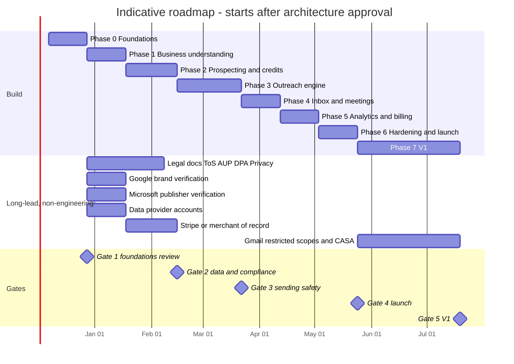

# Implementation Roadmap

> Status: **Proposed. Awaiting approval.** Synced with PRD v2.0 on 2026-11-26.
> Durations are indicative and assume **2 full-stack engineers using AI coding assistants**. Scale them for your actual team (assumption 6 in ARCHITECTURE.md §18).
> Each phase ends at an **approval gate**. No phase starts until the previous gate is passed.
> Feature IDs (`AUTH-01`, `APR-04`, ...) refer to [PRODUCT_REQUIREMENTS.md](PRODUCT_REQUIREMENTS.md) §6.

---

## 1. Phase Overview

| Phase | Name | Indicative duration | Outcome |
|-------|------|--------------------|---------|
| **0** | Foundations | 3 weeks | Monorepo, auth, workspaces and roles, queues, AI gateway, CI/CD, VPS deploy, backups |
| **1** | Business understanding | 3 weeks | Website → profile → offerings → ICP, multiple business profiles, onboarding steps 1–4 |
| **2** | Prospecting, data quality and credits | 4 weeks | BYOK discovery, CSV import, enrichment, verification, suppression, scoring, **credit ledger** |
| **3** | Outreach engine | 5 weeks | Mailboxes (SMTP/IMAP + Microsoft 365), campaign wizard, AI drafts and review, **launch approval**, scheduler, safe sending, reply and bounce detection |
| **4** | Inbox, meetings and notifications | 3 weeks | Reply classification, unified inbox, suggested replies, booking links, manual meetings, notifications |
| **5** | Analytics, billing and plans | 3 weeks | Dashboards, usage and credits view, **self-serve checkout, plans, credit packs, trial lifecycle**, quota enforcement, CSV export |
| **6** | Hardening and launch | 3 weeks | Super Admin console, UI states and responsive pass, security gate, load test, restore drill, legal, **paid beta launch** |
| **7** | V1 | 8 weeks | PRD §7.2: 2FA, Gmail OAuth GA, L2 autonomy, research v2, booking webhooks, calendar slots, A/B, funnel and cost analytics, HubSpot, point-in-time recovery, pen test |
| **8+** | Future | ongoing | PRD §7.3 |

**Launch (paid private beta → public):** about 24 weeks after approval. **V1:** about 32 weeks after approval.

---

## 2. Phases in Detail

### Phase 0: Foundations

**Goal:** a deployable, secure skeleton that every later feature builds on.

| Area | Deliverables |
|------|-------------|
| Repo | pnpm workspaces, Turborepo, shared tsconfig/eslint/prettier, `dependency-cruiser` boundary rules, `.nvmrc` (Node 24 LTS), Renovate, gitleaks pre-commit |
| Backend | NestJS with `main.api.ts` and `main.worker.ts`, Zod env validation, `nestjs-pino` logging with redaction, RFC 9457 error filter, Zod validation pipe, health endpoints, OpenAPI generation |
| Contracts | `packages/contracts` with shared schemas, error codes, enums, permission keys |
| Data | Prisma setup, identity/tenancy/audit tables (`workspaces`, `memberships` with a single-Owner constraint, `invitations`), tenancy Prisma extension, DB roles (migrator/app/readonly), seed script |
| Auth | AUTH-01 to AUTH-06: email+password signup with terms acceptance, verification, login and sessions, password reset, Google/Microsoft sign-in, profile settings |
| Workspaces | WS-01 to WS-07: create, switch, invite (seat-limit hook), manage members, transfer ownership, settings (address, privacy notice, launch-approval toggle), delete with 30-day restore. RBAC permission guard (Owner/Admin/Member). Audit events |
| Async | BullMQ + Valkey wiring, queue conventions, reconciler framework, Bull Board (admin), graceful shutdown |
| AI | `AiGateway` with Anthropic + OpenAI adapters, routing config, Zod structured output + repair retry, `ai_runs` metering, eval harness skeleton (`pnpm ai:eval`), **cost and quality eval to choose the primary provider** |
| Security utilities | `SafeFetch` (SSRF) with test suite, AES-256-GCM field encryption with key versions, HMAC token utility |
| Frontend | Next.js App Router, Tailwind v4, shadcn/ui, responsive app shell (sidebar on desktop, bottom nav on mobile, workspace switcher), auth pages, API client, TanStack Query, theming, shared empty/loading/error/success components (PRD §9.1) |
| Notifications | Transactional email adapter (**Amazon SES or Resend**), Mailpit locally |
| Infra | Dockerfiles (multi-stage, non-root), `docker-compose.dev.yml`, `docker-compose.prod.yml` and a scaled-down `docker-compose.staging.yml` (same VPS, release windows only), nginx config, server bootstrap script, GitHub Actions CI/CD, Sentry, log shipping, uptime monitor (free tiers), nightly encrypted backup to R2/B2 and **one restore drill** |
| Tests | Vitest unit setup, Testcontainers integration setup, **cross-tenant test harness**, Playwright smoke test |

**Exit criteria (Gate 1):** a user can sign up, verify email, create a workspace, invite a member, change roles and transfer ownership with correct permission behavior. CI deploys via the staging stack to production. A worker job calls `AiGateway` and records cost. A backup is restored successfully into a temporary container. Conventions are reviewed and approved.

### Phase 1: Business Understanding

| Area | Deliverables |
|------|-------------|
| Website Analyst | BIZ-01 to BIZ-03: sitemap and robots handling, page prioritization, crawl (≤25 pages), text extraction, progress, extraction prompt v1, failure fallbacks (manual entry or paste text), re-analysis merge rules |
| Business profiles | BIZ-04 to BIZ-06: offerings editor, brand voice, **multiple business profiles with plan limits** (for agencies) |
| ICP Strategist | ICP-01 to ICP-03: generation prompt v1 (1–3 ICPs), hints input, personas, rationale, exclusions, structured editor, versioning, activation |
| Onboarding | WS-08 checklist + guided steps: website → profile review → ICP review → activate |
| Agent runs | `agent_runs` tracking and UI progress via polling |
| Evals | 20+ website→profile golden cases. Scoring rubric |
| **Long-lead (start now)** | Google brand verification + Gmail OAuth app in testing mode, Microsoft Entra app + publisher verification, first data-provider account, legal document drafting, product domain + links domain + Cloudflare DNS |

**Exit criteria:** 10 real websites analyzed with ≥80% of fields rated "accurate or minor edit" by reviewers. ICPs are editable, versioned and activatable. Extraction eval passes.

### Phase 2: Prospecting, Data Quality and Credits

| Area | Deliverables |
|------|-------------|
| Integrations | Credential vault, connections UI, provider call wrapper (rate limit, retry, circuit breaker, metering, provenance), fake providers |
| Discovery | DISC-01 to DISC-03: one BYOK data-provider adapter (decided at Gate 1), Search Planner (ICP→filters), estimate and confirm flow (threshold 500), `discovery_runs`, cancel with partial results |
| Import | DISC-04: CSV upload → mapping → preview → lawful-basis attestation → dedupe → error report |
| Records | DISC-05, DISC-06: companies and contacts grids with filters, search (trigram) and bulk actions, manual add, provenance panel (CMP-03) |
| Enrichment | ENR-01 email finder (BYOK), ENR-03 company enrichment, ENR-04 basic homepage facts |
| Verification | ENR-02: lowest-cost reliable verifier (platform-managed, 1 credit), auto-verify, 60-day freshness, no double charge |
| Compliance (part 1) | CMP-01 suppression lists (email hash + domain), CMP-02 country policy with launch-market defaults + Admin attestation |
| Scoring | SCO-01 to SCO-05: deterministic scorer v1, tiers, breakdown, overrides, rescore, lead lists |
| **Credits (ledger)** | `credit_grants` + `usage_records` reserve/settle/release, spend order, trial grant (150), credit cost table from PRD §8.4, plan limits config (`plans.ts`), 80% and 0 thresholds (in-app), concurrency tests |

**Exit criteria (Gate 2: data and compliance review):** from an active ICP, produce at least 200 verified, scored leads for a design partner. Suppressed or excluded contacts are never admitted or charged. Provenance is recorded for 100% of contacts. The credit ledger never goes negative under concurrent load, and charges match the PRD cost table exactly.

### Phase 3: Outreach Engine

| Area | Deliverables |
|------|-------------|
| Mailboxes | MBX-01 Microsoft Graph, **MBX-02 SMTP/IMAP with presets (including Gmail app passwords)**, MBX-03 Gmail OAuth for allow-listed test users, token refresh, MBX-04 DNS checks with fix-it guidance, MBX-05 limits and ramp-up, MBX-06 health and auto-pause |
| Campaigns | CAM-01 wizard, CAM-02 enrollment rules, CAM-03 sequence builder, CAM-06 schedule, CAM-07 rotation. Enrollment and campaign state machines (domain layer, unit tested) |
| Copywriter | CAM-04 draft generation (credits, generated ahead of each step, out-of-credits pause), CAM-05 lint |
| Approval | APR-01 review queue (bulk approve, desktop shortcuts, mobile card flow), APR-02 L0/L1, **APR-03 launch checks**, **APR-04 launch approval workflow** (`campaign_approvals`, notifications, re-approval on change) |
| Scheduler | `campaign.schedule-tick`: due enrollments, caps, spacing + jitter, recipient-timezone windows, ramp-up, monthly email allowance, trial limits (25/day, 100 total) |
| Send engine | SND-01 to SND-03: MIME composition, deterministic `Message-ID`, threading headers, List-Unsubscribe + one-click, footer (address, privacy notice), exactly-once guards, `SENDING` reconciler |
| Compliance (part 2) | SND-05 unsubscribe on links domain, last-mile checks, SND-06 bounce handling + campaign auto-pause, SND-07 controls, SA-03 kill switches, account standing |
| Inbox sync (base) | Polling sync for all three providers, thread matching, **SND-04 reply detection stops sequences**, OOO pause, DSN bounce parsing → suppression |
| Progress | SND-08 campaign progress view |

**Exit criteria (Gate 3: sending safety review):** an internal dogfood campaign sends at least 500 emails across 3 mailboxes (SMTP/IMAP and Microsoft) with **zero duplicates**, correct stops on reply, bounce and unsubscribe, and correct send windows. A chaos test (killing the worker and Valkey mid-send) produces no duplicates or lost sends. Unsubscribe works from Gmail and Outlook one-click UI. A Member's campaign cannot send without approval when the setting is ON.

### Phase 4: Inbox, Meetings and Notifications

| Area | Deliverables |
|------|-------------|
| Classification | INB-02 Reply Classifier prompt v1 + eval set (≥200 labeled replies, free of credits), INB-03 auto-actions |
| Unified inbox | INB-01, INB-04: thread list with category filters, sanitized thread view, composer via the mailbox, assignment, snooze, done, classification override |
| Reply assistant | INB-05 suggested replies (1 credit), booking link inserted. Human sends |
| Meetings | MTG-01 booking links (workspace + user), MTG-02 manual meeting logging, sequence stop on meeting |
| Notifications | NOT-01 in-app bell, NOT-02 critical emails + daily digest + per-type preferences |

**Exit criteria:** classifier ≥90% accuracy on core categories in the eval set. A positive reply can be read, answered with the suggestion and sent in under 2 minutes of user time, including on a 360 px mobile screen. OOO pause/resume verified.

### Phase 5: Analytics, Billing and Plans

| Area | Deliverables |
|------|-------------|
| Events and rollups | Completeness audit of `email_events` emission. `analytics.rollup` (hourly + nightly), idempotent recompute |
| Dashboards | ANA-01 dashboard with "needs attention", ANA-02 campaign report, ANA-03 deliverability health, ANA-04 usage and credits, ANA-08 CSV export (formula-injection safe) |
| **Billing** | BIL-01 trial lifecycle (expiry, read-only, 14-day reply sync), BIL-02 hosted checkout (Starter, Growth, Agency, monthly and annual, seat and mailbox add-ons) + customer portal, BIL-03 plan credit grants on renewal, BIL-04 credit packs, BIL-05 failed payment grace, BIL-06 cancellation. Webhook processing with idempotency. Stripe Tax or merchant of record |
| Quotas | Enforcement for seats, business profiles, mailboxes, monthly emails, contacts stored and active campaigns, with limit-reached states (PRD §8.3, §9.1) |

**Exit criteria:** dashboard numbers reconcile exactly with raw event counts (automated test). A test card can complete trial → subscribe → upgrade → buy pack → failed payment → recover → cancel end-to-end in sandbox, with correct credits and limits at every step. Replayed webhooks never double-grant.

### Phase 6: Hardening and Launch

| Area | Deliverables |
|------|-------------|
| Platform admin | SA-01 workspace directory, SA-02 standing and auto-flagging, SA-04 credit adjustments and limit overrides, SA-05 impersonation, SA-06 system health |
| UX quality | Pass over every screen against the PRD §9 state matrix and the §10 responsive requirements (360 px → wide), plus an accessibility audit (WCAG 2.2 AA) |
| Security | Walk through the launch gate (SECURITY.md §15), cross-tenant suite audit for every endpoint, dependency and container scan clean, secrets review, billing and credit abuse tests |
| Performance | k6 load test at launch capacity (PRD §11). Index review with `EXPLAIN` on seeded 1M contacts |
| Reliability | Restore drill (timed against RTO), runbooks written, alert tuning, kill-switch drill |
| Legal | ToS (incl. subscription, credits, refunds), AUP, Privacy Policy, DPA + sub-processor list published. Acceptance at signup. Country policy reviewed by counsel |
| Product | Onboarding polish, help content (deliverability guide, DNS setup guides, Gmail app-password guide) |
| Launch | 10–20 paying design partners, weekly feedback loop, price validation (PRD §8) |

**Exit criteria (Gate 4: launch):** every launch gate item is green and signed off.

### Phase 7: V1 (PRD §7.2)

AUTH-07 2FA, AUTH-08 account deletion · ICP-04 exclude existing customers · DISC-07 more providers and waterfall · ENR-04 full research (news, hiring, funding with sources) · SCO-06 AI score adjustment, SCO-07 engagement scoring · **MBX-03 Gmail OAuth GA** (restricted-scope verification + CASA) · CAM-08 A/B tests, CAM-09 manual task steps, CAM-10 tracking toggle, CAM-11 multi-language · APR-02 L2 sample approval · INB-06 referrals · MTG-03 booking webhooks, MTG-04 calendar slot proposals, MTG-05 outcomes · ANA-05 funnel, ANA-06 cost per meeting, ANA-07 agency client reports · CMP-05 retention settings · HubSpot CRM sync.
Platform: WAL point-in-time recovery (RPO 15 min), external penetration test, RLS on high-risk tables, MFA required for super-admins, dedicated staging VPS when revenue allows.

**Exit criteria (Gate 5: V1):** GA security gate (SECURITY.md §15), success metrics trending at targets (PRD §13), on-call and support processes in place.

### Phase 8+: Future (PRD §7.3)

Change detection for websites, ICP performance insights, lookalike and local business discovery, campaign templates library, AI weekly insights, Viewer/Client role and white-label agency portal, Pipedrive and Salesforce sync, public API and API keys, SSO, guarded auto-send (L3), push-based inbox sync, custom tracking domains, platform-managed data credits (only with reseller agreements), PWA inbox, worker scale-out to a second VPS.

---

## 3. Approval Gates

| Gate | When | Reviewers decide |
|------|------|-----------------|
| **Gate 0** | Now | Approve architecture, stack, PRD v2.0 scope and startup defaults (PRD §2, ARCHITECTURE.md §19.1) |
| **Gate 1** | End of Phase 0 | Conventions, scaffolding and deploy pipeline acceptable. Primary LLM chosen from the eval. Choose the first BYOK data provider and the verifier |
| **Gate 2** | End of Phase 2 | Data sourcing, provenance, suppression and credit ledger are correct and lawful before any sending code exists |
| **Gate 3** | End of Phase 3 | Sending is safe (no duplicates, stops work, caps and approvals respected) before external users send |
| **Gate 4** | End of Phase 6 | Launch (paid beta) |
| **Gate 5** | End of Phase 7 | V1 |

---

## 4. Startup Running Costs (launch, indicative)

| Item | Choice | Monthly cost |
|------|--------|-------------|
| Server | Hostinger KVM 2 (prod + on-demand staging stack) | Plan price (check current Hostinger pricing) |
| DNS | Cloudflare free | $0 |
| Errors, logs, uptime | Sentry, Better Stack or Grafana Cloud, UptimeRobot (free tiers) | $0 at launch |
| Backups and files | Cloudflare R2 or Backblaze B2 | ≈ $0–5 |
| System email | Amazon SES or Resend | ≈ $0–5 |
| Domains | App domain + links domain | ≈ $2–4 (annual cost spread) |
| Code and CI | GitHub (free/team) + GHCR | $0–4 per user |
| AI, verification, search | Usage-based, **paid for by customer credits** (target ≤ $0.004 per credit) | Variable, covered by revenue |
| Data providers | BYOK, so customers pay their provider directly | $0 |
| One-off later | Gmail CASA assessment (V1), pen test (V1), legal review (before launch) | Budget separately |

Target: **under $50/month in tooling** plus the VPS until revenue justifies upgrades (PRD §11).

---

## 5. Risk Register

| # | Risk | Likelihood | Impact | Mitigation |
|---|------|-----------|--------|-----------|
| R1 | Gmail users find the app-password setup hard before Gmail OAuth is generally available | High | Medium | Step-by-step guide with screenshots, presets, connection test errors that explain fixes. Gmail OAuth for allow-listed design partners. CASA in V1 once revenue allows |
| R2 | Data-provider ToS or pricing incompatible with the product | Medium | High | BYOK model, adapter abstraction, CSV import as a universal fallback, evaluation checklist (INTEGRATIONS.md §10) |
| R3 | Customers damage their domains (poor deliverability) | Medium | High | Conservative caps and ramp-up, verified-only sending, DNS launch checks, auto-pause, education |
| R4 | Legal exposure in strict-consent jurisdictions | Medium | High | Launch markets limited to US/UK/CA/AU/IE, country policy default-block, counsel review, attestation, AUP |
| R5 | AI personalization fabricates claims | Medium | Medium | Facts-with-sources only, lint, human approval (L1), evals, judge pass in V1 |
| R6 | AI or verification cost exceeds credit pricing | Medium | Medium | Credit costs reviewed monthly against `usage_records`, cheap model tiers, prompt caching, batch APIs, hidden per-workspace cost caps |
| R7 | Platform abused by spammers (especially free trials) | Medium | High | Trial limits (25/day, 100 total), account standing, auto-flagging, AUP, kill switches |
| R8 | KVM 2 resource exhaustion (worse while the staging stack runs) | Medium | Medium | Memory budget, staging only during release windows, lower worker concurrency during staging, monitoring, swap, documented scale path |
| R9 | Single-VPS outage or data loss | Low | High | Offsite encrypted backups, restore drills, point-in-time recovery in V1, 99.5% SLA target |
| R10 | Scope creep delays launch | High | Medium | Strict MVP definition (PRD §7.1), phase gates |
| R11 | Small team bandwidth | Medium | Medium | AI-assisted development with strict conventions (AGENTS.md), fakes for providers, cut V1 items before MVP items |
| R12 | Stripe unavailable in the company's country | Medium | Medium | `PaymentProvider` port. Paddle or Lemon Squeezy as merchant of record, applied for in Phase 2 |
| R13 | Pricing doesn't fit the market | Medium | Medium | Validate with the first 10–20 customers. Plans and credit costs are config, not code |

---

## 6. Immediate Next Steps (after Gate 0 approval)

1. Answer the remaining open questions (ARCHITECTURE.md §19.2): company country (Stripe vs merchant of record), product name and domains, and the first design partners' data provider.
2. `git init`, create the GitHub repository, enable branch protection.
3. Upgrade local Node.js to 24 LTS. Install pnpm 10.
4. Provision the Hostinger KVM 2 (UK or EU datacenter recommended) and an R2/B2 bucket. No separate staging VPS.
5. Register domains (app + links) on Cloudflare DNS. Set up SES or Resend DNS.
6. Begin Phase 0.
