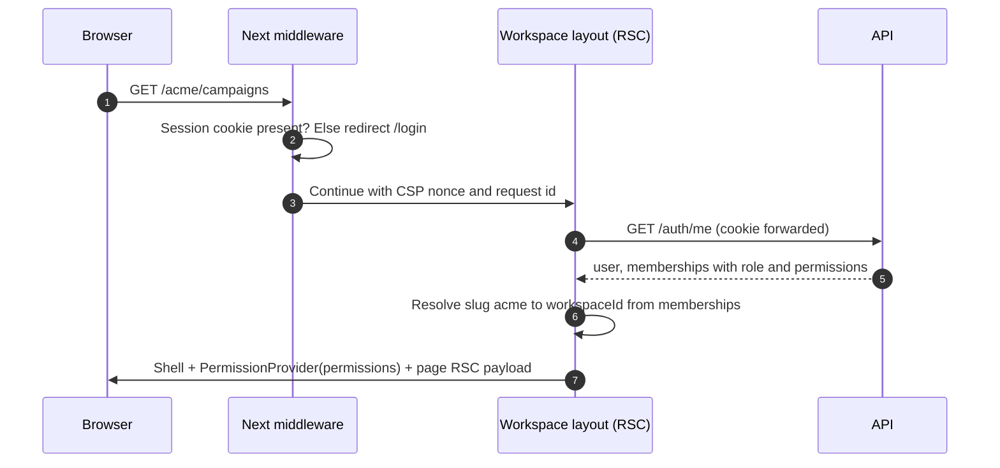

# 01. Frontend Architecture

> Status: Draft for review · Related: [ADR-0003](adr/ADR-0003-nextjs-presentation-layer.md), [ADR-0028](adr/ADR-0028-polling-first-realtime.md), PRD §9–10

## 1. Goals and constraints

1. **Presentation only.** No database, Valkey, LLM or secret-bearing provider access. No business rules that the API doesn't also enforce.
2. **Every screen implements the PRD §9 states** (empty, loading, error, success) and **works at 360 px** (PRD §10).
3. **Cheap to run.** Small server footprint on the shared VPS (≤ 768 MB), and no paid frontend services.
4. **Secure by default.** Strict CSP, no `dangerouslySetInnerHTML` outside one audited component, no secrets in client bundles.

## 2. Stack

Next.js App Router (latest stable at scaffolding, pinned) · React · TypeScript strict · Tailwind CSS v4 · shadcn/ui (Radix primitives) · Lucide icons · TanStack Query · TanStack Table · React Hook Form + `@hookform/resolvers/zod` · Recharts (via shadcn charts) · `next-intl` · `next-themes`.

Config choices for the VPS:
- `output: 'standalone'` for a small runtime image.
- `images.unoptimized: true`. The app has few images, so this saves CPU and memory on the shared VPS.
- No ISR or data cache for tenant data (`dynamic = 'force-dynamic'` on the `(app)` group).

## 3. Directory structure

```
apps/web/src/
├─ app/
│  ├─ (auth)/login/page.tsx …           # public auth pages
│  ├─ (app)/workspaces/page.tsx          # picker + create workspace
│  ├─ (app)/[workspaceSlug]/layout.tsx   # resolves workspace, loads permissions, shell
│  ├─ (app)/[workspaceSlug]/…/page.tsx   # feature routes (ARCHITECTURE.md §8.1)
│  ├─ admin/…                            # Super Admin console (desktop only)
│  ├─ u/[token]/page.tsx                 # NOT here: unsubscribe is served by the API (links domain)
│  ├─ error.tsx · not-found.tsx · global-error.tsx
│  └─ layout.tsx                         # html, theme, intl provider, CSP nonce consumer
├─ components/
│  ├─ ui/                                # shadcn primitives (generated, lightly customized)
│  ├─ shell/                             # AppShell, Sidebar, IconRail, BottomNav, WorkspaceSwitcher
│  ├─ states/                            # EmptyState, ErrorPanel, PermissionPanel, LimitReachedPanel,
│  │                                     # OfflineBanner, JobProgress, Skeletons, Milestone
│  ├─ data/                              # DataTable (desktop) + CardList (mobile) + FilterBar/FilterSheet
│  └─ email/SafeEmailFrame.tsx           # the ONLY place raw (sanitized) HTML is rendered
├─ features/<domain>/                    # business-profile, icp, prospects, leads, campaigns, inbox, …
│  ├─ components/ · hooks/ · queries.ts  # queries.ts = query keys + fetchers for that domain
├─ lib/
│  ├─ api/client.ts                      # browser fetch wrapper
│  ├─ api/server.ts                      # serverApi(): RSC fetch to internal API
│  ├─ api/errors.ts                      # problem+json → ApiError → UI state mapping
│  ├─ auth/session.ts                    # getSession() (React cache, per request)
│  ├─ permissions.tsx                    # PermissionProvider, <Can>, useCan()
│  ├─ format/                            # dates (workspace tz), numbers, credits
│  └─ env.ts                             # zod-validated env (server-only + public split)
├─ messages/en.json                      # next-intl strings
└─ middleware.ts                         # cookie presence → redirect, CSP nonce, request id
```

## 4. Rendering strategy

| Route group | Rendering | Notes |
|-------------|-----------|-------|
| `(auth)` | Server-rendered pages + client forms | No session required. Redirect to `/workspaces` if already signed in |
| `(app)/workspaces` | RSC | Lists memberships from `/auth/me` |
| `(app)/[workspaceSlug]/*` | RSC shell + client islands | Layout fetches workspace and permissions once. Pages fetch initial data in RSC, and interactive parts hydrate TanStack Query with that data (`initialData`) |
| `admin/*` | RSC + client tables | Hidden below 1024 px ("Use a desktop") |

## 5. Data access

### 5.1 Server Components: `serverApi()`

```ts
// lib/api/server.ts (server-only)
export async function serverApi<T>(path: string, schema: ZodType<T>, init?: RequestInit): Promise<T> {
  const h = await headers();
  const res = await fetch(`${env.INTERNAL_API_URL}/api/v1${path}`, {
    ...init,
    cache: 'no-store',
    headers: {
      cookie: h.get('cookie') ?? '',
      'x-request-id': h.get('x-request-id') ?? crypto.randomUUID(),
      'x-requested-with': 'lga-web',
      origin: env.APP_ORIGIN,           // so OriginGuard accepts internal SSR calls
    },
  });
  if (!res.ok) throw await ApiError.fromResponse(res); // handled by error.tsx / not-found.tsx
  return schema.parse(await res.json());              // contracts from packages/contracts
}
```

- `INTERNAL_API_URL=http://api:4000` (Docker network). The API never trusts this hop more than the public one: the same guards run.
- **Server Actions are not used for mutations.** All mutations are client-side calls to `/api/v1` (one code path, one CSRF model).

### 5.2 Client: `apiClient` + TanStack Query

- `fetch` with `credentials: 'same-origin'` and header `X-Requested-With: lga-web` on every request (required by `OriginGuard` for unsafe methods).
- `Idempotency-Key: crypto.randomUUID()` is generated **once per user intent** (stored in the mutation's variables, so retries reuse it) for endpoints marked idempotent in [03-api.md](03-api.md) §6.
- Query key convention: `['ws', workspaceId, domain, resource, params]`. Switching workspace clears all `['ws', previousId]` keys, so no cross-workspace cache bleed in the browser.
- Defaults: `staleTime 30s`, `retry 2` for GET (never retry 4xx), `refetchOnWindowFocus true` for inbox and dashboard only.
- **Job progress polling** (ADR-0028): `refetchInterval: (q) => isTerminal(q.state.data?.status) ? false : 3000`. It backs off to 10 s after 2 minutes.
- Optimistic updates only for low-risk actions (mark read, assign, snooze, add to list), with rollback on error. Never for approvals, launches, payments or anything that spends credits.

### 5.3 Error → UI state mapping (`lib/api/errors.ts`)

| API result | UI treatment (PRD §9.1) |
|-----------|-------------------------|
| `400 VALIDATION_FAILED` with `errors[]` | Map `errors[].pointer` to form fields, focus first invalid |
| `401 UNAUTHENTICATED` | Clear query cache and redirect to `/login?next=…` |
| `403 PERMISSION_DENIED` | `PermissionPanel` (page) or disabled control with tooltip (action) |
| `404 NOT_FOUND` | `not-found.tsx` (also used for other-tenant IDs) |
| `402 QUOTA_EXCEEDED` / `CREDITS_INSUFFICIENT` | `LimitReachedPanel` with usage, plus "Upgrade" or "Buy credits" for the Owner and "Ask your Owner" for others |
| `409 IDEMPOTENCY_IN_PROGRESS` | Keep spinner and poll the resource |
| `409 CONFLICT` / `412 PRECONDITION_FAILED` | "This was changed by someone else" + reload |
| `422 LAUNCH_CHECKS_FAILED` | Launch checklist with fix links |
| `429 RATE_LIMITED` | Toast with retry time from `Retry-After` |
| `5xx` / network | Toast with error reference (`requestId`) + Retry. `ErrorPanel` for page loads |
| Offline (`navigator.onLine=false`) | `OfflineBanner`. Disable send, approve and launch buttons |

## 6. Session, workspace and permissions in the UI



- `middleware.ts` checks only cookie **presence** (cheap, edge-safe). Authentication and authorization always happen in the API.
- `<Can permission="campaigns.approve_launch">` hides or disables UI. **UI permission checks are cosmetic.** Every action is re-checked by `PermissionGuard`.
- Launch button logic: if the user has `campaigns.launch`, show **Launch**. Else if `campaigns.submit_for_approval`, show **Submit for approval** (PRD APR-04).
- Impersonation sessions render a persistent red banner ("Support view, read-only, ends in mm:ss") and disable all mutations.

## 7. Forms

- Zod schemas come from `packages/contracts`, so client and server validate with the same rules.
- RHF `mode: 'onBlur'`, submit disables the button and shows "Saving…".
- Server `VALIDATION_FAILED.errors[]` (`{ pointer: '/name', code, message }`) map to `setError`.
- Unsaved-changes guard on long forms (campaign wizard, ICP editor). Campaign wizard autosaves drafts (PRD CAM-01) with debounced `PATCH` plus `If-Match` (ETag), so it never silently overwrites someone else's edit.

## 8. Shared state components (PRD §9)

| Component | Props (essentials) | Used for |
|-----------|-------------------|---------|
| `EmptyState` | `icon, title, description, primaryAction, secondaryAction?` | First-use and no-results states |
| `Skeleton*` | `TableSkeleton rows=8`, `CardSkeleton`, `KpiSkeleton` | Page loading (shown within 100 ms) |
| `JobProgress` | `steps[], currentStep, counts, status` | Website analysis, discovery, import, draft generation |
| `ErrorPanel` | `title, message, requestId, onRetry` | Page and widget failures (widget-isolated via error boundaries) |
| `PermissionPanel` | `admins[]` | 403 |
| `LimitReachedPanel` | `limitKey, used, limit, isOwner` | Plan and credit limits |
| `Milestone` | `kind` | First ICP, first launch, first meeting (shown once, tracked server-side) |
| `ConfirmDialog` | `consequence, typedConfirmation?` | Destructive actions. Default focus on Cancel |

A Storybook-free approach saves setup time: each component has a `*.test.tsx` rendering every state, and a `/dev/states` page (development builds only) shows all states for visual review.

## 9. Responsive shell (PRD §10)

| Width | Shell | Tables | Dialogs | Filters |
|-------|-------|--------|---------|---------|
| < 640 px | `BottomNav` (Dashboard, Inbox, Leads, Campaigns, More) + top bar | `CardList` (3–4 key fields + expand) | Full-screen `Sheet` | `FilterSheet` button "Filters (n)" |
| 640–1023 px | `IconRail` (collapsible) | `DataTable` with priority columns + column menu | Centered `Dialog` | Inline, wraps |
| ≥ 1024 px | `Sidebar` + workspace switcher | Full `DataTable`, sticky header and first column | `Dialog` | Inline `FilterBar` |
| ≥ 1280 px | Max content width 1440 px. Inbox three-pane | — | — | — |

- `DataTable` and `CardList` share one column definition (`columns.tsx` declares `priority` and `mobileField`), so both views stay in sync.
- `ResponsiveDialog` picks `Sheet` or `Dialog` by breakpoint via CSS (`md:` variants), not JS, which avoids hydration mismatch.
- Touch targets ≥ 44 px (Tailwind `min-h-11 min-w-11` on interactive elements in mobile variants). `pb-[env(safe-area-inset-bottom)]` for the bottom nav.
- Draft review on mobile: one card per draft with Approve and Edit buttons and swipe-to-next (PRD APR-01). Desktop adds keyboard shortcuts A/E/R/J/K.
- "Best on desktop" hint for the CSV mapping and sequence editor below 640 px, with a "Continue anyway" option.

## 10. Safe email rendering (`SafeEmailFrame`)

- The API returns `bodyHtmlSanitized` (sanitized server-side, see [07-email-infrastructure.md](07-email-infrastructure.md) §7.4) with remote images rewritten to `data-lga-src` placeholders.
- The frontend renders it **only** inside `<iframe sandbox="" srcdoc={…}>`. No `allow-scripts`, `allow-same-origin`, `allow-forms` or `allow-popups`. The srcdoc includes `<meta http-equiv="Content-Security-Policy" content="default-src 'none'; img-src data:; style-src 'unsafe-inline'">`.
- "Show images" re-requests the body with `?images=1`. The API then returns the same sanitized HTML with the original `https:` image URLs restored (no image proxy in MVP), and the frame's CSP relaxes to `img-src data: https:` for that render only. The user is warned that the sender may learn the email was opened.
- Plain-text view is the default for inbound replies on mobile.
- ESLint rule `react/no-danger` is an error everywhere except `components/email/SafeEmailFrame.tsx`.

## 11. Security headers and CSP

`middleware.ts` generates a per-request nonce and sets:

```
Content-Security-Policy: default-src 'self'; script-src 'self' 'nonce-{n}' 'strict-dynamic';
  style-src 'self' 'unsafe-inline'; img-src 'self' data: blob:; font-src 'self';
  connect-src 'self' https://*.ingest.sentry.io; frame-src 'self'; frame-ancestors 'none';
  form-action 'self'; base-uri 'self'; object-src 'none'; upgrade-insecure-requests
```

Other headers (HSTS, nosniff, Referrer-Policy, Permissions-Policy) are set by nginx (ADR-0012). Fonts are self-hosted (no Google Fonts CDN at runtime). `NEXT_PUBLIC_*` variables are limited to `APP_ORIGIN`, `SENTRY_DSN_PUBLIC` and `RELEASE`, and a CI check fails the build if any other `NEXT_PUBLIC_` variable appears.

## 12. Performance budgets

| Metric | Budget |
|--------|--------|
| Initial JS per route (gzip) | ≤ 200 KB (charts and editors lazy-loaded via `next/dynamic`) |
| LCP (mid-range mobile, 4G) dashboard and inbox | < 2.5 s |
| INP | < 200 ms |
| Web server memory | ≤ 512 MB heap (`--max-old-space-size=512`) |

Checked in CI with `@next/bundle-analyzer` size thresholds and a Lighthouse CI run against the staging stack.

## 13. Testing

- **Unit/component:** Vitest + Testing Library, rendering every state per component.
- **Accessibility:** `@axe-core/playwright` on each main page, failing on serious or critical issues.
- **E2E:** Playwright journeys J1/J2 (PRD §5) on `Desktop Chrome` and `Pixel 7` / `iPhone 14` viewports, against the API with fake providers.
- **Visual sanity:** screenshots of `/dev/states` at 360, 768 and 1280 px, attached to the PR (no paid visual-diff service).
