# 02. Backend Architecture

> Status: Draft for review · Related: [ADR-0001](adr/ADR-0001-modular-monolith.md), [ADR-0005](adr/ADR-0005-postgres-source-of-truth.md), ARCHITECTURE.md §6

## 1. Process roles

> **Implemented layout (ADR-0032):** `apps/api` and `apps/worker` are separate NestJS apps and images. Code they share lives in `packages/core`. Read "codebase" below as `core` + the two apps. Express adapter, ESM, NestJS 12.

The two backend roles, and how they boot:

| Role | Entrypoint | Bootstrap | Listens | Root module |
|------|-----------|-----------|---------|-------------|
| `api` | `dist/main.api.js` | `NestFactory.create(AppApiModule)` (Express adapter, `rawBody: true`) | `:4000` (Docker network only) | Imports `*.module` + `*.http.module` |
| `worker` | `dist/main.worker.js` | `NestFactory.createApplicationContext(AppWorkerModule)` + a tiny HTTP server for `/health` and `/metrics` | `:4100` (internal only) | Imports `*.module` + `*.jobs.module` |

**Express vs Fastify:** we use Express. It has the broadest compatibility with Nest middleware, Bull Board and raw-body webhook handling. The performance gap doesn't matter at our scale, and nginx handles slow clients.

## 2. Request pipeline (api)

```mermaid
flowchart LR
    n["nginx<br/>X-Request-Id, real IP"] --> m1["requestId + context middleware<br/>AsyncLocalStorage"]
    m1 --> m2["body parsers<br/>JSON 1 MB, raw for /webhooks,<br/>streaming for /files"]
    m2 --> m3["cookie parser"]
    m3 --> g1["ThrottlerGuard<br/>Valkey storage"]
    g1 --> g2["OriginGuard<br/>unsafe methods"]
    g2 --> g3["SessionGuard<br/>unless @Public"]
    g3 --> g4["PlatformAdminGuard<br/>/admin only"]
    g4 --> g5["TenantGuard<br/>routes with :workspaceId"]
    g5 --> g6["PermissionGuard<br/>@RequirePermission"]
    g6 --> p["ZodValidationPipe"]
    p --> i["Interceptors<br/>Idempotency, Logging, ETag"]
    i --> c["Controller"]
    c --> s["Application service"]
    s -.-> f["ProblemDetailsFilter<br/>on any exception"]
```



Rules:
- Guards are registered **globally** in that order. `SessionGuard` is default-deny: a route without `@Public()` requires a valid session. CI fails if a controller method has neither `@Public()` nor a permission decorator (custom lint rule `lga/require-authz-decorator`).
- `TenantGuard` runs only on routes whose path contains `:workspaceId`. For those routes `@RequirePermission()` is **mandatory**.
- Body limits: JSON 1 MB globally. CSV uploads stream through `/files` (20 MB hard limit, see [03-api.md](03-api.md) §9).

## 3. RequestContext

```ts
interface RequestContext {
  requestId: string;
  ip: string; userAgent: string;
  userId?: string; sessionId?: string; platformRole?: 'NONE' | 'SUPER_ADMIN';
  workspaceId?: string; role?: 'OWNER' | 'ADMIN' | 'MEMBER';
  permissions?: ReadonlySet<Permission>;
  impersonation?: { adminUserId: string; expiresAt: Date; readOnly: true };
  system?: { reason: SystemContextReason };   // only via withSystemContext()
}
```

Stored in AsyncLocalStorage (`ContextService.get()`). Job processors create it via `runInJobContext(envelope)` ([06-background-jobs.md](06-background-jobs.md) §3). The logger, `TenantPrisma`, `JobProducer` and `AiGateway` all read from it, so callers can't "forget" the tenant.

## 4. Module anatomy

```
modules/campaigns/
├─ campaigns.module.ts        # providers: CampaignService, EnrollmentService, repositories, policies
├─ campaigns.http.module.ts   # CampaignsController, ApprovalsController, DraftsController
├─ campaigns.jobs.module.ts   # ScheduleTickProcessor, DraftGenerateProcessor
├─ index.ts                   # export { CampaignService, CampaignEvents, type CampaignDto }
├─ api/                       # controllers (thin): parse → call service → map to contract DTO
├─ application/               # use cases: launchCampaign, submitForApproval, approveLaunch, …
├─ domain/                    # pure: campaign-state-machine.ts, launch-checks.ts, enrollment-rules.ts
├─ infrastructure/            # campaign.repository.ts (TenantPrisma), mappers
└─ jobs/                      # processors + payload schemas
```

**Layer rules** (dependency-cruiser):

```js
// .dependency-cruiser.cjs (excerpt)
forbidden: [
  { name: 'no-cross-module-internals', from: { path: '^src/modules/([^/]+)/' },
    to: { path: '^src/modules/(?!$1)[^/]+/(?!index\\.ts$)' } },
  { name: 'domain-is-pure', from: { path: '/domain/' },
    to: { path: '(@prisma|bullmq|ioredis|node:http|/infrastructure/|/api/)' } },
  { name: 'no-llm-sdk-outside-adapters', from: { pathNot: '^src/platform/ai/providers/' },
    to: { path: '(openai|@anthropic-ai/sdk)' } },
  { name: 'no-raw-fetch', from: { pathNot: '^src/(common/safe-fetch|platform/integrations/http)/' },
    to: { path: '^(undici|node-fetch|axios|got)$' } },
]
```

Global `fetch` usage outside `SafeFetch` and the provider HTTP client is banned by an ESLint `no-restricted-globals` rule.

## 5. Application service pattern

```ts
@Injectable()
export class CampaignLaunchService {
  constructor(private tx: TxManager, private repo: CampaignRepository, private checks: LaunchChecks,
              private credits: CreditService, private jobs: JobProducer, private audit: AuditService,
              private events: EventBus, private clock: Clock) {}

  async launch(campaignId: string, expectedVersion: number): Promise<CampaignDto> {
    return this.tx.run(async (t) => {
      const c = await this.repo.getForUpdate(t, campaignId);         // tenant-scoped + row lock
      assertVersion(c, expectedVersion);                               // optimistic concurrency (412)
      const result = await this.checks.evaluate(t, c);                 // domain/launch-checks.ts
      if (!result.ok) throw new DomainError('LAUNCH_CHECKS_FAILED', 422, result);
      const next = CampaignStateMachine.transition(c, 'LAUNCH', this.clock.now()); // throws on illegal
      await this.repo.save(t, next);
      await this.audit.record(t, 'campaign.launched', { campaignId });
      t.afterCommit(() => this.jobs.add('campaign-scheduler', 'campaign.activate', { campaignId }));
      t.afterCommit(() => this.events.emit('campaign.launched', { campaignId }));
      return toDto(next);
    });
  }
}
```

Conventions:
- **Controllers are thin** (no Prisma, no business logic).
- **State changes go through domain state machines** (`domain/*-state-machine.ts`) with an explicit transition table. Illegal transitions throw `ILLEGAL_STATE_TRANSITION` (409).
- **`Clock` is injected** (never `new Date()` in domain or application code), which makes scheduling, trials, expiries and windows testable.
- **Side effects outside the DB** (jobs, events, emails) are registered with `afterCommit`. They never run inside a transaction that might roll back.

## 6. Transactions (`TxManager`)

- `tx.run(fn, { isolation: 'ReadCommitted', timeoutMs: 10_000 })` wraps a Prisma interactive transaction on the tenant-extended client.
- `t.afterCommit(cb)` queues callbacks and runs them after a successful commit. Failures are logged and left to reconcilers (ADR-0005).
- Nested `run` joins the outer transaction (no savepoints by default).
- Long work (HTTP calls, LLM calls) is **never** done inside a transaction.

## 7. Events

| Kind | Mechanism | Delivery | Use for |
|------|-----------|----------|---------|
| In-process domain event | `EventBus` (typed wrapper over `@nestjs/event-emitter`), emitted after commit | At-most-once, same process | Cheap reactions in the same role: cache invalidation, notifications enqueue |
| Cross-process / must-happen | `JobProducer.add()` after commit + reconciler | At-least-once | Anything that must not be lost: stop enrollment on reply, settle credits, send |

Event names live in `packages/contracts/events.ts` (`reply.received`, `message.bounced`, `campaign.launched`, `credits.low`, …), each with a Zod payload schema. **Rule:** if losing the event would be a bug, it must be a job, not an in-process event.

## 8. Errors

```ts
class DomainError extends Error {
  constructor(readonly code: ErrorCode, readonly status: number,
              readonly details?: Record<string, unknown>, readonly errors?: FieldError[]) { super(code); }
}
```

`ProblemDetailsFilter` maps `DomainError`, Zod errors (400), Prisma `P2002` (409 `CONFLICT`), `P2025` (404) and unknown errors (500, generic message, details only in logs and Sentry) to RFC 9457. The error code catalog is in [03-api.md](03-api.md) §4. Stack traces never leave the server.

## 9. Configuration

`ConfigModule` loads env and validates it with a Zod schema at boot. The process exits non-zero on any error. Groups:

| Group | Variables (examples) |
|-------|---------------------|
| Runtime | `NODE_ENV`, `APP_ENV` (`local`/`staging`/`production`), `APP_ORIGIN`, `LINKS_ORIGIN`, `RELEASE` |
| Data | `DATABASE_URL` (app role), `DATABASE_MIGRATOR_URL` (migrate container only), `VALKEY_URL` |
| Crypto | `APP_ENCRYPTION_KEYS` (JSON `{version: base64}`), `APP_ENCRYPTION_ACTIVE_VERSION`, `EMAIL_HASH_PEPPER`, `UNSUBSCRIBE_TOKEN_KEYS`, `UNSUBSCRIBE_TOKEN_ACTIVE_KEY_ID`, `SESSION_PEPPER` |
| AI | `ANTHROPIC_API_KEY`, `OPENAI_API_KEY` (required in real mode for every routed provider), `AI_ROUTING_FILE`, `AI_PRICING_FILE` (default `packages/core/config/*.yaml`), `AI_DISABLED` (global kill switch) |
| Providers | `VERIFIER_API_KEY`, `SEARCH_API_KEY`, `MS_OAUTH_CLIENT_ID/SECRET`, `GOOGLE_OAUTH_CLIENT_ID/SECRET` (sign-in, API only; a provider is enabled when both are set), `PAYMENT_PROVIDER`, `STRIPE_SECRET_KEY`, `STRIPE_WEBHOOK_SECRET`, `SES_*` or `RESEND_API_KEY` |
| Storage | `S3_ENDPOINT`, `S3_BUCKET_FILES`, `S3_ACCESS_KEY_ID/SECRET` |
| Observability | `SENTRY_DSN`, `LOG_LEVEL` |
| Modes | `INTEGRATIONS_MODE` (`real`/`fake`), `ADMIN_IP_ALLOWLIST` |

`INTEGRATIONS_MODE=fake` is **rejected at boot when `APP_ENV=production`**.

## 10. Worker bootstrap

1. Create the application context and validate config.
2. Register processors per queue with concurrency from config ([06-background-jobs.md](06-background-jobs.md) §2).
3. Upsert job schedulers (idempotent `upsertJobScheduler`) for repeatable jobs.
4. Start the internal health and metrics server on `:4100`.
5. On `SIGTERM`: stop schedulers, call `worker.close()` (finishes active jobs, up to 60 s), close DB and Valkey, then exit.

## 11. Resource budgets

| | api | worker |
|-|-----|--------|
| Container memory | 768 MB | 1.5 GB |
| `--max-old-space-size` | 512 | 1024 |
| Prisma pool | 10 | 15 |
| Valkey connections | 2 (commands, throttler) | 1 per queue worker + 1 producer + 1 blocking |

## 12. Testing

| Level | Tool | Scope |
|-------|------|-------|
| Unit | Vitest | `domain/*` (state machines, launch checks, scoring, scheduling math, country policy), validators, mappers |
| Integration | Vitest + Testcontainers (PostgreSQL 18, Valkey) | Repositories, tenancy extension, services with real transactions, processors |
| API | Supertest against `AppApiModule` + Testcontainers | Guards, permissions per role, cross-tenant suite, problem+json shape, idempotency |
| Contract | Zod schemas from `packages/contracts` used in both test clients | No drift between web and backend |

Test data comes from factories (`test/factories/*.ts`) that always create entities inside an explicit workspace. Every integration test that touches tenant tables seeds **two** workspaces.
