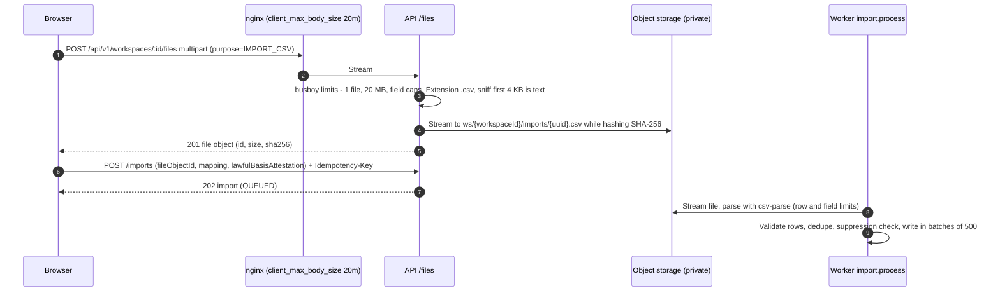

# 03. API Architecture

> Status: Draft for review · Related: [ADR-0004](adr/ADR-0004-rest-zod-contracts.md), ARCHITECTURE.md §9 (endpoint catalog)

## 1. Style

- **REST over HTTPS, JSON** (`application/json; charset=utf-8`). Resource-oriented paths, kebab-case (`/campaign-approvals`), camelCase fields.
- **Base:** `https://app.<domain>/api/v1`. Tenant resources: `/api/v1/workspaces/:workspaceId/...`. Platform admin: `/api/v1/admin/...`. Public: `/u/:token`, `/webhooks/:provider`, `/health/*` (not versioned).
- **Contracts:** Zod schemas in `packages/contracts/<domain>.ts` define every request body, query, params and response. OpenAPI 3.1 is generated from them (non-production only, at `/api/docs`). The web app imports the same schemas, so no code generation is needed.

## 2. Data conventions

| Item | Convention |
|------|-----------|
| IDs | UUIDv7 strings (ADR-0020) |
| Timestamps | ISO-8601 UTC with `Z` (`2026-11-26T09:15:00.000Z`). The client formats them in the workspace or user timezone |
| Dates (no time) | `YYYY-MM-DD` (analytics buckets) |
| Money | `{ amountMinor: 4900, currency: "USD" }` |
| Credits | Number with up to 3 decimals (`credits: 1999.8`). Stored internally as millicredits (`bigint`) |
| Enums | `UPPER_SNAKE` strings, identical to DB enums |
| Nullability | Absent and `null` are distinct in PATCH: absent = unchanged, `null` = clear (only where allowed) |
| Unknown fields | Rejected (`z.object(...).strict()`), so mass-assignment fails loudly |

## 3. Responses

- **Single resource:** the object itself, plus an `ETag` header for editable aggregates.
- **Collections:** `{ "data": [...], "nextCursor": "…" | null }`. `total` is only included where cheap (with `?includeTotal=true`, capped at 10,000 with `totalIsEstimate`).
- **Async operations:** `202 Accepted` + `Location: /api/v1/workspaces/:id/analysis-runs/:runId` + the run resource body (`status: "QUEUED"`).
- **Created:** `201` + `Location` + resource.
- **No content:** `204` for deletes and pure state commands without a body.

## 4. Errors (RFC 9457)

```json
{
  "type": "https://docs.<domain>/errors/QUOTA_EXCEEDED",
  "title": "Monthly email limit reached",
  "status": 402,
  "code": "QUOTA_EXCEEDED",
  "detail": "This workspace has sent 3,000 of 3,000 emails this period.",
  "instance": "/api/v1/workspaces/0193…/campaigns/0193…/resume",
  "requestId": "f3a1…",
  "limit": { "key": "emailsPerMonth", "used": 3000, "limit": 3000, "resetsAt": "2026-12-01T00:00:00Z" },
  "errors": []
}
```

**Error code catalog** (`packages/contracts/errors.ts`):

| Code | HTTP | Meaning |
|------|------|---------|
| `VALIDATION_FAILED` | 400 | Body, query or params failed the schema. `errors[]` has `{pointer, code, message}` |
| `UNAUTHENTICATED` | 401 | No or invalid session |
| `EMAIL_NOT_VERIFIED` | 403 | Action requires a verified email (AUTH-02 AC3) |
| `REAUTH_REQUIRED` | 403 | Step-up needed for a sensitive action ([08-authentication.md](08-authentication.md) §7) |
| `PERMISSION_DENIED` | 403 | Authenticated but not allowed |
| `WORKSPACE_RESTRICTED` | 403 | Standing, read-only or billing status blocks the action |
| `NOT_FOUND` | 404 | Not found **or belongs to another workspace** |
| `CONFLICT` | 409 | Unique violation or duplicate |
| `ILLEGAL_STATE_TRANSITION` | 409 | For example, approving a campaign that isn't `PENDING_APPROVAL` |
| `IDEMPOTENCY_CONFLICT` | 409 | Same key with a different request body |
| `IDEMPOTENCY_IN_PROGRESS` | 409 | Same key still processing |
| `PRECONDITION_FAILED` | 412 | `If-Match` ETag mismatch |
| `PRECONDITION_REQUIRED` | 428 | `If-Match` missing on a versioned update |
| `QUOTA_EXCEEDED` | 402 | Plan limit (seats, mailboxes, emails/month, contacts, profiles, campaigns) |
| `CREDITS_INSUFFICIENT` | 402 | Not enough credits (`required`, `available` in body) |
| `LAUNCH_CHECKS_FAILED` | 422 | `checks[]` with id, status and fix link (APR-03) |
| `UNPROCESSABLE` | 422 | Semantically invalid (for example, a URL that fails SafeFetch policy) |
| `RATE_LIMITED` | 429 | With `Retry-After` |
| `PROVIDER_ERROR` | 502 | Upstream provider failure on a synchronous call (for example, a BYOK key test) |
| `ORIGIN_REJECTED` | 403 | State-changing request without the app `Origin` and `X-Requested-With: lga-web` (CSRF, TM-05) |
| `PAYLOAD_TOO_LARGE` | 413 | Request body over the limit (JSON 1 MB) |
| `SERVICE_UNAVAILABLE` | 503 | Dependency down or service not ready |
| `INTERNAL` | 500 | Unexpected. Generic message with `requestId` |

## 5. Pagination, filtering, sorting

- **Cursor pagination:** `?limit=25&cursor=<opaque>`. Default 25, max 100. The cursor is base64url of `{v:1, sort:[value,id], dir}` and is **HMAC-signed** (prevents tampering into unindexed scans). An invalid cursor returns 400.
- **Filters:** `?filter[status]=ACTIVE&filter[tier]=A,B&filter[createdAt][gte]=…`. Each endpoint declares an allowlisted filter schema. Unknown filters are rejected.
- **Sort:** `?sort=-score,createdAt`, allowlisted per endpoint and mapped to indexed columns. Values are never interpolated into SQL ([04-database.md](04-database.md) §6).
- **Search:** `?q=` (max 100 chars) runs trigram search on allowlisted columns with escaped `%`/`_`.

## 6. Idempotency

**Required** (`Idempotency-Key` header, UUID) on:

| Endpoint | Why |
|----------|-----|
| `POST …/discovery-runs` | Spends provider quota and credits |
| `POST …/imports` | Creates many records |
| `POST …/verifications` | Spends credits |
| `POST …/contacts/:id/enrich`, `POST …/companies/:id/research` | Spends credits |
| `POST …/campaigns/:id/launch`, `…/submit-for-approval`, `POST …/campaign-approvals/:id/approve` | External effects |
| `POST …/drafts/:id/regenerate`, `POST …/threads/:id/suggest-reply` | Spends credits |
| `POST …/threads/:id/reply` | Sends an email |
| `POST …/billing/checkout` | Payment session |
| `POST …/members/invitations` | Sends an email |

**Mechanics** (`IdempotencyInterceptor`):
1. Key scope: `idem:{workspaceId|userId}:{route}:{key}` in Valkey, TTL 24 h.
2. On first use, store `{ state: 'IN_PROGRESS', requestHash: sha256(method+path+canonicalBody) }` with `SET NX`.
3. On completion, store `{ state: 'DONE', status, body }` (bodies over 64 KB store only status + resource id, and the replay re-reads the resource).
4. Same key + same hash + DONE: replay the stored response with `Idempotent-Replayed: true`. Same key + different hash: `409 IDEMPOTENCY_CONFLICT`. IN_PROGRESS: `409 IDEMPOTENCY_IN_PROGRESS`.
5. **Valkey is only the first line.** Credit and send operations are also idempotent in PostgreSQL (`usage_records.idempotency_key` UQ, `email_messages` partial UQ), so a Valkey loss cannot double-charge or double-send (ADR-0005, ADR-0018, ADR-0023).

## 7. Concurrency control

- Editable aggregates (`business_profiles`, `icps`, `campaigns`, `campaign_steps`, `message_drafts`, `workspaces.settings`) have `row_version int`. GET returns `ETag: W/"<row_version>"`.
- `PATCH`/`PUT` on them **require** `If-Match` (428 if missing, 412 on mismatch). The update is `UPDATE … SET row_version = row_version + 1 WHERE id = $1 AND workspace_id = $2 AND row_version = $3`.
- *As implemented for workspaces (P0.4):* `GET`/`PATCH /workspaces/:workspaceId` send the ETag. `PATCH` parses `If-Match` with `parseIfMatch` (`packages/core/src/platform/http/etag.ts`) and updates with `WHERE id = $1 AND row_version = $2`; `workspaces` has no `workspace_id` column.
- State commands (`launch`, `approve`, `pause`) also accept `If-Match`. A campaign approval stores the `config_hash` (DATABASE_DESIGN.md `campaign_approvals`), so edits after approval are detected.

## 8. Rate limits

Enforced by nginx (per IP, coarse) and `ThrottlerGuard` (Valkey, fine-grained). Values are defaults in config.

| Class | Key | Limit |
|-------|-----|-------|
| Auth: login, signup, reset, verify-resend | IP + account | 10/min per IP, 5 failed logins per 15 min per account (progressive delay, [08-authentication.md](08-authentication.md) §5) |
| General authenticated | user | 300/min |
| Expensive reads (analytics, search) | workspace | 60/min |
| Credit-spending commands | workspace | 30/min |
| AI preview and regenerate | user | 20/min |
| Exports | workspace | 10/hour |
| Webhooks | provider IP | 600/min (nginx) |
| Unsubscribe | IP | 60/min (nginx). Always succeeds if the token is valid |

Responses carry `RateLimit-Limit`, `RateLimit-Remaining` and `RateLimit-Reset`. A 429 includes `Retry-After`.

## 9. File uploads (CSV)



Details and threats are in [14-threat-model.md](14-threat-model.md) TM-08. The original filename is stored only as sanitized display text. It is never used in storage paths.

## 10. Webhooks (inbound)

- `POST /webhooks/:provider` (`@Public()`, no session, exempt from `OriginGuard`) with raw body preserved.
- Pipeline: verify signature over the raw bytes (provider SDK or HMAC with constant-time compare) → check timestamp tolerance (±5 min where provided) → `INSERT … ON CONFLICT (provider, external_id) DO NOTHING` into `webhook_events` → `200` immediately → enqueue `webhook.process` by id.
- Processing is idempotent and, for billing, **re-fetches the authoritative object** from the provider API rather than trusting payload ordering ([10-billing.md](10-billing.md) §6).
- Invalid signature: `400`, stored with `signature_valid=false` (payload truncated), and a metric is incremented.

## 11. Public endpoints

| Endpoint | Auth | Notes |
|----------|------|-------|
| `GET /u/:token` | HMAC token | Confirmation page (server-rendered minimal HTML by the API, no JS) |
| `POST /u/:token` | HMAC token | RFC 8058 one-click. Body `List-Unsubscribe=One-Click` or form button. Idempotent. Always 200 for valid tokens |
| `GET /health/live` | none | Process up |
| `GET /health/ready` | none (no details) | DB, Valkey and migrations OK. Details only on the internal port |

## 12. Versioning and deprecation

- Additive changes (new fields, endpoints, enum values) ship within `v1`. Clients must ignore unknown fields and handle unknown enum values gracefully.
- Breaking changes require `/api/v2` for the affected resources and a 90-day deprecation window with `Deprecation` and `Sunset` headers. Today the only client is our web app, which is deployed together with the API.

## 13. Example: submit and approve a campaign launch

```http
POST /api/v1/workspaces/0193…/campaigns/0193…/submit-for-approval
If-Match: W/"7"
Idempotency-Key: 6f0c…
X-Requested-With: lga-web

202 Accepted
{ "approvalId": "0193…", "status": "PENDING", "launchChecks": [{ "id": "DNS_AUTH", "status": "PASS" }, …] }
```

```http
POST /api/v1/workspaces/0193…/campaign-approvals/0193…/approve
Idempotency-Key: 91ab…
{ "comment": "Looks good" }

200 OK
{ "approvalId": "0193…", "status": "APPROVED", "campaign": { "id": "0193…", "status": "ACTIVE" } }
```

Errors: `403 PERMISSION_DENIED` (a Member calling approve), `409 ILLEGAL_STATE_TRANSITION` (already decided), `409 CONFLICT` with `code: APPROVAL_STALE` detail (config changed since request), `422 LAUNCH_CHECKS_FAILED` (checks re-run at approval time).

## 14. Future: public API

API keys (`lga_live_<random>`, SHA-256 stored, scoped permissions, per-key rate limits) via `Authorization: Bearer`. Same controllers, with a `ApiKeyGuard` alternative to `SessionGuard`. Exempt from `OriginGuard` because there are no cookies. Not in MVP.
