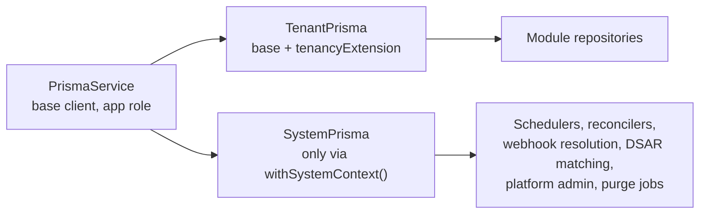

# 04. Database Architecture

> Status: Draft for review · Schema: [DATABASE_DESIGN.md](../DATABASE_DESIGN.md) · Related: [ADR-0005](adr/ADR-0005-postgres-source-of-truth.md), [ADR-0006](adr/ADR-0006-shared-schema-multitenancy.md), [ADR-0020](adr/ADR-0020-uuidv7-keys.md)

This document covers **how** the database is run and accessed. Tables and columns are in DATABASE_DESIGN.md.

## 1. Topology

- One PostgreSQL 18 container (`postgres:18`, pinned digest) with a named volume `pgdata` on the VPS NVMe disk.
- Private Docker network only, with no host port mapping. Local access for operators goes through `docker compose exec` over SSH.
- Extensions: `pg_trgm`, `btree_gin`, `pg_stat_statements`. `auto_explain` is loaded via `session_preload_libraries` for the app role.

## 2. Roles and privileges

| Role | Used by | Privileges | Session settings |
|------|---------|-----------|------------------|
| `lga_owner` | Nobody at runtime. Owns schema objects | All | — |
| `lga_migrator` | `migrate` one-off container | DDL on `public`, member of `lga_owner` | `lock_timeout=5s`, `statement_timeout=15min` |
| `lga_app` | api and worker | `SELECT, INSERT, UPDATE, DELETE` on app tables. **`audit_logs`: `INSERT, SELECT` only.** `usage_records`, `credit_grants`: no `DELETE` | `statement_timeout=15s` (api), worker override `30s` per session, `idle_in_transaction_session_timeout=30s`, `lock_timeout=3s` |
| `lga_readonly` | Support and analytics tooling | `SELECT` | `statement_timeout=60s`, `default_transaction_read_only=on` |
| `lga_backup` | backup container | `pg_read_all_data` | — |

Authentication is `scram-sha-256`. Passwords are random 32-byte values held in server env files only.

## 3. Connection management

| Process | Pool size | Notes |
|---------|-----------|-------|
| api | 10 | Requests hold a connection only during a query or transaction |
| worker | 15 | Concurrency across all queues ≤ ~40, and most jobs spend their time waiting on HTTP |
| migrate | 1 | |
| staging stack (when running) | api 3, worker 5 | Separate database `lga_staging` on the same instance, separate roles |

`max_connections = 60`. No PgBouncer until a second app host exists ([ARCHITECTURE.md](../ARCHITECTURE.md) §17.9).

## 4. Prisma client layering



- Use the latest Prisma major at scaffolding with the PostgreSQL driver adapter if that version requires one. Multi-file schema lives in `prisma/schema/*.prisma`.
- Tenant models are marked with a schema doc comment `/// @tenant`. A generator step emits `TENANT_MODELS` (a `Set<ModelName>`) used by the extension, so a new table can't be forgotten.
- **Tenancy extension algorithm** (`common/db/tenancy.extension.ts`), for each operation on a model in `TENANT_MODELS`:
  1. Read `workspaceId` from `RequestContext`. If it's missing and no system context is set, throw `TenantContextMissing`.
  2. `findMany | findFirst | count | aggregate | groupBy | updateMany | deleteMany`: `args.where = { AND: [args.where ?? {}, { workspaceId }] }`.
  3. `findUnique | findUniqueOrThrow | update | delete | upsert`: require that the unique selector is a compound `workspaceId_id` (or another compound unique including `workspaceId`). Otherwise throw `TenantUniqueSelectorRequired`.
  4. `create | createMany`: set `data.workspaceId = ctx.workspaceId`. If the caller passed a different value, throw.
  5. Nested writes and relation filters are covered by **composite foreign keys** at the DB level ([09-multi-tenancy.md](09-multi-tenancy.md) §4). The extension does not try to rewrite nested queries.
- `SystemPrisma` is obtained only through `withSystemContext(reason, fn)`, where `reason` is an enum (`SCHEDULER`, `RECONCILER`, `WEBHOOK`, `DSAR_MATCH`, `PLATFORM_ADMIN`, `PURGE`, `BILLING_SYNC`, `TENANT_RESTORE`). Every use is logged with the reason. ESLint flags imports of `SystemPrisma` outside an allowlisted set of directories.

## 5. Transactions and locking

| Concern | Approach |
|---------|---------|
| Default isolation | `READ COMMITTED` |
| Scheduler claims due enrollments | `SELECT … FOR UPDATE SKIP LOCKED LIMIT 500` |
| Credit reservation per workspace | `pg_advisory_xact_lock(hashtextextended('credits:' || workspace_id, 0))` inside the reserve transaction ([10-billing.md](10-billing.md) §5) |
| Campaign state commands | `SELECT … FOR UPDATE` on the campaign row + `row_version` check |
| Optimistic concurrency for edits | `row_version` compare-and-increment ([03-api.md](03-api.md) §7) |
| Job double-processing | Compare-and-set status transitions: `UPDATE … SET status='RUNNING' WHERE id=$1 AND status='QUEUED' RETURNING *`. Zero rows means another worker has it, so skip |
| Deadlock avoidance | Lock order convention: workspace advisory lock → campaign → enrollment → mailbox |
| Long work | Never inside a transaction (no HTTP or LLM calls while holding locks) |

## 6. SQL injection prevention (TM-03)

- Prisma query builder by default (parameterized).
- `$queryRaw` / `$executeRaw` **tagged templates only**. `$queryRawUnsafe` and `$executeRawUnsafe` are banned by ESLint (`no-restricted-properties`).
- Dynamic identifiers (sort columns, directions) come from **allowlist maps** (`{ createdAt: Prisma.sql\`created_at\`, score: Prisma.sql\`score\` }`), never from user strings.
- `LIKE`/trigram search input escapes `\`, `%` and `_`. Length is capped at 100.
- JSONB filters use fixed paths defined in code. User input only supplies values.
- Least privilege (§2) and `statement_timeout` limit the blast radius of any mistake.

## 7. JSONB discipline

- Every JSONB column has a Zod schema in `packages/contracts/db/*.ts` with `schemaVersion`.
- Repositories parse on read (`schema.parse`) and on write. Old versions go through **upcasters** (`v1 → v2` functions), so old rows never break reads.
- JSONB is never used for anything that is filtered or joined frequently. Those values are promoted to columns.

## 8. Hand-written SQL in migrations

Prisma can't express some objects, so they live in migration SQL with a comment in the schema:
- partial unique indexes (single Owner, live enrollments, pending approval, exactly-once sends, suppressions),
- GIN trigram indexes, BRIN on `email_events.occurred_at`,
- composite foreign keys on `(workspace_id, <fk>)` where Prisma relation syntax is insufficient,
- CHECK constraints (`credit_grants.remaining_millicredits >= 0`, `leads.score BETWEEN 0 AND 100`),
- grants per role,
- RLS policies (V1).

CI runs `prisma migrate diff --from-migrations --to-schema-datamodel` and fails on drift. A second check applies all migrations to an empty DB and runs `pg_dump --schema-only` to diff against a committed snapshot (`prisma/schema.snapshot.sql`), which catches hand-written SQL drift.

## 9. Migration safety

- **Expand → migrate → contract** across at least two releases.
- Checklist enforced in PR review (template):
  - [ ] No `ALTER TABLE … ADD COLUMN … DEFAULT <volatile>` on large tables.
  - [ ] New NOT NULL columns are added nullable, backfilled by a job, then constrained (`NOT VALID` + `VALIDATE CONSTRAINT`).
  - [ ] Indexes on large tables use `CREATE INDEX CONCURRENTLY` in their own migration (non-transactional).
  - [ ] No renames or drops of columns still read by the previous release.
  - [ ] `lock_timeout` is respected (the migration fails fast instead of blocking traffic).
- The deploy runs `migrate` **before** restarting api and worker. If it fails, the deploy stops and the old version keeps running.

## 10. Retention and purge jobs

- They run nightly at 02:00 UTC in the `maintenance` queue, in **batches of 1,000 rows** per statement with a short pause between batches, so autovacuum and locks stay calm.
- Each purge type is idempotent and resumable (keyed by cutoff timestamp) and records counts in logs and metrics.
- Workspace purge: delete in dependency order inside per-table batches, then the `workspaces` row. Files under `ws/{workspaceId}/` in object storage are deleted by prefix.

## 11. Configuration (8 GB VPS)

```ini
shared_buffers = 768MB
effective_cache_size = 2GB
work_mem = 16MB
maintenance_work_mem = 256MB
max_connections = 60
wal_level = replica                 # ready for WAL archiving in V1
max_wal_size = 2GB
checkpoint_timeout = 15min
random_page_cost = 1.1              # NVMe
effective_io_concurrency = 200
autovacuum_vacuum_scale_factor = 0.05
autovacuum_analyze_scale_factor = 0.02
log_min_duration_statement = 500ms
shared_preload_libraries = 'pg_stat_statements'
pg_stat_statements.track = top
auto_explain.log_min_duration = 1s
```

`email_events`, `usage_records` and `ai_runs` get per-table autovacuum settings (`autovacuum_vacuum_scale_factor=0.01`) because they are append-heavy.

## 12. Monitoring

- `pg_stat_statements` top 20 by total time, reviewed weekly (exported as metrics by the observability agent).
- Alerts: connections > 80% of max, replication/WAL archive lag (V1), table bloat on hot tables, disk > 80%, long-running transactions > 60 s, deadlocks > 0/hour.

## 13. Read scaling path

1. Rollup tables for analytics ([11-analytics.md](11-analytics.md)).
2. A read replica when analytics or exports load the primary (V1+), with `lga_readonly` pointed at the replica.
3. Declarative monthly partitioning for `email_events` and `ai_runs` past roughly 20M rows.
