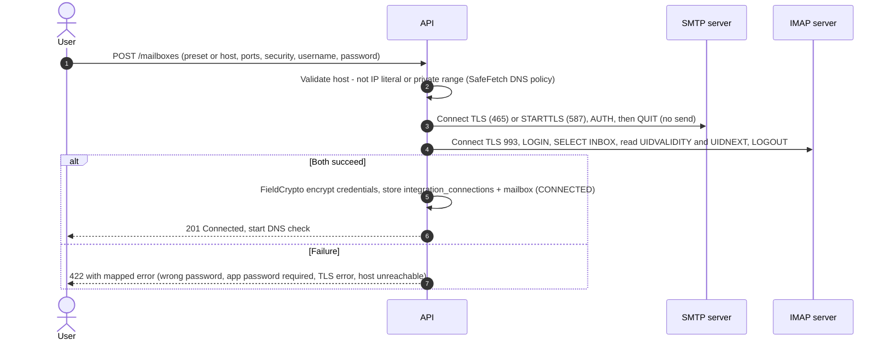
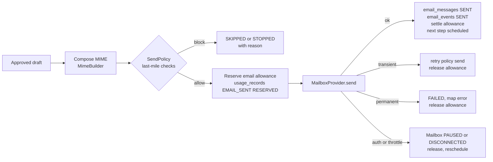
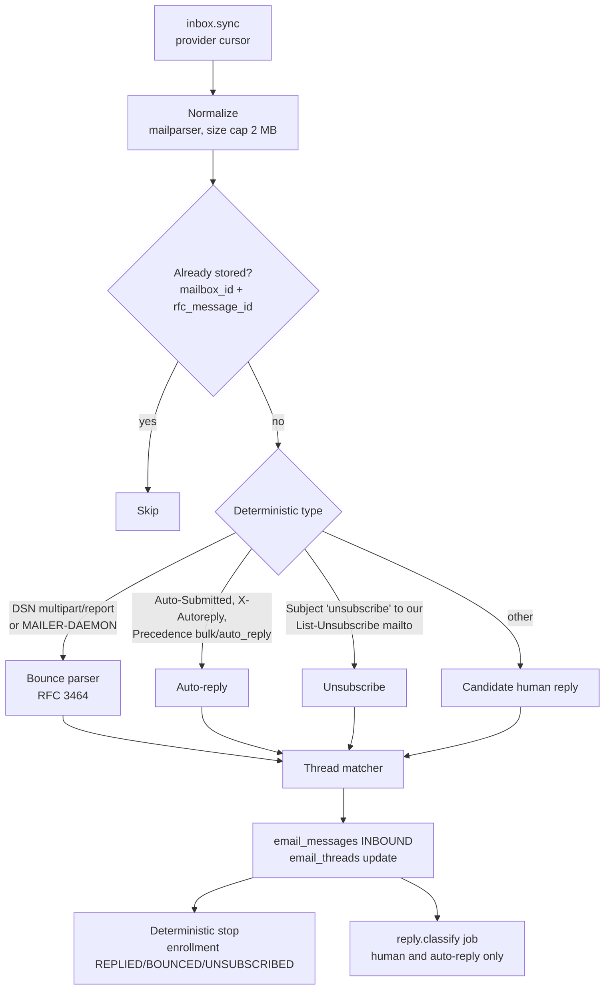

# 07. Email Infrastructure

> Status: Draft for review · Related: [ADR-0008](adr/ADR-0008-customer-mailboxes-only.md), [ADR-0014](adr/ADR-0014-polling-inbox-sync.md), [ADR-0015](adr/ADR-0015-tracking-off-links-domain.md), [ADR-0023](adr/ADR-0023-exactly-once-sending.md), [ADR-0024](adr/ADR-0024-hmac-unsubscribe-tokens.md), [INTEGRATIONS.md](../INTEGRATIONS.md) §6

## 1. Two separate email systems

| | **Outreach mail** | **System mail** |
|-|------------------|-----------------|
| Purpose | Cold sequences, replies to prospects | Verification, resets, invites, alerts, digests, billing notices |
| Sent through | The **customer's own mailbox** (SMTP, Microsoft Graph, Gmail API) | Amazon SES **or** Resend from `notify.<app-domain>` |
| From | Customer's address | `no-reply@notify.<app-domain>` |
| Volume controls | Caps, ramp-up, spacing, windows, plan allowance | Provider limits only |
| Code path | `email-engine` + `SendPolicy` | `notifications` module |

**The two never mix.** The `notifications` module cannot send to contacts (its API only accepts `userId` recipients), and `email-engine` cannot send through SES or Resend (ADR-0008).

## 2. Domains and DNS

| Domain | Purpose | Records we need |
|--------|---------|-----------------|
| `app.<domain>` | Web app + API | A/AAAA → VPS (optionally Cloudflare-proxied) |
| `notify.<domain>` | System mail | SPF include for SES or Resend, DKIM CNAMEs/TXT, `_dmarc` (`p=quarantine`, then `reject`), custom MAIL FROM (SES) |
| `links.<separate-domain>` | Unsubscribe pages, future click redirects | A/AAAA → VPS. Separate registrable domain to isolate reputation |
| Customer domains | Outreach | **Customer** must have SPF, DKIM and DMARC. We check them (§9) |

## 3. Mailbox connection flows

### 3.1 SMTP/IMAP (launch priority)



- Connection tests run in the API with a 15 s total timeout. The host must resolve to a public IP (the same IP policy as SafeFetch), which prevents probing internal services through "SMTP host" fields (TM-06).
- Certificates are validated (`rejectUnauthorized: true`), with no plaintext auth fallback.
- The initial IMAP cursor is set to `UIDNEXT`, so we don't import historical mail.
- **Sent-copy detection:** after connecting, a self-addressed test send (optional, user-confirmed) or the provider preset tells us whether the SMTP server saves sent mail automatically (`mailboxes.smtp_saves_sent`). If it doesn't, every outreach send is followed by an IMAP `APPEND` to the Sent folder (detected via `SPECIAL-USE \Sent`), so the user sees it in their mail client and crash reconciliation can find it (ADR-0023).

### 3.2 Microsoft 365 (Graph, OAuth)

Authorization code + PKCE with `state` bound to session + workspace + `mailbox.connect` intent. Scopes: `offline_access Mail.Send Mail.ReadWrite User.Read`. Tokens go to `integration_connections` (encrypted). `mailbox.token-refresh` refreshes 15 min before expiry. On `invalid_grant` the mailbox becomes `DISCONNECTED`, its campaigns stop scheduling from it, and the owner is notified (MBX-01 AC2).

### 3.3 Gmail (OAuth, testing mode)

The same flow with Google scopes `gmail.send gmail.modify`. The UI offers it only if the user's email is on the `GMAIL_OAUTH_TEST_USERS` allowlist (Google testing mode) and otherwise shows the app-password guide (ADR-0008).

## 4. Outbound pipeline



### 4.1 `SendPolicy` (deterministic last-mile checks)

All must pass **immediately before** the provider call, in the same process, reading fresh DB state:

| # | Check | Block reason |
|---|-------|-------------|
| SP-01 | Workspace status ∈ {`TRIALING`, `ACTIVE`} (or `PAST_DUE` within grace) and standing ≠ `SUSPENDED` | `WORKSPACE_BLOCKED` |
| SP-02 | Global, workspace and mailbox kill switches off | `KILL_SWITCH` |
| SP-03 | Campaign `ACTIVE` and enrollment `ACTIVE` | `NOT_ACTIVE` |
| SP-04 | No inbound reply on the thread or from the contact since enrollment (DB check, independent of AI) | `REPLIED` |
| SP-05 | Recipient email not suppressed (email hash) and domain not suppressed | `SUPPRESSED` |
| SP-06 | Contact `email_status = VALID` (or `CATCH_ALL` with campaign opt-in and the 10% cap) and verified within 60 days | `EMAIL_NOT_SENDABLE` |
| SP-07 | Country policy allows (including attestations) | `COUNTRY_POLICY` |
| SP-08 | Draft `APPROVED`, draft content hash unchanged since approval, `fact_ids` still exist | `DRAFT_NOT_APPROVED` |
| SP-09 | Workspace physical address and privacy-notice URL present (footer renderable) | `FOOTER_INCOMPLETE` |
| SP-10 | Mailbox `CONNECTED`, sent today < effective cap, within send window | `MAILBOX_CAPACITY` (reschedule) |
| SP-11 | Monthly email allowance available (reservation succeeds) | `EMAIL_LIMIT_REACHED` (pause campaign) |
| SP-12 | Trial limits (25/day, 100 total) if trialing | `TRIAL_LIMIT` |
| SP-13 | Launch approval satisfied (campaign approved if `launchRequiresApproval` and the creator is a Member) | `APPROVAL_MISSING` |

Every evaluation result is logged (check id + outcome, no PII). Blocks increment `email_send_blocked_total{reason}`.

### 4.2 MIME composition (`MimeBuilder`)

| Header | Value |
|--------|-------|
| `From` | `"{display_name}" <{mailbox.email_address}>`. The display name is sanitized (no CR/LF, no quotes or angle brackets, ≤ 64 chars) |
| `To` | Exactly one recipient (the contact) |
| `Subject` | Draft subject. CR/LF rejected (header injection, TM-11). RFC 2047 encoded if non-ASCII |
| `Message-ID` | `<{uuidv7}.{base32(enrollmentId:stepId hash)}@{sender-domain}>`, generated **before** sending and stored first (ADR-0023) |
| `In-Reply-To`, `References` | Previous message IDs in the enrollment thread, for `REPLY_IN_THREAD` steps |
| `List-Unsubscribe` | `<https://links.<domain>/u/{token}>, <mailto:{sender}?subject=unsubscribe>` |
| `List-Unsubscribe-Post` | `List-Unsubscribe=One-Click` |
| `X-LGA-Ref` | Opaque HMAC of `messageId`, used only to recognise our own messages in sync. No PII |
| `MIME-Version`, `Content-Type` | `multipart/alternative`: `text/plain; charset=utf-8` (primary) + minimal `text/html` (paragraphs, links, signature, no images, no tracking) |

**Footer** (both parts, appended by the builder, not by AI): sender company legal name and physical address, "Why am I receiving this?" link → privacy notice URL, unsubscribe link.

The mailto unsubscribe goes to the **sender's own mailbox**, so no inbound mail infrastructure is needed. Inbound processing recognises it deterministically (§7.3).

### 4.3 Provider result mapping

| Provider signal | Classification | Action |
|-----------------|---------------|--------|
| SMTP 2xx / Graph 202 / Gmail 200 | Sent | Persist `SENT` |
| SMTP 421, 450, 451, 452 / Graph 429, 503 / Gmail 429, 5xx | Transient | Retry (`send` policy). After 3 attempts, `FAILED` + reschedule next window |
| SMTP 535 / OAuth `invalid_grant` / Graph 401 | Auth | Mailbox `DISCONNECTED`, owner notified |
| SMTP 550 5.7.x policy, Gmail `rateLimitExceeded` / "daily sending quota", Graph `ErrorSubmissionQuotaExceeded` | Throttle or reputation | Mailbox `PAUSED` (`throttled`) for 24 h, alert the owner |
| SMTP 550 5.1.1 at submission (some servers check synchronously) | Hard bounce | As a DSN hard bounce (§7.2) |
| Other 5xx | Permanent | `FAILED` with code, no retry |

## 5. Unsubscribe tokens (ADR-0024)

```
token = "k" + keyId + "." + base64url(payload) + "." + base64url(HMAC_SHA256(key[keyId], payload)[0:16])
payload = { v:1, w: workspaceId, c: contactId, m: campaignId, t: issuedAtEpochSeconds }
```

- Verification: parse, look up `keyId` in `UNSUBSCRIBE_TOKEN_KEYS`, constant-time compare, and check `v`. There is **no expiry** (CAN-SPAM requires at least 30 days, and we keep them valid forever). Rotation adds a new key id while old ids stay valid for verification.
- `POST /u/:token` upserts `suppressions (workspace_id, email_hash, reason UNSUBSCRIBED)`, stops all live enrollments for the contact in that workspace, writes an `email_events UNSUBSCRIBED` row and an audit entry. It is idempotent and returns 200 even if already unsubscribed.
- The page shows only the sender company name, never the contact's email. Unsubscribe isn't reversible from the page.

## 6. Reply composition from the inbox

Inbox replies use the same `MimeBuilder` and a reduced `SendPolicy` (SP-01, SP-02, SP-05, SP-09 footer not required for 1:1 replies, mailbox connected). They require `inbox.reply` permission, are threaded, and are **always** user-initiated (an AI suggestion is never auto-sent, see doc 15 AIC-ACT).

## 7. Inbound pipeline



### 7.1 Sync per provider

| Provider | Cursor | Batch | Notes |
|----------|--------|-------|-------|
| IMAP | `UIDVALIDITY` + last UID (INBOX) | ≤ 200 messages per run | A `UIDVALIDITY` change triggers a resync from `SINCE now−3 days` |
| Graph | `deltaLink` (Inbox) | page size 50 | `410 Gone` triggers a resync from `receivedDateTime ge now−3d` |
| Gmail | `historyId` | `history.list` with `messageAdded` | `404` (expired history) triggers a resync from `newer_than:3d` |

Sync runs in system context with the mailbox's `workspace_id` set, holds a per-mailbox lock (`lock:sync:{mailboxId}`, TTL 5 min), and updates `last_synced_at` and the cursor in one transaction after persisting messages.

### 7.2 Bounce parsing

- `multipart/report; report-type=delivery-status`: parse `Final-Recipient`, `Action`, `Status`. Status `5.x.x` is **HARD** and `4.x.x` is **SOFT**. Original `Message-ID` from the `text/rfc822-headers` part links it to our message.
- No DSN structure but sender is `MAILER-DAEMON`/`postmaster`: use heuristic patterns (a 5.1.1-style code in the body), with low confidence → soft. A heuristic match **never** suppresses by itself without the recipient matching one of our sent recipients.
- Hard bounce: suppress (`HARD_BOUNCE`), set contact `email_status=INVALID`, enrollment `BOUNCED`, event. Soft: retry the step once after 24 h, then `FAILED` (PRD SND-06).
- Campaign auto-pause at > 3% hard bounces over the last 100 sends. Mailbox auto-pause at > 5% over 7 days.

### 7.3 Thread matching (in order)

1. `In-Reply-To` or any `References` id equals one of our `rfc_message_id`s for this mailbox.
2. Provider thread id (Gmail `threadId`, Graph `conversationId`) equals a stored thread.
3. `X-LGA-Ref` echoed in quoted headers (rare).
4. Sender email equals a contact with a live or recent (≤ 30 days) enrollment from this mailbox **and** the normalized subject matches (`Re:`/`AW:`/`RE:` stripped).
5. Otherwise the message is stored as **unmatched** in the "Other" inbox view (INB-01 AC2) and never dropped.

**Deterministic stops** (doc 15 AIC-ACT-REPLY): any matched inbound message that isn't an auto-reply or bounce stops the sequence (`REPLIED`) **before and regardless of** AI classification. Unsubscribe mailto replies suppress immediately.

### 7.4 HTML sanitization for display

`sanitize-html` / DOMPurify (server-side, jsdom) allowlist: `p, br, div, span, a[href], b, strong, i, em, u, ul, ol, li, blockquote, table/tr/td/th, img[src→data-lga-src,alt,width,height], h1–h4, pre, code, hr`. Only `https:`/`mailto:` links. All `style` attributes are stripped except a safe subset (`color, background-color, text-align, font-weight`). `<style>`, `<script>`, `<iframe>`, `<form>`, `<object>`, `on*` attributes and `javascript:`/`data:` URLs (except images) are removed. Bodies over 512 KB are truncated with a note. The original raw MIME isn't stored (size and PII minimization). Only parsed text and sanitized HTML are kept.

## 8. Deliverability controls (summary)

| Control | Default | Source |
|---------|---------|--------|
| Mailbox daily cap | 30 (warning above 50, max 100) | MBX-05 |
| Ramp-up | 5/day, +3/day until cap | MBX-05 |
| Minimum spacing | 120 s, randomized ×1–2.5 | §6 of 06 |
| Send window | Mon–Fri 09:00–17:00 recipient time | CAM-06 |
| Catch-all share | Off, or ≤ 10% of daily volume | ENR-02, CAM-02 |
| Campaign auto-pause | > 3% hard bounces over the last 100 | SND-06 |
| Mailbox auto-pause | Throttle/auth errors, > 5% hard bounces over 7 days | MBX-06 |
| Workspace flag | > 5% bounces or > 1% unsubscribes over 7 days → standing `WARNING` | SA-02 |
| Content | Plain-text-first, no images or attachments, no tracking by default, lint | CAM-05 |

## 9. Sending-domain DNS checks

| Record | Check | Pass criteria |
|--------|-------|---------------|
| SPF | `TXT` at domain starting `v=spf1`. Recursive include resolution with a 10-lookup limit | Exactly one SPF record, includes the mailbox provider (`_spf.google.com`, `spf.protection.outlook.com`, the SMTP host's documented include, or the host's IP/`a`/`mx` mechanism) and doesn't end in `+all` |
| DKIM | `TXT` at `{selector}._domainkey.{domain}` for known selectors (`google`, `selector1`, `selector2`, `default`, `s1`, `s2`, `k1`, plus user-entered) | At least one valid `v=DKIM1` key with `p=` non-empty |
| DMARC | `TXT` at `_dmarc.{domain}` | Exists with `v=DMARC1` and a `p=` tag. `p=none` passes with an advisory to tighten later |
| MX | `MX` records | Present (needed for replies) |

DNS lookups use Node's resolver with a 5 s timeout per query, are cached 10 min in Valkey, and results are stored in `sending_domains.check_details` with copy-paste fix instructions per DNS host in the UI.

## 10. System mail

- Templates are React Email or MJML compiled at build time, plain-text alternative included, rendered with escaped variables only.
- Sent via the `notify.email` job. Failures retry with the `standard` policy.
- SES bounces and complaints (SNS) or Resend webhooks go through `/webhooks/ses|resend`. A hard bounce marks `users.email_bounced_at` and stops non-critical notifications to that user.
- No marketing email from the platform in MVP. If added later, it uses a separate subdomain and consent flags.

## 11. Testing

- Local: **Mailpit** (SMTP + web UI) for system and outreach mail. **GreenMail** container for IMAP sync tests.
- Fixture corpus: real-world DSNs (Gmail, Outlook, Exchange, Postfix), auto-replies in 5 languages, mailto unsubscribes, and HTML emails with malicious payloads (XSS vectors) for sanitizer tests.
- Contract tests for Graph and Gmail adapters use recorded responses.
- Gate 3 dogfood campaign (ROADMAP Phase 3) across real SMTP and Microsoft mailboxes.
