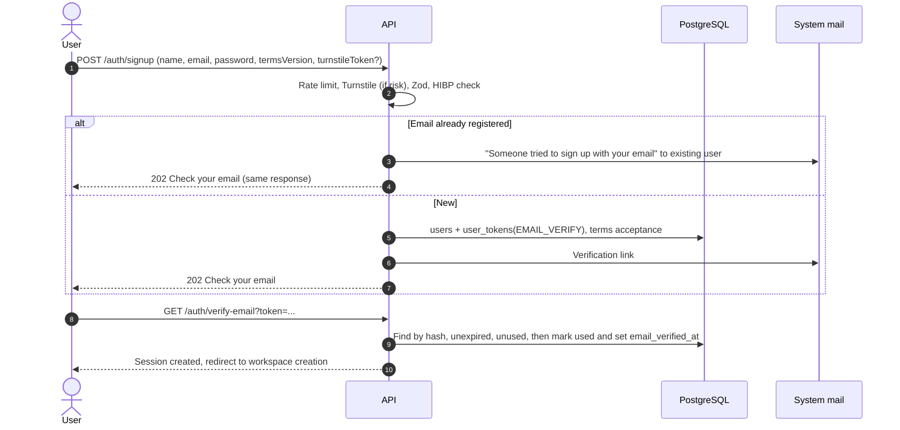

# 08. Authentication

> Status: Draft for review · Related: [ADR-0007](adr/ADR-0007-opaque-server-sessions.md), [ADR-0016](adr/ADR-0016-workspace-roles-rbac.md), [SECURITY.md](../SECURITY.md) §3, PRD AUTH-01 to AUTH-08
>
> **Implemented (2026-11-27):** email/password signup, verification, login, sessions, step-up, reset, workspaces, invitations, members and the `READ_ONLY` role. [ADR-0034](adr/ADR-0034-auth-implementation-and-read-only-role.md) records where the implementation settles open points:
> - The session starts at verification, not signup.
> - Verification is `POST`.
> - The worker mints tokens at send time.
> - The progressive delay is `429` + `Retry-After`.
> - SMTP is used for system mail.
>
> OAuth (§4.3), email change (§4.5) and MFA (§9) are not built yet.

## 1. Identity model

- `users` (one per human, email unique), `auth_identities` (Google and Microsoft OIDC subjects linked to a user), `sessions`, `user_tokens` (verify, reset, email change), `mfa_factors`.
- Login identities (OIDC `openid email profile`) are **separate** from mailbox and calendar OAuth grants (`integration_connections`). Signing in with Google never grants mailbox access.

## 2. Secrets and token formats

| Token | Generation | Stored as | Lifetime |
|-------|-----------|-----------|----------|
| Session | 32 random bytes, base64url | `sha256(token ‖ SESSION_PEPPER)` | Idle 7 d, absolute 30 d |
| Email verification | 32 bytes | sha256 | 24 h, single use |
| Password reset | 32 bytes | sha256 | 30 min, single use |
| Email change | 32 bytes | sha256 | 24 h, single use, sent to the **new** address + notice to the old |
| Invitation | 32 bytes | sha256 | 7 d |
| MFA recovery codes | 10 × 10 chars (base32) | argon2id each | Until used |
| TOTP secret | 20 bytes | `FieldCrypto` encrypted | Until removed |

Token lookups are by hash (an index lookup), so no timing-sensitive string compare is needed. Raw tokens exist only in the email or cookie.

## 3. Password handling

- `@node-rs/argon2`, argon2id, `memoryCost=19456 KiB`, `timeCost=2`, `parallelism=1`. Parameters are stored in the hash string and rehashed on login if they are weaker than current.
- Policy: length 12–128 (Unicode NFKC-normalized), no composition rules, rejected if found in HIBP (k-anonymity range query, 2 s timeout, fail-open with a metric).
- Passwords are never logged and are scrubbed from Sentry (`password`, `currentPassword`, `newPassword`).

## 4. Flows

### 4.1 Signup and verification

- A session **is** issued at signup (so the user can continue), but unverified users are blocked from credit spend, mailbox connect and campaigns (`EMAIL_NOT_VERIFIED`, AUTH-02 AC3).
- **Cloudflare Turnstile** (free) is required on signup always, and on login after 3 failures from an IP or account. It's verified server-side.

### 4.2 Login

1. Throttle check (§5). 2. Look up user by `email_normalized`. 3. argon2 verify against the real hash, or against a dummy hash if the user doesn't exist, so timing is equal. 4. On success: rotate (new session, delete any pre-auth session), reset failure counters, record `last_login_at`, send a new-device email if `(ua family, /16 IP prefix)` was not seen in the last 90 days. 5. On failure: generic `401 "Email or password is incorrect"`.

### 4.3 OAuth sign-in (Google, Microsoft)

- Library: `openid-client` (certified OIDC RP). Authorization code + **PKCE** + `state` (stored in a 10-min `__Host-lga_oauth` cookie, HMAC-signed) + `nonce` validated in the ID token.
- Microsoft uses the `common` endpoint. Issuer validation accepts the `https://login.microsoftonline.com/{tid}/v2.0` pattern with tenant id taken from the token.
- **Linking rules:** if `auth_identities(provider, sub)` exists, sign in. Else, if the IdP asserts `email_verified=true` (Google) or the email is a verified tenant UPN (Microsoft) and it matches an existing user, **require the existing password** (or an emailed link for OAuth-only users) before linking (AUTH-03 AC2). Else create a new user with `email_verified_at=now`.
- Redirect URIs are exact-match (`https://app.<domain>/api/v1/auth/oauth/{provider}/callback`). No open redirect: the post-login `next` parameter must be a relative path matching `^/[a-z0-9/_-]*$`.

### 4.4 Password reset

Same response regardless of account existence. Reset links are built from the configured `APP_ORIGIN`, **never** from the request `Host` header (reset-poisoning defense). A successful reset revokes all sessions and emails a confirmation.

### 4.5 Email change

Requires step-up (§7). The verification link goes to the new email. The old email gets a notice with a "This wasn't me" link that revokes sessions and reverts the change within 7 days.

## 5. Brute-force and abuse defense

| Counter (Valkey) | Window | Threshold | Effect |
|------------------|--------|-----------|--------|
| `auth:fail:acct:{emailHash}` | 15 min | 5 | Progressive delay (1 s, 2 s, 4 s … max 30 s) + Turnstile required |
| `auth:fail:acct:{emailHash}` | 24 h | 20 | Account soft-lock 1 h + email to owner ("unlock now" link) |
| `auth:fail:ip:{ip}` | 15 min | 30 | Turnstile required for all logins from the IP |
| `auth:signup:ip:{ip}` | 1 h | 5 | 429 |
| `auth:reset:acct:{emailHash}` | 1 h | 3 | Silently drop extra emails |

nginx `limit_req zone=auth rate=10r/m burst=20` applies in front of all of this. Cloudflare proxy (free) is recommended for the app domain for basic DDoS absorption. nginx then trusts `CF-Connecting-IP` only from Cloudflare IP ranges.

## 6. Sessions

- Cookie: `__Host-lga_session=<token>; Path=/; Secure; HttpOnly; SameSite=Lax`. No `Domain` attribute, so it's never sent to the links domain.
- Resolution: `SessionGuard` hashes the cookie, checks the Valkey cache `sess:{hash}` (TTL 60 s), and falls back to the DB. It rejects revoked or expired sessions and slides `idle_expires_at` (written at most once every 10 min to limit writes).
- Revocation (logout, "sign out all", password reset, removal from all workspaces, admin action) deletes the DB row state and the Valkey cache entry immediately.
- **Role changes** take effect on the next request because permissions are loaded from `memberships` per request (not cached in the session), with a 30 s cache keyed by `(userId, workspaceId, membershipVersion)`.

## 7. Step-up (re-authentication)

`sessions.reauthenticated_at` is set when the user re-enters their password (or TOTP or a passkey later). Endpoints decorated `@RequireRecentAuth(10 * 60)` return `403 REAUTH_REQUIRED` if it's older:
email change, password change, workspace deletion, ownership transfer, contacts export, BYOK key create/rotate, disconnect all mailboxes, enable or disable 2FA, billing owner changes.

## 8. CSRF design (TM-05)

1. Same-origin deployment: the browser only ever calls `https://app.<domain>/api/...`.
2. `SameSite=Lax` session cookie (not sent on cross-site POST/fetch).
3. `OriginGuard` on `POST/PUT/PATCH/DELETE`: requires `Origin` equal to `APP_ORIGIN` (or `Sec-Fetch-Site: same-origin` when `Origin` is absent) **and** header `X-Requested-With: lga-web`. A custom header can't be sent cross-origin without a CORS preflight, and we answer preflights with no CORS headers, so they fail.
4. Exempt: `/webhooks/*` (signature-authenticated, no cookies used) and `/u/*` (token-authenticated, idempotent, no session use).
5. No state changes on GET (lint rule: `@Get()` handlers may not call services annotated `@Mutating`).

## 9. MFA

- **Super Admins: TOTP mandatory in MVP.** This is a platform-security requirement, implemented early and only for the `/admin` login path. Customer-facing 2FA (AUTH-07) is V1.
- V1: TOTP enrollment (QR + verify), 10 recovery codes, workspace setting "require 2FA for Owners and Admins", and an MFA challenge at login when enrolled. Sessions record `mfa_verified_at`.
- Later: passkeys (WebAuthn) as an MFA factor and passwordless option.

## 10. Platform admin and impersonation

- `PlatformAdminGuard`: `users.platform_role = SUPER_ADMIN` + `mfa_verified_at` on the session within 12 h + client IP in `ADMIN_IP_ALLOWLIST` (also enforced by nginx for `/admin`).
- Impersonation: `POST /api/v1/admin/impersonations {workspaceId, reason}` creates a **separate session** flagged `impersonation = {adminUserId, workspaceId, expiresAt: +30 min, readOnly: true}`. `PermissionGuard` allows only `*.read`/`analytics.view` permissions under impersonation. Any write returns 403 unless a second, explicitly confirmed "write mode" is granted (logged, 10 min). Start and end are audited in the platform log **and** the workspace audit log (visible to the Owner).

## 11. Account enumeration defenses

The same response and similar timing for signup, login, reset and verification-resend whether or not the account exists. Invitations return the same message for existing and new users. Rate limits key on email hash, so attackers can't use them to probe.

## 12. Future

API keys (public API), SSO via SAML/OIDC per workspace (domain verification + JIT provisioning), passkeys.

## 13. Tests

Unit: token hashing, argon2 rehash rule, linking rules, origin checks. Integration: every flow above, including timing-equalization smoke checks, lockout thresholds, session revocation propagation within 60 s (cache TTL), and impersonation read-only enforcement across all mutating routes (generated from the route table).
