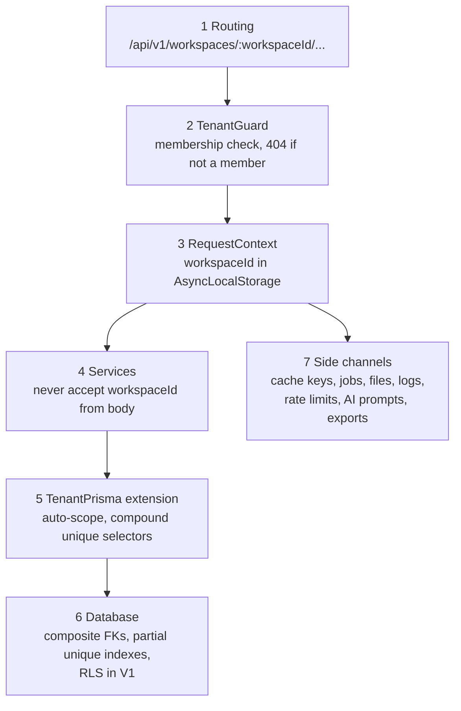
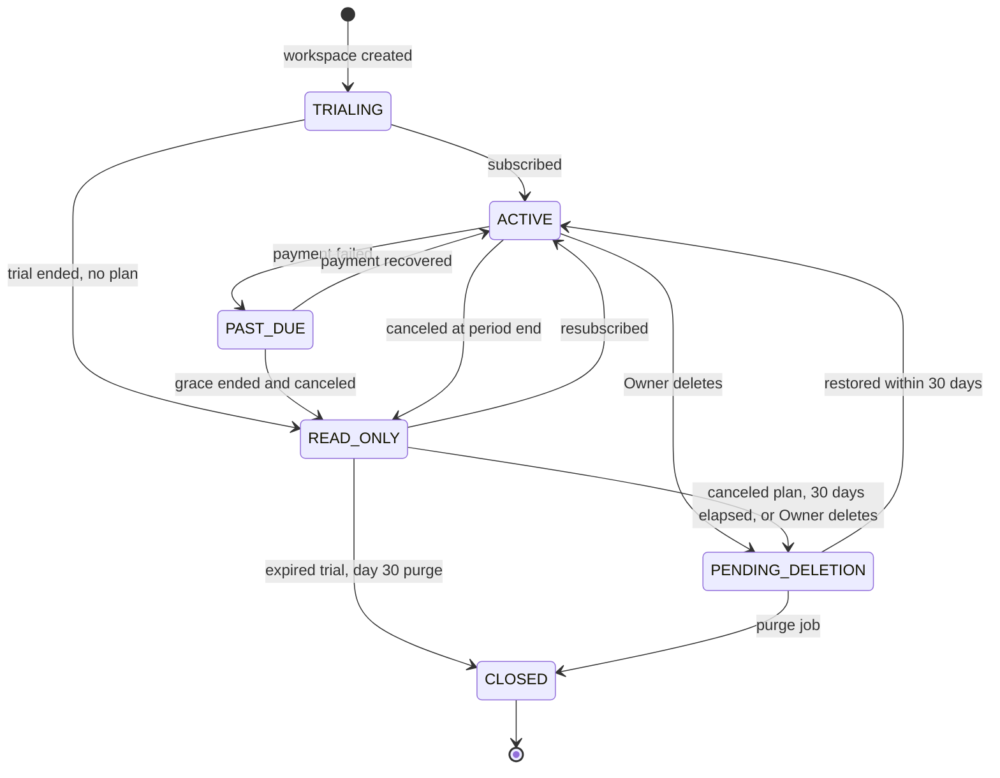

# 09. Multi-tenant Isolation

> Status: Draft for review · Related: [ADR-0006](adr/ADR-0006-shared-schema-multitenancy.md), [ADR-0016](adr/ADR-0016-workspace-roles-rbac.md), [DATABASE_DESIGN.md](../DATABASE_DESIGN.md) §7, threat TM-01

## 1. Model

- **Tenant = workspace.** Every tenant-owned row has `workspace_id` (UUIDv7, NOT NULL).
- Users are global. Access to a workspace exists only through `memberships`.
- Agencies separate clients by `business_profiles` **inside** one workspace. Within a workspace all members see all business profiles in MVP. Per-profile restrictions come with the future Viewer/Client role.

## 2. Defense in depth



Each layer is designed to hold **even if the layer above fails**.

## 3. Request path

| Step | Control |
|------|---------|
| `:workspaceId` param | Must be a UUID. Invalid → 404 |
| `TenantGuard` | `SELECT role FROM memberships WHERE workspace_id=$1 AND user_id=$2`. Missing → **404 `NOT_FOUND`** (don't reveal existence). Workspace `CLOSED` → 404. `PENDING_DELETION`/`READ_ONLY` → reads allowed, writes `403 WORKSPACE_RESTRICTED` |
| Super Admin | No implicit membership. Must use impersonation ([08-authentication.md](08-authentication.md) §10) |
| Body fields | `workspaceId`, `role`, `status`, `ownerUserId`, `createdBy*` are **never** accepted from bodies (strict Zod schemas) |
| Nested resources | Always looked up with `{ id, workspaceId }`. A resource from workspace B requested under workspace A's path returns 404 |

## 4. Database-level guarantees

### 4.1 Composite foreign keys (cross-tenant reference prevention)

Every tenant table has `UNIQUE (workspace_id, id)`. Every tenant-to-tenant foreign key includes `workspace_id`:

```sql
ALTER TABLE campaign_enrollments
  ADD CONSTRAINT fk_enrollment_contact
  FOREIGN KEY (workspace_id, contact_id) REFERENCES contacts (workspace_id, id);
```

This makes it **impossible at the DB level** to create, for example, an enrollment in workspace A that points at a contact, mailbox, lead or campaign in workspace B, even if application code has a bug. It applies to all tenant FKs (DATABASE_DESIGN.md §2 convention).

### 4.2 Other constraints

- Partial unique indexes always include `workspace_id` (suppressions, live enrollments, dedupe keys).
- `audit_logs` is append-only for the app role.
- V1: PostgreSQL RLS on `contacts`, `companies`, `email_messages`, `email_threads`, `integration_connections`, `suppressions`, `message_drafts` with `USING (workspace_id = current_setting('app.workspace_id', true)::uuid)`. `TxManager` sets `SET LOCAL app.workspace_id` in every tenant transaction. System context uses a separate role with `BYPASSRLS` (`lga_system`), only from allowlisted modules.

## 5. Side channels

| Channel | Isolation rule |
|---------|---------------|
| Valkey cache keys | Always `ws:{workspaceId}:…`. Global keys only for non-tenant data (`sess:`, `rl:provider:`, `lock:`) |
| Rate limits and fairness | Keyed per workspace and user. One tenant can't exhaust another's limit (shared provider limits use fairness, see [06-background-jobs.md](06-background-jobs.md) §8) |
| Jobs | Envelope carries `workspaceId`. Processors run inside it. A job for workspace A that loads an entity not in A fails via the tenancy extension |
| Object storage | Keys `ws/{workspaceId}/{purpose}/{uuid}`. Downloads use pre-signed URLs (5–15 min) generated only after a tenant-scoped DB lookup of `file_objects`. The bucket is private |
| Logs and Sentry | `workspaceId` included for debugging. No content. Log access is limited to operators |
| AI prompts | `ContextBuilder` only receives entities loaded through `TenantPrisma` in the job's workspace. AIC-PRE-07 asserts every included entity's `workspaceId` equals the context ([15-ai-security-controls.md](15-ai-security-controls.md)) |
| Provider caches | No cross-tenant reuse of provider data (INTEGRATIONS.md principle 4). Research facts are per workspace |
| Exports and DSAR | Generated in the requester's workspace context only |
| Analytics | Rollups keyed by `workspace_id`. Platform-level aggregates only in Super Admin views (system context) |
| Email threading | Matching is per mailbox (mailbox belongs to exactly one workspace) |
| Search indexes | PostgreSQL indexes are always filtered by `workspace_id` first |

## 6. System context (the controlled exception)

`withSystemContext(reason, fn)` is the **only** way to query across workspaces.

| Reason | Allowed callers | Typical query |
|--------|----------------|---------------|
| `SCHEDULER` | `campaigns/jobs`, `email-engine/jobs` | Due enrollments across workspaces, then each processed in its own workspace context |
| `RECONCILER` | `maintenance` processors | Stale statuses |
| `WEBHOOK` | `webhooks` processor | Resolve provider ids → workspace |
| `DSAR_MATCH` | `compliance` | Find workspaces holding an email hash (returns workspace ids only, then notifies each) |
| `PLATFORM_ADMIN` | `admin` controllers (Super Admin) | Directory, standing |
| `PURGE` | Retention and workspace purge | Batched deletes |
| `BILLING_SYNC` | `billing` | Reconcile subscriptions |
| `TENANT_RESTORE` | Operator CLI only (`dist/cli.js`), never from HTTP | Re-import one workspace's rows from a side database ([13-backup-recovery.md](13-backup-recovery.md) §6 F) |

Rules: system-context code must immediately **narrow to a single workspace** (`runInWorkspace(id, …)`) before doing per-tenant work. Every entry is logged with its reason. Code review requires a security reviewer for new system-context call sites (CODEOWNERS on the allowlist file).

## 7. Tenant lifecycle



Sending standing (`GOOD`/`WARNING`/`RESTRICTED`/`SUSPENDED`) is orthogonal and enforced by `SendPolicy` SP-01 and entitlement checks.

## 8. Noisy-neighbor protection

- Per-workspace job concurrency caps (06 §2), scheduler per-tick caps, per-workspace API rate limits.
- Expensive queries are capped (`statement_timeout`, pagination max 100, `total` estimate cap).
- Plan limits on contacts stored, mailboxes and emails per month bound each tenant's footprint.

## 9. Testing (mandatory)

1. **Generated cross-tenant API suite:** the test harness reads the Nest route table and, for every route with `:workspaceId`, seeds workspace A (resource owner) and workspace B (attacker member). It then calls the route as B with A's resource IDs (path and body) and expects **404** (or 403 for permission-only routes). A new route without coverage fails CI.
2. **Repository suite:** every repository method is called under workspace B's context with A's IDs and must return nothing or throw.
3. **DB constraint tests:** attempt cross-tenant FK inserts directly with SQL and expect a violation.
4. **Lint:** forbid `findUnique({ where: { id } })` on tenant models. Forbid `SystemPrisma` imports outside the allowlist.
5. **Jobs:** processors invoked with a mismatched `workspaceId`/entity pair must fail without side effects.
6. Periodic (V1): RLS enabled in the test DB to catch any query the extension missed.
