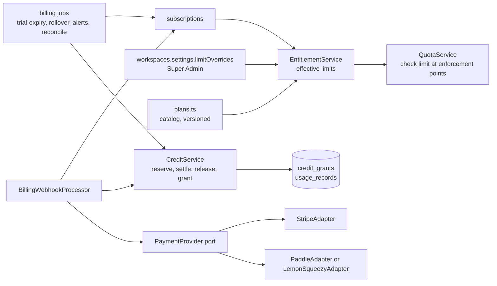

# 10. Billing Architecture

> Status: Draft for review · Related: [ADR-0018](adr/ADR-0018-credit-ledger.md), [ADR-0019](adr/ADR-0019-hosted-checkout-payment-port.md), PRD §8 and BIL-01 to BIL-06, [INTEGRATIONS.md](../INTEGRATIONS.md) §9

## 1. Components



## 2. Plan catalog (`platform/billing/plans.ts`)

```ts
export const PLANS = {
  trial:   { seats: 2,  businessProfiles: 1,  mailboxes: 1,  emailsPerMonth: null, emailsTotal: 100, emailsPerDay: 25,
             monthlyCredits: 0, trialCredits: 150, contactsStored: 1_000,  activeCampaigns: 1,  autonomy: ['L0','L1'] },
  starter: { seats: 2,  businessProfiles: 1,  mailboxes: 3,  emailsPerMonth: 3_000,  monthlyCredits: 2_000,
             contactsStored: 10_000,  activeCampaigns: 5,    autonomy: ['L0','L1'],
             prices: { monthly: 4900, annualPerMonth: 3900 }, addOns: { seat: 1500, mailbox: 500 } },
  growth:  { seats: 5,  businessProfiles: 3,  mailboxes: 10, emailsPerMonth: 15_000, monthlyCredits: 8_000,
             contactsStored: 50_000,  activeCampaigns: null, autonomy: ['L0','L1','L2'],
             prices: { monthly: 12900, annualPerMonth: 10300 }, addOns: { seat: 1500, mailbox: 500 } },
  agency:  { seats: 15, businessProfiles: 15, mailboxes: 40, emailsPerMonth: 60_000, monthlyCredits: 25_000,
             contactsStored: 250_000, activeCampaigns: null, autonomy: ['L0','L1','L2'],
             prices: { monthly: 29900, annualPerMonth: 23900 }, addOns: { seat: 1000, mailbox: 400 } },
} as const satisfies Record<PlanKey, PlanDefinition>;

export const CREDIT_PACKS = { pack_1k: { credits: 1_000, price: 1500 }, pack_5k: { credits: 5_000, price: 6000 },
  pack_20k: { credits: 20_000, price: 20000 }, pack_100k: { credits: 100_000, price: 80000 } };

export const CREDIT_COSTS_MILLI = { VERIFICATION: 1000, AI_DRAFT: 1000, AI_REPLY: 1000, RESEARCH: 2000,
  WEBSITE_ANALYSIS: 20000 /* first per profile free */, ICP_GENERATION: 5000 /* first 3 free */, SCORE_ADJUST: 200 };
```

- `null` means unlimited. Prices are in cents. Provider price IDs are mapped in env-specific config (`billing/price-map.{env}.json`), never in code.
- The catalog is **versioned** (`PLAN_CATALOG_VERSION`). Existing subscribers keep their limits until they change plan (grandfathering is explicit, not accidental).

## 3. Entitlements and enforcement

`EntitlementService.get(workspaceId)` returns effective limits = plan + paid add-ons (`subscriptions.extra_seats`, `extra_mailboxes`) + Super Admin overrides. It's cached in Valkey `ws:{id}:entitlements` (TTL 5 min, invalidated on subscription or override change).

| Limit | Enforcement point | Check |
|-------|------------------|-------|
| Seats | Invite create, invite accept | `members + pending invites < seats` |
| Business profiles | Create profile, unarchive | count non-archived |
| Mailboxes | Connect mailbox | count non-disconnected |
| Contacts stored | Discovery, import, manual add (pre-check + per-batch check) | count non-deleted contacts. 90% warning |
| Active campaigns | Launch, resume, approve | count `ACTIVE`+`SCHEDULED` |
| Emails per month / trial totals | `SendPolicy` SP-11/SP-12 via `usage_records EMAIL_SENT` reservation | sum in current period |
| Autonomy level | Campaign settings update | allowed set |
| Credits | `CreditService.reserve` before every credit action | balance |

Each limit failure returns `402 QUOTA_EXCEEDED` (or `CREDITS_INSUFFICIENT`) with `{key, used, limit}` for the UI's `LimitReachedPanel`.

## 4. Billing status state machine

Workspace `status` is derived from trial and subscription events (see the lifecycle diagram in [09-multi-tenancy.md](09-multi-tenancy.md) §7):

| Event | Transition | Side effects |
|-------|-----------|--------------|
| Workspace created | → `TRIALING`, `trial_ends_at = +14 d` | `TRIAL` grant of 150 credits expiring at trial end |
| Checkout completed (subscription) | → `ACTIVE` | `subscriptions` row. The first `invoice.paid` creates the `PLAN` grant |
| `invoice.paid` (renewal) | stay `ACTIVE` | New `PLAN` grant for the period (`external_ref`=invoice id). Previous `PLAN` grant expires at its `expires_at` |
| `invoice.payment_failed` | → `PAST_DUE`, `grace_period_ends_at = +7 d` | Owner email + banner. Sending continues during grace |
| Grace elapsed, unpaid | stay `PAST_DUE` (sending paused) | Campaigns paused with reason `PAST_DUE`. Credit spend blocked |
| Payment recovered | → `ACTIVE` | Campaigns auto-resume (they were paused automatically, not manually) |
| Subscription canceled (period end) | → `READ_ONLY` | Exports allowed. Sending and credit spend blocked. Reply sync continues 14 days |
| Trial ended without subscription | → `READ_ONLY` | Same, and purge at day 30 (DATABASE_DESIGN §8.1) |
| Upgrade | stay `ACTIVE` | Provider prorates immediately. Entitlements updated on webhook. **Monthly credit difference** granted immediately as a prorated `PLAN` grant |
| Downgrade request | scheduled at period end | Blocked if current usage exceeds the target plan. The API returns the list of items to reduce (BIL-02 AC2) |

## 5. Credit ledger algorithms (ADR-0018)

Units: **millicredits** (`bigint`). One credit = 1,000.

### 5.1 Reserve

```sql
BEGIN;
SELECT pg_advisory_xact_lock(hashtextextended('credits:' || $ws, 0));
-- available = unexpired grant remainder − open reservations
SELECT COALESCE(SUM(remaining_millicredits),0) AS remaining FROM credit_grants
  WHERE workspace_id=$ws AND expires_at > now() AND remaining_millicredits > 0;
SELECT COALESCE(SUM(quantity),0) AS reserved FROM usage_records
  WHERE workspace_id=$ws AND metric='CREDITS' AND status='RESERVED';
-- if remaining − reserved < $qty → ROLLBACK; throw CREDITS_INSUFFICIENT
INSERT INTO usage_records (workspace_id, metric, action, quantity, status, idempotency_key, reference_type, reference_id, period, actor_user_id)
  VALUES ($ws,'CREDITS',$action,$qty,'RESERVED',$key,$refType,$refId,$period,$actor)
  ON CONFLICT (idempotency_key) DO NOTHING;   -- replay returns the existing reservation
COMMIT;
```

Idempotency keys are deterministic per action: `ver:{contactId}:{yyyymmdd}`, `draft:{enrollmentId}:{stepId}:{version}`, `research:{companyId}:{yyyymm}`, `reply:{threadId}:{messageId}`, and so on.

### 5.2 Settle

Under the same advisory lock: debit grants in **spend order** (PRD BIL-03 AC2) and record what was taken.

```
order: source IN (TRIAL, PLAN) first by expires_at, then PACK and ADJUSTMENT by expires_at, then created_at
for each grant while need > 0: take = min(grant.remaining, need); grant.remaining -= take; debits.push({grantId, take})
usage_record.status = SETTLED, grant_debits = debits, quantity = actualQty (≤ reserved)
if need > 0 (grant expired between reserve and settle): record shortfall_millicredits, absorbed by platform, metric++
```

### 5.3 Release

The status becomes `RELEASED` (no grant changes). It's used on provider failure, invalid AI output, cancellation and reconciler timeout (reservations older than 1 h).

### 5.4 Grants

| Source | Created by | Expires | Idempotency |
|--------|-----------|---------|-------------|
| `TRIAL` | Workspace creation | `trial_ends_at` | one per workspace (UQ partial) |
| `PLAN` | `invoice.paid` webhook / rollover job | `current_period_end` | `(PLAN, invoice id)` |
| `PACK` | Checkout `mode=payment` completed | +12 months | `(PACK, checkout session id)` |
| `ADJUSTMENT` | Super Admin (reason required, audited) | Chosen (default +12 months) | `(ADJUSTMENT, admin action id)` |
| `REFUND` | Not a positive grant. A pack refund **zeroes** that grant's remainder (audit entry) | — | `(REFUND, refund id)` |

### 5.5 Balance reads

`GET /billing/credits` returns `{available, reserved, grants[], recent ledger}`. The UI badge uses a cached value (`ws:{id}:credits`, refreshed after each settle/grant, TTL 60 s). **Authorization decisions never use the cache**, only the locked SQL in §5.1.

## 6. Payment provider integration (ADR-0019)

```ts
interface PaymentProvider {
  createSubscriptionCheckout(i: { workspaceId; planKey; interval; seats; mailboxes; customerRef?; successUrl; cancelUrl }): Promise<{ url }>;
  createPackCheckout(i: { workspaceId; packKey; customerRef?; successUrl; cancelUrl }): Promise<{ url }>;
  createPortalSession(i: { customerRef; returnUrl }): Promise<{ url }>;
  verifyWebhook(rawBody: Buffer, headers: IncomingHttpHeaders): ProviderEvent;   // throws on invalid
  fetchSubscription(ref: string): Promise<ProviderSubscription>;                 // authoritative re-fetch
  fetchCheckout(ref: string): Promise<ProviderCheckout>;
}
```

- Checkout sessions are created **server-side** from catalog price IDs. The client sends only `planKey`/`packKey`/`interval`/quantities, validated against the catalog. Metadata carries `workspaceId` (resolved server-side) and the price map version.
- **Webhook processing re-fetches** the subscription, checkout or invoice from the provider API and applies the authoritative state. This defeats out-of-order and replayed events (TM-09).
- Stripe events handled: `checkout.session.completed`, `invoice.paid`, `invoice.payment_failed`, `customer.subscription.updated`, `customer.subscription.deleted`, `charge.refunded`. Merchant-of-record adapters map their equivalent events to the same internal `ProviderEvent` union.
- Tax: Stripe Tax on Checkout (or merchant of record). Invoices and receipts come from the provider, so we never generate tax documents ourselves.

## 7. Jobs

| Job | Schedule | Function |
|-----|----------|----------|
| `billing.trial-expiry` | hourly | Trials past `trial_ends_at` become `READ_ONLY` + notify. Day 14/25 deletion warnings |
| `billing.period-rollover` | hourly sweep (webhooks are primary) | Safety net: active subscriptions whose current period has no `PLAN` grant → fetch the invoice and grant |
| `billing.usage-alerts` | hourly | 80% credits, 80% emails, 90% contacts → notify Owner once per period per threshold |
| `billing.reconcile` | nightly | Compare every `subscriptions` row with `fetchSubscription`. Fix drift, alert on mismatch |

## 8. Security (see SECURITY.md §7.7 and threat model TM-09)

- Only `billing.manage` (Owner) can start checkout or the portal. Re-auth isn't required for checkout (the provider handles payment auth), but it is for ownership transfer.
- No card data on our servers (hosted checkout). Webhook secrets live in env only.
- Amounts and plan limits are never read from client input or webhook payload amounts. They always come from the catalog and the re-fetched provider state.
- Credit adjustments are Super Admin only, with reason, audit entry, and visibility in the workspace usage history (SA-04).

## 9. Testing

- Unit: entitlement resolution, spend order, settle shortfall, downgrade validation.
- Concurrency: 50 parallel reservations against a 10-credit balance. Exactly 10 succeed and the balance never goes negative.
- Provider sandbox E2E (Stripe test mode + test clocks): trial → subscribe → renew → fail → recover → upgrade → pack → refund → cancel (ROADMAP Phase 5 exit).
- Webhook replay tests: duplicate and out-of-order deliveries produce identical end state.
