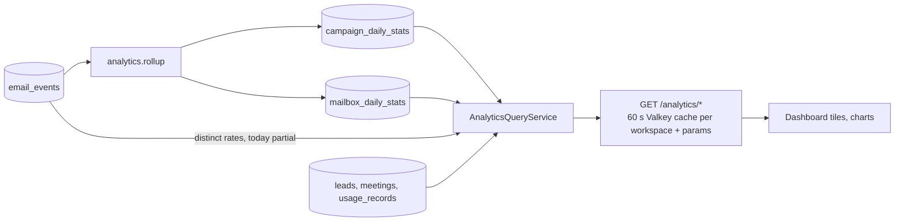

# 11. Analytics Architecture

> Status: Draft for review · Related: [ADR-0025](adr/ADR-0025-postgres-analytics-rollups.md), PRD ANA-01 to ANA-09 and §13

## 1. Approach

- **No separate warehouse or third-party product analytics at launch.** Customer analytics come from an append-only event table plus rollups in PostgreSQL. Our own product KPIs (activation, conversion, retention) are **derived from existing domain tables**. There's zero extra cost and no extra sub-processor.
- Rollups are **recomputable** from source tables at any time (idempotent), so a bug fix is a recompute, not a data migration.

## 2. Event taxonomy (`email_events`)

| `type` | Emitted by | When | `dedupe_key` |
|--------|-----------|------|--------------|
| `SENT` | email-engine | Provider accepted the message | `sent:{messageId}` |
| `FAILED` | email-engine | Permanent send failure | `failed:{messageId}` |
| `BOUNCED` | inbox (bounce parser) | Hard or soft DSN matched (`metadata.bounceType`) | `bounce:{messageId}:{dsnMessageId}` |
| `REPLIED` | inbox | First human reply per enrollment | `reply:{enrollmentId}` |
| `POSITIVE_REPLY` | inbox (after classification or override) | Category ∈ {INTERESTED, MEETING_REQUEST} (first per enrollment). Removed if overridden to a non-positive category | `positive:{enrollmentId}` |
| `UNSUBSCRIBED` | compliance | Unsubscribe applied | `unsub:{workspaceId}:{contactId}:{campaignId}` |
| `MEETING_BOOKED` | meetings | Meeting created with status BOOKED | `meeting:{meetingId}` |
| `OPENED`, `CLICKED` | (V1, when tracking enabled) | | `open:{messageId}` (first only), `click:{messageId}:{linkId}` |

`email_events.dedupe_key` is **UNIQUE**, so emission is idempotent (`INSERT … ON CONFLICT DO NOTHING`). Overrides that invalidate an event delete it and enqueue a recompute for that day. Every event carries `workspace_id, campaign_id, step_id, mailbox_id, contact_id, occurred_at`.

## 3. Metric definitions (single source: `packages/contracts/metrics.ts`)

| Metric | Definition |
|--------|-----------|
| Emails sent | count `SENT` |
| Hard bounce rate | count `BOUNCED` (hard) / count `SENT` |
| Reply rate | distinct enrollments with `REPLIED` / distinct enrollments with ≥ 1 `SENT` (per contact, not per email) |
| Positive reply rate | distinct enrollments with `POSITIVE_REPLY` / distinct enrollments with ≥ 1 `SENT` |
| Unsubscribe rate | count `UNSUBSCRIBED` / distinct enrollments with ≥ 1 `SENT` |
| Meetings booked | count `MEETING_BOOKED` |
| Meetings per 1,000 emails | meetings / sent × 1000 |
| New leads by tier | count `leads` created in range grouped by tier |
| Credits used | sum of settled `usage_records.quantity` (CREDITS) by action / 1000 |
| Cost per meeting (V1) | credits used (or internal cost for platform view) in range / meetings in range |

Attribution: replies, positive replies, unsubscribes and meetings are attributed to the **step of the last message sent before the event** and to the enrollment's campaign and mailbox.

## 4. Rollups

Tables (DATABASE_DESIGN.md §5.9): `campaign_daily_stats (campaign_id, date, step_order)`, `mailbox_daily_stats (mailbox_id, date)`. Dates are the **workspace's default timezone** calendar date (changing the workspace timezone triggers a full recompute for that workspace).

```sql
-- analytics.rollup for (workspace, date range), idempotent upsert
INSERT INTO campaign_daily_stats (workspace_id, campaign_id, date, step_order, sent, bounced, replied, positive_replies, unsubscribed, meetings_booked)
SELECT e.workspace_id, e.campaign_id, (e.occurred_at AT TIME ZONE $tz)::date, COALESCE(s.step_order, 0),
       count(*) FILTER (WHERE type='SENT'), count(*) FILTER (WHERE type='BOUNCED' AND metadata->>'bounceType'='HARD'),
       count(*) FILTER (WHERE type='REPLIED'), count(*) FILTER (WHERE type='POSITIVE_REPLY'),
       count(*) FILTER (WHERE type='UNSUBSCRIBED'), count(*) FILTER (WHERE type='MEETING_BOOKED')
FROM email_events e LEFT JOIN campaign_steps s ON s.id = e.step_id
WHERE e.workspace_id = $ws AND e.occurred_at >= $from AND e.occurred_at < $to
GROUP BY GROUPING SETS ((1,2,3,4),(1,2,3))          -- per step and campaign total (step_order 0)
ON CONFLICT (campaign_id, date, step_order) DO UPDATE SET sent = EXCLUDED.sent, …;
```

| Schedule | Range |
|----------|-------|
| Hourly | Today (workspace tz) for workspaces with events in the last hour |
| Nightly 01:00 UTC | Last 3 days for all active workspaces (late bounces and overrides) |
| On demand | Recompute range after override deletions or timezone change |

Distinct-enrollment rates can't be summed across days, so dashboards compute rates for arbitrary ranges **directly from `email_events`** using `count(DISTINCT enrollment_id)` with the `(workspace_id, campaign_id, occurred_at)` index. Rollups serve counts and charts. At launch scale (≤ 6M events/year) this is well within budget, and it's re-evaluated at 20M rows.

## 5. Dashboard data flow



- `AnalyticsQueryService` runs read-only queries (it's allowed to read across module tables per ARCHITECTURE.md §6.3 rule 2) in the tenant context.
- Responses are cached for 60 s (`ws:{id}:analytics:{hash(params)}`). "Needs attention" counts (replies awaiting response, drafts awaiting approval, launch requests, mailbox issues) are **not** cached.
- Comparison with the previous period is the same query for the shifted range.

## 6. Correctness guarantees

- Automated **reconciliation test** (ANA-01 AC3): for seeded scenarios, dashboard values equal counts computed from raw `email_messages`, `meetings` and `leads`.
- A nightly check samples 20 workspaces and compares rollup totals with raw event counts for yesterday. Any mismatch alerts and triggers a recompute.

## 7. Exports (ANA-08)

`contacts.export` permission + step-up. Generated by a `maintenance` export job streaming rows into CSV in object storage (`ws/{id}/exports/`), with formula-injection escaping (TM-08), downloadable via a 15-minute signed URL, deleted after 24 h, and audited.

## 8. Platform analytics (Super Admin)

Computed in system context, never exposed to customers:

| View | Source |
|------|--------|
| Workspace directory metrics (SA-01): sends 7 d, bounce rate, unsubscribe rate, credit balance | rollups + `usage_records` |
| Abuse flags (SA-02): > 5% bounces or > 1% unsubscribes over 7 days | nightly job → `workspaces.sending_standing = WARNING` + alert |
| Product KPIs (PRD §13): activation, trial→paid, time to first launch, churn | derived from `workspaces`, `campaigns.launched_at`, `subscriptions`, `meetings` |
| Unit economics (PRD §8.6): cost per credit, gross margin | `ai_runs.cost_micros`, `usage_records.unit_cost_micros`, provider invoices |
| AI quality: draft approval-without-edit rate, classification override rate | `message_drafts`, `reply_classifications` |

## 9. Future

V1 adds the funnel (ANA-05) from `leads` and `discovery_runs` statuses, cost per meeting (ANA-06) and agency client reports (ANA-07: read-only share links with signed, revocable tokens scoped to one business profile and date range). Product analytics tooling (for example, self-hosted PostHog) is considered only if derived KPIs prove insufficient.
