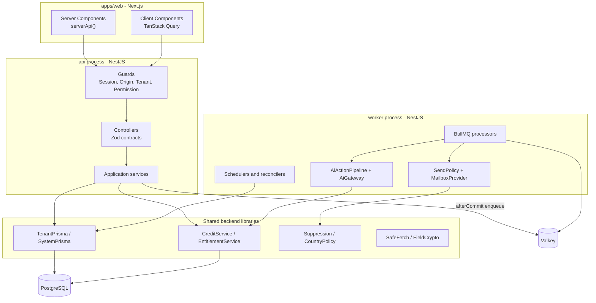

# Detailed Technical Architecture

> **Status: Draft for design review. Implementation is blocked until this folder is reviewed and approved (Gate 0, [ROADMAP.md](../ROADMAP.md)).**
> Version 1.0 · 2026-11-26 · Based on [PRODUCT_REQUIREMENTS.md](../PRODUCT_REQUIREMENTS.md) v2.0

## 1. How this folder relates to the other docs

| Layer | Documents | Answers |
|-------|-----------|---------|
| Product | `docs/PRODUCT_REQUIREMENTS.md` | *What* we build and *why*. Features, acceptance criteria, plans |
| System overview | `docs/ARCHITECTURE.md`, `DATABASE_DESIGN.md`, `SECURITY.md`, `INTEGRATIONS.md`, `ROADMAP.md` | The big picture, schema, policies, providers, sequencing |
| **Detailed design (this folder)** | `docs/architecture/*.md` | **How** each subsystem works: components, algorithms, contracts, failure handling, security controls |
| Decisions | `docs/architecture/adr/ADR-*.md` | Why each significant choice was made, and what was rejected |

**Precedence when documents disagree:** PRD → ADRs → detailed design → overview docs. A disagreement is a bug. Stop and raise it, and don't pick one silently.

## 2. Document map

| # | Document | Scope |
|---|----------|-------|
| 01 | [Frontend architecture](01-frontend.md) | Next.js structure, rendering, data fetching, permissions in UI, states, responsive shell, safe email rendering |
| 02 | [Backend architecture](02-backend.md) | NestJS process roles, request pipeline, module anatomy, transactions, events, errors, config |
| 03 | [API architecture](03-api.md) | REST conventions, errors, pagination, idempotency, concurrency, rate limits, uploads, webhooks |
| 04 | [Database architecture](04-database.md) | Topology, roles, Prisma client layering, locking, raw SQL policy, migrations, tuning |
| 05 | [AI orchestration](05-ai-orchestration.md) | AiGateway, agent runner, prompt layout, routing, batching, cost, evals |
| 06 | [Background jobs](06-background-jobs.md) | Queues, job envelope, processor pattern, retries, scheduler algorithm, reconcilers, fairness |
| 07 | [Email infrastructure](07-email-infrastructure.md) | Outreach vs system mail, mailbox connections, MIME, send policy, inbound parsing, DNS checks |
| 08 | [Authentication](08-authentication.md) | Sessions, OAuth login, CSRF, brute-force defense, step-up, impersonation |
| 09 | [Multi-tenant isolation](09-multi-tenancy.md) | Isolation layers, composite foreign keys, context, caches, files, fairness, tests |
| 10 | [Billing](10-billing.md) | Plan catalog, entitlements, credit ledger algorithms, payment webhooks, lifecycle |
| 11 | [Analytics](11-analytics.md) | Event taxonomy, metric definitions, rollups, dashboards, platform metrics |
| 12 | [Logging and monitoring](12-observability.md) | Logs, metrics, errors, health, alerts, SLOs |
| 13 | [Backup and recovery](13-backup-recovery.md) | Backups, immutability, restore tests, disaster scenarios and runbooks |
| 14 | [Threat model](14-threat-model.md) | Data-flow diagram, trust boundaries, the 12 required threat categories, controls and tests |
| 15 | [AI security controls](15-ai-security-controls.md) | Deterministic checks before, during and after every AI action, plus the action gates |
| — | [ADR index](adr/README.md) | 31 architecture decision records |

## 3. Shared identifiers used across these documents

| Prefix | Meaning | Defined in |
|--------|---------|-----------|
| `ADR-00NN` | Architecture decision record | `adr/` |
| `TM-NN` | Threat (threat model) | 14 |
| `AIC-PRE-NN`, `AIC-CALL-NN`, `AIC-OUT-NN`, `AIC-ACT-NN`, `AIC-AUD-NN` | Deterministic AI checks | 15 |
| `AUTH-01`, `APR-04`, ... | PRD features | PRD §6 |
| `AD-NN` | Summary decisions in ARCHITECTURE.md §2 (each maps to an ADR, see `adr/README.md`) | ARCHITECTURE.md |

## 4. Core component names (canonical)

| Component | Kind | Location | Purpose |
|-----------|------|----------|---------|
| `RequestContext` | AsyncLocalStorage store | `common/context` | requestId, userId, sessionId, workspaceId, role, permissions, impersonation |
| `SessionGuard` | Global guard | `platform/identity` | Authenticates the session cookie. Default-deny (routes opt out with `@Public()`) |
| `OriginGuard` | Global guard | `common/security` | CSRF: `Origin` + `X-Requested-With: lga-web` on unsafe methods |
| `TenantGuard` | Guard | `platform/tenancy` | Resolves `:workspaceId`, verifies membership, sets workspace in `RequestContext` |
| `PermissionGuard` + `@RequirePermission()` | Guard + decorator | `platform/tenancy` | Permission check against the SECURITY.md §3.2 matrix |
| `PlatformAdminGuard` | Guard | `platform/identity` | Super Admin plus MFA plus IP allowlist for `/api/v1/admin/*` |
| `TenantPrisma` / `SystemPrisma` | DB clients | `common/db` | Tenant-enforcing Prisma extension / explicit system access |
| `TxManager` | Service | `common/db` | Transactions plus `afterCommit()` hooks for jobs and events |
| `JobProducer` | Service | `common/jobs` | Typed, after-commit enqueueing with deterministic job IDs |
| `SafeFetch` | Utility | `common/safe-fetch` | SSRF-safe HTTP egress |
| `FieldCrypto` | Utility | `common/crypto` | AES-256-GCM field encryption with key versions |
| `AiGateway` | Service | `platform/ai` | The only path to LLM providers |
| `AiActionPipeline` | Service | `platform/ai` | Wraps every AI action with the AIC-* checks (doc 15) |
| `CreditService` / `EntitlementService` | Services | `platform/billing` | Reserve/settle/release credits. Effective plan limits |
| `PaymentProvider` | Port | `platform/billing` | Stripe or merchant-of-record adapter |
| `MailboxProvider` | Port | `modules/email-engine` | SMTP/IMAP, Graph and Gmail adapters |
| `SendPolicy` | Domain service | `modules/email-engine` | Last-mile deterministic checks before any email is sent |
| `CountryPolicy` | Domain service | `platform/compliance` | Recipient-country rules |
| `SuppressionService` | Service | `platform/compliance` | Suppression lookups and writes |

## 5. Component overview

## 6. Reviewer checklist

- [ ] Every PRD MVP feature is mapped to a subsystem in docs 01–13.
- [ ] Every threat TM-01 to TM-12 has preventive and detective controls and a verification test (doc 14).
- [ ] Every AI task in doc 05 has an explicit check profile and action gate (doc 15).
- [ ] No design element requires a paid service beyond PRD §2 decisions.
- [ ] No design element moves business state out of PostgreSQL.
- [ ] ADRs are accepted, amended or rejected individually.
